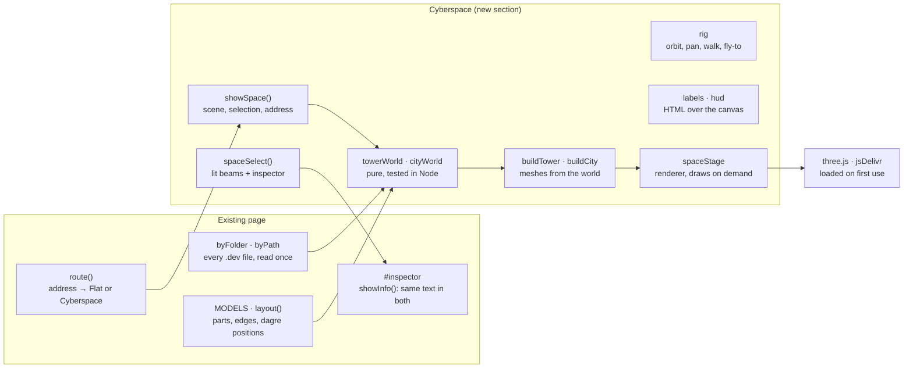

# Cyberspace mode: implementation spec

2026-11-13 · David Hermann Brandt

The design this spec implements is the canvas [Cyberspace explorer in 3D](https://claude.ai/artifact/VDLEAr9k5mUna6aAPuC1Pp). The spec was drafted as a doc ([Cyberspace mode: implementation spec](https://claude.ai/artifact/X4UTWACvWidkSSJHWom9iu)); this file is the copy the repository keeps, and the one to change from now on. Wanted work: backlog item `cyberspace-mode` in [.dev/backlog.json](../.dev/backlog.json).

## Summary

Add a second way to read a repository, **Cyberspace**, next to today's flat page. It is a WebGL scene inside `index.html` that draws the same `.dev` data in 3D. The look and every number in it come from the design canvas [Cyberspace explorer in 3D](https://claude.ai/artifact/VDLEAr9k5mUna6aAPuC1Pp). This spec says how to build it without breaking any decision, contract or quality requirement already recorded in the repository's `.dev` folder.

The mode has three scenes, each one artboard on the canvas:

| Scene | Canvas artboard | What the reader sees | Built from |
| --- | --- | --- | --- |
| Folder tower | `Strata.dc.html` | One folder as a stack of glass floors, one floor per `.dev` file, grouped Drawn · Written · Knowledge. A floor slides out to be entered. | `byFolder.get(folder)` |
| City | `Main.dc.html` | One drawn view (component diagram first) as a city: groups are raised plates, parts are glass towers, outside services are amber beacons, relationships are arcs of light. | `MODELS[kind]` + `layout()` |
| Street | `Street.dc.html` | The same city from eye level, walking with W A S D, with a map and a hover card. | Same scene as the city, another camera |

The 3D ground plan is the flat drawing's dagre layout laid on the floor. A part stands where its plate sits on the flat sheet, so a reader who switches modes finds everything in the same place.

**Done means:**

- [ ] A **Flat / Cyberspace** switch in the bar; the choice is in the address and survives reload, back and forward.
- [ ] The three scenes work for this repository and for any repository the flat page can open, for every drawn kind (component, deployment, class, state, use case, user journey).
- [ ] Selecting a tower opens the existing inspector with the same content as the flat page.
- [ ] Without WebGL, without three.js, with reduced motion, from the keyboard and in light mode, the mode degrades as section *Fallbacks, performance budgets, accessibility* says.
- [ ] 60 fps on a 2021 MacBook Air (M1) at 1440×900 for this repository; 30 fps or better for a 400-part diagram.
- [ ] The repository's `.dev` views are updated in the same change (last section).

## Ground rules

The repository already records how the page must be built; Cyberspace follows those records, and changes only one of them (`one-motion`, below). Read these files before writing code, in this order:

1. `.dev/backlog.json` → item `design-pass` (what to read in what order).
2. `.dev/decisions.json` — every accepted decision below is binding.
3. `.dev/quality-requirements.json`, `.dev/requirements.json`, `.dev/contracts.json`.
4. `.dev/component-diagram.json` and `.dev/deployment-diagram.json` — where the new parts go.
5. `index.html` around `load`, `route`, `componentModel`, `layout`, `drawDiagram`, `select`, `closeInspector`, `focusPart`.

| Record | What it means for Cyberspace |
| --- | --- |
| decision `one-file` | All code stays in `index.html`. No build step, no bundler, no new files served. The only new network dependency is three.js from jsDelivr, loaded the way dagre is (`import()` of a pinned `+esm` URL). |
| decision `own-drawing` | Draw the scene ourselves with three.js core. Do not add OrbitControls, CSS2DRenderer or any other examples/addons module; write the controls and the label layer (they are small and need to match this page). |
| decision `survey-sheet`, `light-dark`, `colour-per-kind` | Every colour in the scene comes from the page's CSS custom properties (`--k-component` … `--k-knowledge`, `--paper`, `--ink` …), read with `getComputedStyle` and re-read when `prefers-color-scheme` changes. No colour literals in the scene code. |
| decision `barlow`, `own-icons` | Labels and panels use the existing Barlow stacks and `ic()` icons. |
| decision `tables-always`, requirement `works-without-drawing` | Cyberspace is another way in, never the only one: every fact shown in 3D stays reachable in Flat. |
| decision `address-is-state`, contract `page-address`, requirement `addressable` | The mode and the selected part are in the address; existing forms keep their meaning (section *Routing, state and links*). |
| decision `one-motion` | **Changed by this work.** Camera moves (fly-to, slide a floor out, rise from street to orbit) are new motion. Record the change as a new decision `cyberspace-motion` that supersedes nothing but amends `one-motion`: motion only moves the camera to where the reader asked to go, and all of it is off with reduced motion. |
| quality `safe-content` | Repository text never becomes markup: labels are set with `textContent`, inspector content goes through the existing `esc()` paths. |
| quality `keyboard`, `reduced-motion`, `fallbacks`, `screen-sizes` | See *Fallbacks, performance budgets, accessibility*. Laid out for 15-inch to 34-inch screens. |
| quality `requests` | No extra requests to the repository host. The scene uses what `load()` already read. |
| requirement `token-to-its-host` | three.js is fetched without credentials; nothing in the scene sends repository data anywhere. |

What stays out of scope: editing `.dev` files (limitation `no-edit`), VR/XR, multiplayer, persisting camera positions beyond the address.

## Architecture

Cyberspace is one new section of the existing `<script type="module">`, headed `// ── Cyberspace ──`, placed after the Waiting section. It reads the same `byFolder`, `byPath`, `MODELS` and `layout()` the flat page uses, and writes into one new element. Nothing in the loading path changes.



Cyberspace reuses what the page loaded; three.js is the only new download.

The new section only reads `byFolder` and the models; it writes the scene, the HUD, and the inspector through the same `showInfo()` Flat uses.

**New markup** (inside `#layout`, after `<main id="view">`):

```html
<section id="space" hidden aria-label="Cyberspace">
  <canvas id="space-gl" tabindex="0" aria-describedby="space-help"></canvas>
  <div id="space-labels" aria-hidden="true"></div>
  <div id="space-hud"></div>      <!-- layers, legend, controls, map, breadcrumb, hover card -->
  <p id="space-help" class="sr">…keyboard help text…</p>
  <ul id="space-parts" class="sr" aria-label="Parts in this scene"></ul>
</section>
```

While Cyberspace is on, `body` gets the class `space`: `#view` and `#side` are hidden, `#space` fills the window under the bar and status line, and `#inspector` is restyled as the floating card from the design. The existing `#inspector` element and its `select`/`closeInspector` behaviour are reused, not copied.

**New code units** (all plain functions and closures in the same module, named as below so the component diagram can cite them):

| Unit | Responsibility | Reads | Writes |
| --- | --- | --- | --- |
| `THREE_URL`, `loadThree()` | Imports three.js once, on first entry to Cyberspace; resolves `null` on failure. | — | `three` |
| `spaceTheme()` | Turns the page's CSS custom properties into a palette object (section *Rendering*). Re-run on `prefers-color-scheme` change. | `getComputedStyle(document.documentElement)` | `theme` |
| `towerWorld(folder)` | Folder → floor specs, and the skyline when the repository has several folders. | `byFolder`, `childrenOf`, `KIND_ORDER`, `KNOWLEDGE` | plain objects |
| `cityWorld(doc, folder)` | One drawn view → plates, towers, beacons, beams in world units, from the flat layout. | `MODELS`, `layout`, `dagre` | plain objects |
| `spaceStage` | Owns the `WebGLRenderer`, `Scene`, resize observer, and an on-demand render loop. | `#space-gl` | GPU |
| `buildTower(world)`, `buildCity(world)` | World specs → a `THREE.Group`, plus a `pick` map from mesh id to part key. | `theme`, `three` | scene graph |
| `rig` | The camera: orbit, pan, walk, fly-to; keyboard and pointer input. | input events | `camera` |
| `labels` | DOM labels projected over the canvas each frame, with overlap avoidance. | `camera`, world specs | `#space-labels` |
| `hud` | Layers panel, legend, camera buttons, map, breadcrumb, hover card. | world specs, `space` | `#space-hud` |
| `spaceSelect(key)`, `spaceRoute()` | Selection (lights beams, opens the inspector) and the address. | `location.hash` | `#inspector`, address |

**State.** One object, the only mutable state the section adds:

```js
const space = {
  on: false,          // Cyberspace is showing
  scene: null,        // "tower" | "city" | "street"
  folder: null,       // folder being shown
  doc: null,          // the drawn view the city is built from
  world: null,        // output of towerWorld / cityWorld
  selected: null,     // part key
  hovered: null,      // part key
  layers: new Set(["component", "deployment"]),
};
```

## Scene model

Every scene is built in two steps: a pure function turns loaded `.dev` data into a **world** (plain objects in world units, no three.js), and a builder turns the world into meshes. Keep the first step free of three.js so it can be unit-tested in Node and reused for the map and the label layer.

**Units and axes.** World units are metres in spirit. `y` is up. The flat sheet lies on the ground: sheet `x` → world `x`, sheet `y` → world `z`, flipped so the top of the sheet is furthest from the default camera. One world unit = 40 sheet px (`S = 1/40`).

```js
const S = 1 / 40;
const toWorld = (L, b) => ({ x: (b.x - L.w / 2) * S, z: (L.h / 2 - b.y) * S });  // centred on the origin
```

**One frame for every number in this spec.** All positions here (and on the design canvas) use a left-handed frame: the default camera looks along +z with +x to its right. three.js is right-handed, so convert in exactly one place and nowhere else:

```js
const V = (x, y, z) => new THREE.Vector3(x, y, -z);   // spec frame → three.js frame
```

Every geometry builder and camera call goes through `V`; world objects keep spec-frame numbers so tests can compare them with this document.

### City world: `cityWorld(doc, folder)`

1. `model = MODELS[doc.kind](doc, folder)`; `L = layout(model, 1200)`. For `use-case` and `user-journey`, build one city per entity, as `drawKind()` draws one canvas per entity; the address picks which (section *Routing*).
2. If `dagre` is null, use the fallback grid: leaf nodes in rows of `ceil(sqrt(n))`, 5 units apart, clusters as plates round their children. Say so in the status line.
3. Classify every node of `model.nodes`:
   - **plate** — `n.cluster` is true. Footprint = its `L.box` × `S`, shrunk 0.2 on every side. Plate thickness `PH = 0.5`. A plate nested in a plate sits on its parent's top: `base = depth × PH`.
   - **beacon** — `n.ext` is true and it is not a cluster (component `external`, deployment nodes with a `condition` or of kind `external-service`). Position = its box centre; hover height `y = 6.5 + 1.5 × (index among beacons mod 3)`.
   - **tower** — everything else. Footprint is square, side `TW = min(2.2, 0.8 × distance to the nearest other tower centre)`, centred on its box. It stands on the top of its innermost plate (or the ground).
4. Tower height from its degree, counting every edge of `model.edges` that touches it once, self-loops included: `h = 2.2 + 1.3 × min(degree, 9)` (so 2.2 to 13.9). In this repository Loader has degree 6 and height 10.0.
5. Beams, one per `model.edges` entry, keyed by `e.key` so tooltips and selection match the flat page:
   - anchors: a tower's top centre; a beacon's centre; a plate's centre at its top + 0.2.
   - path: quadratic Bézier, `A` → `B`, control point at the midpoint raised to `max(A.y, B.y) + 1.5 + 0.22 × groundDistance(A, B)`; 32 segments.
   - a self-loop (`e.self`): a vertical circle of radius 1.2 standing on the tower top.
   - colour: the drawn kind's colour; amber (deployment colour) when either end is a beacon.
6. Bounds = the box round every plate, tower and beacon; used by fit and the map.

The world object:

```js
{
  kind, title, file: doc._path,
  plates:  [{ key, name, x0, x1, z0, z1, base, depth }],
  towers:  [{ key, name, x, z, side, base, h, degree, plate }],
  beacons: [{ key, name, x, y, z }],
  beams:   [{ key, from, to, points: [[x,y,z] × 33], ext, label }],
  parts:   Map(key → model node),   // keeps n.info for the inspector, n.tip for hover
  bounds:  { x0, x1, z0, z1, top },
}
```

### Tower world: `towerWorld(folder)`

1. `docs = byFolder.get(folder)`, already sorted by `orderOf`.
2. Group: **Drawn** = `doc.kind in MODELS`; **Written** = in `KIND_ORDER` but not in `MODELS` (capability, feature, operation); **Knowledge** = in `KNOWLEDGE`. Order Drawn → Written → Knowledge, bottom to top, each in `orderOf` order.
3. Floors are 16 × 12 units, 0.14 thick, 1.05 apart, with an extra 1.4 gap between groups. This repository's 24 files put the top floor at y = 26.95.
4. What each floor shows on its top face (all real data, never random):
   - Drawn: the view's own flat layout, scaled to fit 13 × 9 units, nodes as small tiles and edges as lines. Per-entity kinds show their first entity.
   - Written: one bar per card, at most 4, length ∝ the card title's length.
   - Knowledge: one line per record, at most 6, length ∝ the record title's length.
5. The pulled-out floor (one drawn view at a time) slides to `(+20, 0, −12)` relative to its slot, leaving a dashed ghost outline. On it stands the city of that view, scaled by `0.36` about the city's centre.

**Several folders: the skyline.** When `byFolder.size > 1`, the tower scene shows every folder as its own building, with the folder in the address drawn in full, floors and all: footprint 6 × 4.5, floors 0.5 apart, so a building's height says how many views it holds. Lay buildings out as a radial tree from the root (root at the centre, depth `d` on a ring of radius `14 × d`, each subtree's angle ∝ its number of folders), with a dashed ground line from parent to child. Clicking a building flies into its folder tower. This layout is not on the design canvas yet; ask for an artboard before polishing it (last section).

## Rendering

The look is glass wireframe on a dark survey grid: translucent faces, crisp edges, light only where the reader is looking. Use three.js core only: `WebGLRenderer`, `PerspectiveCamera`, `InstancedMesh`, `BufferGeometry`, `LineSegments`, `TubeGeometry`, `QuadraticBezierCurve3`, `ShaderMaterial`. No post-processing.

**Renderer.** `new WebGLRenderer({ canvas, antialias: true, alpha: true, powerPreference: "high-performance" })`; pixel ratio `min(devicePixelRatio, 2)`; transparent clear colour. The sky is CSS on `#space` (below), so the canvas only draws the world. Field of view and view offset are set per scene (the scene sections give them); near 0.6, far 600.

### Palette

`spaceTheme()` reads these custom properties; the dark values are what the canvas shows, the light values come from the same tokens.

| Role | Token | Dark | Light |
| --- | --- | --- | --- |
| Sky centre → edge (CSS radial gradient at 50% 35%, radius 75%) | derived | `#1b3340` → `#122027` → `#0b1216` | `#ffffff` → `#f8fafa` → `#e3eaeb` |
| Ground grid, minor (every 2 units) | `--grid` | `#22333b` | `#d9e1e3` |
| Ground grid, major (every 10 units) | `--edge` at 45% | `#2c4652` | `#b9c6c9` |
| Horizon line | `--k-<kind>` at 18% |  |  |
| Part glass, edges, beams | `--k-<kind>` of the drawn view | component `#6cb2d6` | component `#2c6e8e` |
| Beacons, external beams | `--k-deployment` | `#e0a54a` | `#a26a14` |
| Selected part edge, lit beam core, selected label | `--hot` | `#eef4f4` | `#1d2b33` |
| Labels text / quiet / faint | `--ink`, `--ink2`, `--ink3` | `#dce5e5` / `#9aabb1` / `#6c7f87` | `#1d2b33` / `#56666e` / `#84949b` |
| Panels | `--sheet` at 90%, border `--rule` | `#152128`, `#2a3a42` | `#f8fafa`, `#c9d3d5` |

The two sky ramps and the major grid colour are new: add them as tokens `--space-sky-1`, `--space-sky-2`, `--space-sky-3`, `--space-grid-major` in both blocks of `:root`, beside the others, so limitation `colours-outside-tokens` does not grow.

### Meshes and materials

| Thing | Geometry | Material and numbers |
| --- | --- | --- |
| Ground grid | One 600 × 600 plane at y = 0 | `ShaderMaterial`: anti-aliased lines with `fwidth`, minor every 2 units, major every 10; alpha fades from 1 at 40 units from the camera to 0 at 140. Writes no depth. |
| Plates | One `InstancedMesh` of unit boxes, scaled per plate | Glass shader (below), alphas top 0.10, lit sides 0.20–0.24, other sides 0.14; edges at 55%. A dashed inset outline 0.5 in from the top edge: `LineDashedMaterial`, dash 0.12, gap 0.30, 28% alpha. |
| Towers | One `InstancedMesh` of unit boxes | Glass shader, per-instance colour and state (table below). |
| Tower edges and floor bands | One merged `LineSegments`: the 12 box edges plus a horizontal ring every 1.0 unit up each tower | `LineBasicMaterial({ vertexColors: true, transparent: true })`; colours and alpha rewritten in the attribute when selection changes. Bands at 35% of the edge alpha. |
| Beacons | `OctahedronGeometry(1.25)`, scaled 1.04 in y | Upper faces 34%, lower 16%, edges 90%, all `--k-deployment`. A dashed tether to the ground (dash 0.12, gap 0.20, 54%) and two ground rings, r 1.6 (fill 6%, stroke 60%) and r 2.6 (stroke 25%). |
| Beams | `TubeGeometry(QuadraticBezierCurve3, 32, r, 6)` | Quiet: r 0.035, 42% alpha. Lit: a core r 0.06 in `--hot` plus a glow tube r 0.25 in the kind colour, 35% alpha, `AdditiveBlending` (normal blending in light mode). End dot: sphere r 0.12. |
| Selection rings | Two rings on the plate top round the selected tower | r 2.0 filled `--hot` 8%, stroked 80%; r 3.0 dashed (4/6) kind colour 50%. |

**The glass shader.** Unlit. Alpha comes from the face normal so every tower reads the same from any side: top faces `aTop`, faces whose normal points to −x or −z `aLit`, the rest `aDark`. Depth write off, `transparent: true`, front faces only. Render order: grid 0, plates 1, towers 2, beacons 3, beams 4, glow 5.

| Tower state | When | Top / lit / dark face alpha | Edge colour, alpha |
| --- | --- | --- | --- |
| `norm` | default | 0.30 / 0.16 / 0.10 | kind colour, 75% |
| `near` | joined to the selected part by a beam | 0.42 / 0.24 / 0.14 | kind colour, 100% |
| `dim` | a layer or filter hides its kind | 0.12 / 0.07 / 0.04 | kind colour, 35% |
| `sel` | selected | 0.85 / 0.55 / 0.36 | `--hot`, 100%, 1.2 px |
| `hover` | under the pointer | as `near` | `--hot`, 100% |

### Labels

Labels are HTML in `#space-labels`, never textures: they stay sharp, use Barlow, and their text is set with `textContent`. Each frame the camera moved, project every label's anchor, then place them.

- Pill: height 22 px, padding 0 8 px, radius 4 px, `500 13px` Barlow Semi Condensed, background `--paper` at 78%, border 1 px `--rule`, text `--ink2`.
- Neighbour of the selection: text `--hot`, border kind colour. Selected: background and border `--hot`, text `--paper`, weight 600. Beacon: text `--k-deployment`, border the same at 40%.
- Anchor: a tower's top centre (label bottom 10 px above it); a beacon's top point + 1.7 units.
- Overlap: sort by anchor screen y, nearest first; push each label up in 6 px steps until clear of the ones placed (4 px gap), at most 40 steps, else hide it. When pushed more than 12 px, draw a 1 px leader in `--ink3` from the anchor to the label's bottom centre.
- Hide labels behind the camera, off the canvas, or further than 90 units (city) or 45 units (street). Fade them over the last 10 units.
- Plate names: uppercase, `600 13px` Semi Condensed, letter-spacing 0.1em, kind colour, then `· N parts` in `--ink3`; placed 8 px under the plate's front-left corner.
- Font loading: wait for `document.fonts` as `load()` already does; re-measure labels on `loadingdone`.

## Scene 1: the folder tower

The folder tower is where Cyberspace opens: the folder in the address as a stack of floors, the first drawn view already slid out with its city on it. Match `Strata.dc.html`.

**Camera.** Position (−14, 24, −44), target (8, 11, 2), vertical field of view 49.3°. The design centres the projection at (700, 440) in a 1440 × 900 frame, so set `camera.setViewOffset(W, H, (700 − 720) × W/1440, (440 − 450) × H/900, W, H)`. On wider screens keep the vertical field of view and let the stack sit left of centre.

**Floors.** Built from `towerWorld(folder)` as section *Scene model* says. Floor slab: glass shader with top/underside alpha 0.13 (knowledge floors 0.10), side alpha ×2.2, edges at 85% (knowledge 70%), in the floor's kind colour. Four vertical rails at the back and front corners, kind-neutral `--k-component` at 18%, run from y −0.2 to the top floor + 1.2. Draw floors below eye height bottom-up and those above it top-down, so the nearer slab always paints last.

**Pulled-out floor.** One drawn floor at a time. Its slot keeps a dashed outline (dash 4/6 px equivalent: 0.12/0.20 units) and three dashed drawer lines run from the slot's corners to the floor's. Under the pulled floor sits a soft glow: the same quad in the kind colour at 25% with a 10 px blur. Implement the blur as a second, larger quad with a radial alpha texture made once on a 64 × 64 canvas, not a post-process. The city on it is `buildCity(cityWorld(doc))` scaled by 0.36 about its centre, labels off, with Loader-style highlight for whatever is selected.

**Floor labels** (HTML, left of the stack): right-aligned so their right edge is 14 px left of each floor's front-left corner, vertically centred on it. Kind name uppercase `600 11.5px` Semi Condensed, letter-spacing 0.08em, in the kind colour; then the view's `title` in `--ink` 13 px. The empty slot reads `component  pulled out` in `--ink3`, the second word italic. The kind word for knowledge files is the file's own kind (`vision`, `glossary`…), lowercased, hyphens as spaces.

**Group brackets**: a 2 px `--rule` line 22 px from the left edge, spanning a group's floors ± 10 px, with the group name and count written vertically beside it (`DRAWN · 7`, `WRITTEN · 3`, `KNOWLEDGE · 14`), `600 11.5px`, `--ink2`.

**Folder card** (right 20 px, top 98 px, 340 px wide, padding 18):

1. `FOLDER` in caps, `--ink2`.
2. The folder's name as its `folder` knowledge record titles it (`entities[0].title`), else its last path segment, else `/`; `700 30px/34px` Barlow Condensed, `--hot`.
3. Its path in monospace 12 px, `--ink3`: `./.dev · 24 files` (or `.cyberspace-explorer/<folder> · N files` when the repository keeps one tree).
4. Its purpose, chosen exactly as `showFolder` does (`purpose ?? summary`), 14/21 px.
5. Three equal tiles: count of Drawn, Written, Knowledge files, numbers `700 24px` Condensed.
6. Folders inside it as chips linking to their towers, or `No folders inside it.` in `--ink3`.

**Pulled-floor card** (right 20 px, bottom 300 px, 300 px wide): a 10 px kind swatch and the kind name in caps and kind colour; the view title `700 24px` Condensed; a count line built from the city world, `22 parts · 5 beacons · 23 beams` for this repository; buttons **Enter the city** (primary, a link to the city address) and **Slide back**.

**Interaction.**

| Input | Effect |
| --- | --- |
| Hover a floor | Its edges to 100% and its label text to `--hot`; cursor pointer. |
| Click a drawn floor | Slides it out (the one already out slides back first); 450 ms, ease-out cubic; instant with reduced motion. Updates the address. |
| Click a written or knowledge floor | Opens the inspector with the view's title, kind, description and a **Read it in Flat** link to `#<folder>\|view:<file>` in flat mode. |
| Double-click the pulled floor, **Enter the city**, or Enter on it | Flies into Scene 2 (section *Camera and input*). |
| Wheel | Climbs: moves the camera and its target up or down 1.05 units a notch, clamped to the stack. ⌘/Ctrl + wheel or pinch zooms. |
| ↑ / ↓ | Moves keyboard focus floor by floor (focus ring: the floor's edges in `--hot`). |
| Esc | Slides the pulled floor back. |

Status line: `The root folder is a tower of 24 floors, one per view. Pull a floor out to walk through it.`, right side `Scroll to climb · click a floor to pull it out`. For another folder, `<folder> is a tower of N floors…`.

## Scene 2: the city

The city is one drawn view standing on the ground: what the flat page draws as plates and lines, raised into towers and beams. Match `Main.dc.html` for the look; take every position from `cityWorld`, not from the canvas.

**Where the canvas is only an illustration.** The canvas placed its four districts by hand and invented a fourth plate, *Loose parts*, for the parts no group contains. Build neither: plates come only from clusters in the model, and a part no cluster contains stands on the bare ground where dagre put it. The canvas also ends towers at the same base height on every plate; nested plates stack instead (section *Scene model*).

**Camera.** An orbit camera aimed at the centre of the world's bounds, elevation 33.6°, azimuth −4.4° (slightly from the left, as on the canvas), vertical field of view 54.1°. Fit: choose the distance at which the bounds' eight corners all project inside the *free rectangle* — the canvas minus the layers panel, the inspector (when open) and the bottom bars — with 24 px to spare; then shift the projection centre to the free rectangle's centre with `setViewOffset`. Refit when the inspector opens or closes, animated over 300 ms (instant with reduced motion).

**What stands in the city.** The view in the address, always. The **Layers** panel can stand more of the folder's drawn views beside it: each one ticked is built with `cityWorld` and placed to the right of the last, 12 units apart, in its own kind colour. Written and knowledge kinds are listed with their counts but disabled, with the hint `Written views and knowledge stand as floors in the folder tower` (the canvas shows them as live checkboxes; that was a mock). Untick a drawn view and its district fades to the `dim` state for 200 ms, then is removed.

**Selection.** Clicking a tower, plate or beacon calls `spaceSelect(key)`:

1. The part gets state `sel`, every part joined to it by a beam gets `near`, and those beams switch to lit (core + glow). Everything else stays `norm`; nothing is dimmed, because the city must stay readable.
2. The selection rings appear round its base.
3. The inspector opens with the same content the flat page shows for that part. Refactor `select()` so the part that writes `#inspector` from `n.info` is a function, `showInfo(info, onSel)`, used by both modes; `onSel` is `select` in Flat and `spaceSelect` in Cyberspace, so the inspector's own part links stay in the mode the reader is in.
4. Cyberspace adds, under the inspector's title: `in <plate name> · <degree> beams · height <h>`, and at its foot two actions: **Walk to \<name>** (primary, goes to Scene 3) and **Open flat** (goes to `#<folder>|<kind>:<key>` in flat mode).
5. The address gains the part (section *Routing*). Clicking empty ground or pressing Esc clears the selection.

**Hover.** A tower or beacon under the pointer gets state `hover` and shows its tooltip: the model's `n.tip` HTML (already escaped by the models) in the page's existing tooltip element, `showTip()`, 16 px right of and below the pointer. A beam under the pointer thickens to r 0.06 and shows its `e.tip`. Picking uses a `Raycaster` against the instanced meshes and a hidden fat tube per beam (r 0.3), at most once per animation frame.

**Panels** (positions from the canvas, 1440 × 900):

| Panel | Where | Content |
| --- | --- | --- |
| Layers | left 20, top 98, 232 wide | `LAYERS`; `Folder . · 24 views`; one 32 px row per kind present: checkbox (accent = kind colour), 10 px swatch, kind name, count in monospace. |
| Inspector | right 20, top 98, 340 wide | The existing `#inspector`, restyled as a floating card (radius 10, `--sheet` at 90%, 1 px `--rule`, shadow 0 12 32 rgba(0,0,0,.35)). Kind chip, title `700 34px/38px` Condensed in `--hot`, the extra line, the model body, the two actions. Scrolls inside itself past `100vh − 120 px`. |
| Camera controls | left 20, bottom 20 | Orbit (pressed), Pan, Walk; divider; Zoom in, Zoom out, Fit everything. 40 px icon buttons with `aria-label` and `aria-pressed`. |
| Legend | left 340, bottom 20, 52 tall | Four items: tower `Part · taller with more beams`; plate `Plate · what contains them`; beacon `Beacon · outside the browser`; beam `Beam · depends on`. Words per kind come from `LEGENDS` where they exist (a deployment city says *connects to*). |

Status line: `Read <n> views in <m> folders. Flying the <kind name>: drag to orbit, scroll to fly, click a tower to read it.` Right side: `Esc goes up a level` (the canvas says *returns to the flat view*; the switch in the bar does that, Esc does not).

## Scene 3: walking a district

The street scene is the city's own meshes seen from eye height, with walking controls, a map and a hover card. It adds no geometry: switching between Scene 2 and Scene 3 only swaps the camera rig and the HUD. Match `Street.dc.html`.

**Arriving.** **Walk to \<name>** puts the eye near that part, looking up at it:

1. Direction `d` = from the part's base towards the orbit camera's ground position, turned 25° clockwise.
2. Eye = part base + 12 × `d`, at the ground height there + 1.7. If that point is inside any tower's footprint grown by 0.6, step 1 unit further along `d` until it is clear.
3. Look at the part's centre line at `base + min(0.55 × h, 6.5)`.
4. Vertical field of view 61.2°; projection centre at (700, 520) of 1440 × 900, so the horizon sits low and towers rise into the frame.

For this repository that gives roughly the canvas's view: eye (15, 1.7, −11), looking at (9, 6.5, 5), Loader centred, both adapters and the GitHub and GitLab beacons to its right.

**Walking.**

| Input | Effect |
| --- | --- |
| W A S D or arrow keys | Walk at 6 units/s; with Shift, 14 units/s. Arrow keys turn instead of strafing when the canvas has focus and Alt is held. |
| Drag | Look: 0.25° per px; pitch clamped to ±60°. |
| Space / Z | Rise / sink at 4 units/s; eye height 1.7 to 30 above the ground under it. |
| Click | Select what is under the pointer (as in the city). |
| Enter | Select what is under the crosshair. |
| Esc | Clear the selection; with none, rise back to the city orbit. |

Towers are solid: the eye is a circle of radius 0.4 and slides along a footprint it walks into, below that tower's top. Plates are steps: the eye's ground height eases to the plate top under it over 150 ms. Beams and beacons are not solid. Walking ends at the world bounds grown by 30 units.

**Look.**

- The ground grid fades from 60 to 200 units instead of 40 to 140.
- A CSS vignette over the canvas: radial, transparent to 60%, black at 55% by the edge; street scene only, and not in light mode (use `--ink` at 12% there).
- A crosshair at the projection centre: four 7 px strokes, 1.5 px, `--hot` at 70%, 8 px gap from the centre.
- Labels only within 45 units.

**Panels** (from the canvas):

| Panel | Where | Content |
| --- | --- | --- |
| Breadcrumb | left 20, top 98, 36 tall | `<repository> › <kind name> › <plate> › <part>`; the first two are links to the tower and the city, the plate is plain text, the part (selected, else the one under the crosshair) is `--hot`, weight 600. A `<nav aria-label="Where you are">`. |
| Hover card | 18 px right of the hovered tower's top right corner, 24 px above it; 280 wide | Kind icon, the part name `700 20px` Condensed, its `n.tip` text, then `<degree> beams · click to read it` in `--ink3`. Labels it would cover are hidden. Border in the kind colour. |
| Key hints | left 20, bottom 20, 52 tall | Key caps for W A S D *walk*, Drag *look*, Space *rise*, Click *read a part*, Esc *orbit*. |
| Map | right 20, bottom 20, 260 wide | Plan view of the world bounds: plates as rounded rectangles (kind colour 12%, stroke 50%), towers as 5 px squares (selected in `--hot`), beacons as amber diamonds, the eye as a 4.5 px `--hot` dot ringed in `--paper`, and a view cone of ±24° reaching 36 units. Clicking the map flies the eye there. `role="img"`, `aria-label` *Map of the city with your position*. |

The canvas's hover card says *Beam from Loader · beam to GitHub*; listing beams by name gets long for busy parts, so the card shows the count.

Status line: `Walking through <plate>, eye level at the plate. <Selected> is selected; its beams are lit.` (drop the second sentence with nothing selected). Right side: `Esc rises back to orbit`.

## Camera and input

One `rig` object owns the camera and has three modes — **orbit**, **pan**, **walk** — plus a tween for flying between poses. Write it yourself (decision `own-drawing`); it is about 250 lines.

```js
rig = {
  mode: "orbit",                 // "orbit" | "pan" | "walk"
  target: [x, y, z],             // orbit and pan
  azimuth, elevation, distance,  // orbit and pan, degrees and units
  eye: [x, y, z], yaw, pitch,    // walk
  fov, offset: [dx, dy],         // per scene
  tween: null,                   // { from, to, t0, ms } while flying
  set(pose), fit(bounds, rect), flyTo(pose, ms), frame(now),
};
```

**Orbit and pan** (Scenes 1 and 2):

| Input | Orbit mode | Pan mode |
| --- | --- | --- |
| Drag (left button, one finger) | Azimuth 0.3°/px, elevation 0.3°/px | Moves the target across the ground under the pointer |
| Right-drag, Shift + drag, two fingers | Pans | Orbits |
| Wheel, pinch | Dollies towards the point under the pointer, distance × 1.0015^deltaY | same |
| Trackpad sideways scroll (`deltaX`) | Azimuth 0.2°/px | same |
| ← → | Azimuth ±5° | Pans 2 units |
| ↑ ↓ | Elevation ±5° | Pans 2 units |
| + / − | Distance ÷/× 1.25 | same |
| F | Fit everything | same |
| Tab / Shift+Tab | Next / previous part, in the order of `#space-parts` | same |
| Enter | Select the focused part | same |

Limits: elevation 8° to 85°; distance 8 units to 3 × the fit distance; the target stays within the world bounds grown by 20. A drag that moves under 4 px is a click.

**Walk** is Scene 3's mode (that section has its keys). Choosing **Walk** in the city's camera controls is the same as **Walk to** the selected part, or to the centre of the bounds with nothing selected.

**Flying between poses.** `flyTo(pose, ms)` interpolates target, eye, angles and field of view with ease-in-out cubic, and lifts the eye on an arc that peaks 0.15 × the travel distance above the straight path. Duration `clamp(400 + 12 × distance, 500, 1200)` ms. Input during a flight cancels it where it is. With `prefers-reduced-motion: reduce`, every flight, slide and fade is instant.

The three scene changes:

1. **Tower → city.** Fly to the pulled-out floor until it fills the free rectangle (600 ms). Then, in one frame, swap the scene for the full-size city and put the camera at the equivalent pose: the same view of the floor divided by the floor's scale, 0.36, relative to the city's centre. The tower fades out over 200 ms behind it. Reverse it to go back up.
2. **City → street.** Fly from the orbit pose to the street pose (section *Scene 3*), swapping the HUD when the flight lands.
3. **Street → city.** Fly back to the orbit pose the reader left, or the fit pose if there was none.

**Rendering on demand.** Request a frame only when something changed: input, a flight, a fade, a label being placed, a theme change, a resize. When nothing moves, no frames are drawn. Stop completely while `#space` is hidden or `document.hidden` is true. Resize with a `ResizeObserver` on `#space`, then refit.

## HUD and overlays

Every panel is ordinary HTML over the canvas, built from the page's own CSS variables, icons and fonts; the scene sections say what each panel holds, this section says what they share.

**The mode switch in the bar.** Between the repository name and **Tokens**, a group `role="group" aria-label="View mode"` of two buttons, **Flat** and **Cyberspace**, each with `aria-pressed`. Group: 2 px padding, 1 px `--rule` border, radius 6. Buttons: 28 px tall, 0 12 px padding, `600 13px` Semi Condensed; pressed = `--rule` background and `--hot` text, else transparent and `--ink2`. Hidden on the landing page and when WebGL is unavailable (section *Fallbacks*). Each press changes the address, nothing else; `route()` does the rest.

**Status line.** The existing `status()` keeps its job and wording rules; Cyberspace only writes its scene sentence when the loader has nothing to report. Over the canvas it is translucent: `--paper` at 88%, bottom border `--grid`. The right-hand hint is a new optional `<span class="hint">` in `--ink3`.

**Panel style** (one CSS class, `.hud`): background `--sheet` at 90%, 1 px `--rule`, radius 10, padding 16, shadow `0 12px 32px rgb(0 0 0 / .35)` (`/ .12` in light mode), `backdrop-filter: blur(6px)` where supported. Panel titles are `.caps`: `600 12px` Semi Condensed, letter-spacing 0.08em, uppercase, `--ink2`. Buttons reuse the page's button styles; the primary button is `--k-<kind>` with `--paper` text.

**New icons** for `ICONS`, on the 24-unit grid, `stroke-width 1.6`, round caps (decision `own-icons`); the canvas has a drawing of each but the space icon:

| Name | Drawing |
| --- | --- |
| `orbit` | an ellipse 18 × 8 round a 5 px dot, with a short tick on its right end |
| `pan` | a cross of four arrows |
| `walk` | a walking figure |
| `zoom-in`, `zoom-out` | plus and minus |
| `fit` | four corner brackets |
| `beacon` | a diamond on a dotted tether |
| `tower` | a glass tower with two floor bands |
| `space` | the mode itself: three stacked floors in perspective |

**Stacking order** in `#space`: canvas 0, labels 1, HUD panels 2, hover card 3, inspector 4 (it is outside `#space` but above it), the token panel and tooltips keep their current z-index above everything.

**Screen sizes** (quality `screen-sizes`, 15-inch laptop to 34-inch monitor):

- From 1280 px wide up, panels sit as on the canvas, at fixed pixel sizes; wider screens give the scene more room, never bigger panels.
- Below 1280 px, the Layers panel collapses to a 40 px button that opens it as a popover, and the legend shows icons only with their words as tooltips.
- Below 900 px tall, the map shrinks to 180 px wide.

## Routing, state and links

The mode, the scene and the selection live in the address as a **third `|` segment**, so every existing form keeps its meaning (contract `page-address`) and a Cyberspace link opened by an older copy of the page still lands on the same folder and part in Flat.

```
#<folder>|<focus>|~space[:<scene>]
```

| Address | Shows |
| --- | --- |
| `#\|~space` | Tower of the root folder, first drawn view pulled out |
| `#\|view:component-diagram.json\|~space` | Tower of the root, that view pulled out |
| `#\|view:component-diagram.json\|~space:city` | City of that view, nothing selected |
| `#\|component:loader\|~space:city` | City of the folder's component diagram, Loader selected |
| `#\|component:loader\|~space:street` | Street scene, walked to Loader, Loader selected |
| `#\|view:use-case.json#<entity id>\|~space:city` | City of one use case of a per-entity file |
| `#\|component:loader` | Flat, exactly as today |

`<scene>` is `tower` (the default, may be left out), `city` or `street`. `<focus>` is any form `focusPart` already accepts; in the city the part form is required for a selection, and the `view:` form names the view without one. The `view:<file>#<entity id>` form is new and is added to the contract.

**`route()` changes.** Split the hash into three parts instead of two. When the third starts with `~space` and Cyberspace can run, call `showSpace(folder, focus, scene)` and return; otherwise hide `#space`, remove `body.space` and run today's code unchanged. `showSpace` reuses what is already built: same folder and view → only the selection or camera changes; same folder, other view → rebuild the city; other folder → rebuild everything.

**History.** A new entry (`location.hash = …`) for: switching mode, changing scene, changing folder, pulling out another floor. Replace the entry (`history.replaceState`) for: selecting or clearing a part, walking. So Back undoes a move, not every click; Forward redoes it.

**Switching modes keeps the place.**

| From | To |
| --- | --- |
| Flat, folder F, tab K open, part P selected | `#F\|K:P\|~space:city` |
| Flat, folder F, tab K open, nothing selected | `#F\|view:<first file of K>\|~space` when K is drawn; `#F\|~space` otherwise |
| Flat, Waiting | `#\|~space` |
| Cyberspace, any scene, part P of kind K selected | `#F\|K:P` |
| Cyberspace, no selection, view V | `#F\|view:V` |

No preference is stored: the address alone says which mode a link opens in (decision `address-is-state`).

## Fallbacks, performance budgets, accessibility

Cyberspace must never be the reason a repository can't be read (quality `fallbacks`): whenever it can't run, the page says why in the status line and shows Flat.

### Fallbacks

| Situation | Detect | What the reader gets |
| --- | --- | --- |
| No WebGL | `canvas.getContext("webgl2")` and `"webgl"` both null, tested once at start-up | The mode switch is hidden. A `~space` address shows Flat, and the status line says `Cyberspace needs WebGL, which this browser has turned off. Showing the flat view.` |
| three.js fails to load | `loadThree()` resolves `null` (network, blocked CDN) | Flat, with `Cyberspace couldn't load its 3D library. Showing the flat view.` The switch stays, so a later try can work. |
| dagre fails to load | `dagre === null` (already detected) | The city uses the fallback grid (section *Scene model*); the status line adds `The parts are set in a grid because the drawing library couldn't load.` |
| WebGL context lost | `webglcontextlost` on the canvas | Stop the loop, show `The 3D view stopped. Restore it` with a button that rebuilds the stage on `webglcontextrestored` or on press. |
| A view the models can't build | `MODELS[kind]` throws | That floor stays in the tower; entering it opens the inspector with the error and a **Read it in Flat** link, as `drawDiagram` does for a drawing. |
| A folder with no drawn views | `towerWorld` finds none | The tower has no drawer and no city; the pulled-floor card says `Nothing here is drawn. Its views are written; read them in Flat.` |

### Performance budgets

| Measure | Budget | How |
| --- | --- | --- |
| Draw calls, city of 400 parts | ≤ 40 | Instancing for towers and plates; one merged `LineSegments` for edges and bands; beams merged into one geometry per state (quiet, lit, glow). |
| Frame time, this repository, 1440 × 900, M1 MacBook Air | ≤ 16 ms | On-demand rendering; labels placed only on frames where the camera moved. |
| Frame time, 400 parts | ≤ 33 ms | Same; labels beyond 90 units culled before measuring. |
| First Cyberspace frame after a click on the switch | ≤ 1.5 s on a cold cache, ≤ 300 ms warm | three.js fetched once and cached by the browser; worlds built on demand, memoised per `doc._path`. |
| Extra network on page load in Flat | 0 bytes | `import()` only on first entry to Cyberspace. |
| GPU memory when leaving Cyberspace | released | Dispose every geometry, material and texture; keep the renderer for 60 s, then `forceContextLoss()`. |

### Accessibility

- **Keyboard** (quality `keyboard`): the canvas is focusable and takes the keys in *Camera and input*. Tab walks the parts in `#space-parts`, a visually hidden list with one `<button>` per part named after it; focusing one moves the scene's focus ring (edges in `--hot`) and announces nothing extra. Enter selects. The inspector, panels and switch are ordinary HTML in tab order.
- **Screen readers:** the canvas has `role="application"` and `aria-describedby="space-help"`, which says what the scene shows and how to move. When a selection changes, an `aria-live="polite"` region says `Loader selected. 6 beams. In Repository reading.` Everything in the scene is also in Flat, which stays one press away.
- **Reduced motion** (quality `reduced-motion`): flights, slides, fades and the glow's shimmer (if any is added later) are all instant. Walking still moves, because the reader drives it.
- **Light and dark** (quality `light-dark`): every colour from `spaceTheme()`; listen to the `prefers-color-scheme` media query and rebuild materials' uniforms, not the geometry.
- **Contrast:** label text 4.5:1 against its pill in both themes; check the quiet `--ink2` labels against the lightest sky in light mode with an automated contrast test.
- **Pointer size:** buttons 40 px or more; the hidden pick tube makes a beam 0.6 units thick to the pointer.

## Build order, tests and acceptance

Build it in eight steps, each a change that leaves the page working and could ship on its own behind the switch.

1. **Plumbing.** The switch, the third address segment, `route()` and `showSpace`, `#space` and `body.space`, `loadThree()`, the WebGL check and every fallback message. Cyberspace shows only the sky and the ground grid.
2. **City, still.** `cityWorld`, `buildCity`, the glass shader, edges and bands, beams, beacons, plate names, labels with overlap avoidance, fit to the free rectangle. Orbit, pan and zoom.
3. **Selection.** Picking, hover tooltips, `spaceSelect`, the `showInfo` refactor of `select()`, lit beams, selection rings, the inspector card, the address for selections.
4. **Folder tower.** `towerWorld`, floors and their real contents, labels and brackets, the folder and pulled-floor cards, sliding floors, tower → city and back.
5. **Street.** Walk controls, collision, the map, the breadcrumb, the hover card, city → street and back.
6. **Layers and many folders.** Several drawn views in one city; the skyline.
7. **Finish.** Light mode, reduced motion, keyboard and screen-reader paths, screen sizes, context loss, disposal, the performance budgets.
8. **Records.** The `.dev` updates and the README (last section).

### Automated tests

Keep the world builders pure so Node can test them without a browser. Put them between two marker comments in `index.html`, `/* space-world:start */` and `/* space-world:end */`, written as functions of their inputs only: `cityWorldFrom(model, L)` and `towerWorldFrom(docs)`; `cityWorld` and `towerWorld` are thin wrappers that pass in `MODELS`, `layout()` and `byFolder`. A new `test/space.test.js` reads `index.html`, slices the block between the markers and runs it in `node:vm`. Change the `test` script in `package.json` to `node --test test/`.

| Test | Expect |
| --- | --- |
| A model of 2 clusters, 6 leaves (1 external) and 7 edges with a hand-written `L` | 2 plates, 5 towers, 1 beacon, 7 beams; heights `2.2 + 1.3 × degree`; a nested plate's base = its parent's top |
| The same with the degree of one leaf at 12 | height capped at 13.9 |
| Towers placed 2 units apart | side shrinks to 1.6 (0.8 × 2); no two footprints overlap |
| A self-loop edge | one beam whose points form a closed circle of radius 1.2 above the tower |
| `towerWorldFrom` on this repository's 24 `.dev` files (read from disk) | groups 7 / 3 / 14 in that order; bottom floor `component`; top floor at y = 26.95 |
| Fallback grid (`L` null) for 9 leaves | 3 rows of 3, 5 units apart |
| `parseSpaceHash` / `spaceHash` for every row of the address table | round-trips exactly; a two-segment hash yields `mode: "flat"` |
| Mode switching table | each *From* state maps to its *To* address |

### Acceptance checklist

Run against `?url=https://github.com/david-brandt-the-icelander/cyberspace-explorer` in current Chrome, Safari and Firefox, on a 15-inch laptop and a 27-inch monitor, in dark and light mode:

- [ ] **Cyberspace** in the bar opens the root folder's tower: 24 floors, brackets `DRAWN · 7`, `WRITTEN · 3`, `KNOWLEDGE · 14`, the component diagram pulled out with its small city.
- [ ] **Enter the city** flies into the component city: 3 plates (Screen, Repository reading, Drawing), 22 towers, 5 amber beacons (GitHub, GitLab, dagre, Barlow typefaces, Browser storage), 23 beams.
- [ ] Loader is the tallest tower (height 10.0); clicking it lights 6 beams and opens the inspector with the same text as Flat.
- [ ] The address after that is `#|component:loader|~space:city`; reloading it shows the same thing; opening it in the currently deployed page shows Loader selected in Flat.
- [ ] **Walk to Loader** lands at street level looking up at Loader, with both adapters and the GitHub and GitLab beacons in view; W A S D walks; walking into a tower slides along it.
- [ ] Esc goes street → city → tower; Back and Forward retrace scene changes but not each click.
- [ ] Switching to Flat with Loader selected shows the component tab with Loader selected.
- [ ] With WebGL turned off, with jsDelivr blocked for three.js, with dagre blocked: the messages and behaviour in *Fallbacks*.
- [ ] With reduced motion on, nothing animates.
- [ ] Every part can be reached and selected from the keyboard alone.
- [ ] A large repository (choose one with a 300+ part component diagram) stays at 30 fps or better while orbiting.
- [ ] Leaving Cyberspace for Flat and waiting 60 s releases the WebGL context (check in the browser's GPU memory tools).

## Records to update, and open questions

The repository describes itself, so the change is not done until its `.dev` files describe Cyberspace too. Follow the schemas the skills in `Meta/Agents/Skills` and the catalogue in `Meta/Agents/Knowledge` define, and set `evidenceStatus` to `source-verified` only for what you checked against the new code.

| File | Change |
| --- | --- |
| `component-diagram.json` | A group **Cyberspace** containing *World builders*, *Stage*, *Camera rig*, *Labels*, *HUD*; an external **three.js** (with its pinned version in the name, as dagre has). Relationships: Router → Cyberspace; World builders → Diagram models and Layout; Stage → three.js; Cyberspace → Inspector; HUD → Icons. Cite the new symbols in `sources`. |
| `deployment-diagram.json` | jsDelivr serves three.js too: update its description and the page → jsDelivr relationship. |
| `decisions.json` | New `cyberspace-mode` (a second way in; its ground plan is the flat layout; three.js core only, our own controls and labels). New `cyberspace-motion`, amending `one-motion`. Update `one-file` (jsDelivr now serves dagre, three.js and the typefaces). |
| `contracts.json` | `page-address`: add the third segment and the `view:<file>#<entity id>` form as guarantees. |
| `requirements.json` | New `works-without-webgl`: without WebGL or three.js everything is still readable in Flat. |
| `quality-requirements.json` | New `space-frame-rate` with the budgets in *Fallbacks, performance budgets, accessibility*. |
| `feature.json`, `capability.json`, `use-case.json`, `user-journey.json` | A *Fly through a repository in 3D* feature and capability; a use case and journey for *walk to a part and read it*. |
| new `space.state-diagram.json` | States Flat, Tower, City, Street, and the WebGL-missing state, with the transitions in *Camera and input* and *Routing*. |
| `glossary.json` | Cyberspace, folder tower, floor, pulled-out floor, city, plate, tower, beacon, beam, street, skyline. |
| `limitations.json` | New `needs-webgl`; check whether `inspector-covers` and `wide-screens-unused` change. |
| `backlog.json` | New items for each open question below that stays open. |
| `README.md` | A *Cyberspace* paragraph under *Using it*, with the new address forms. |

### Open questions

- **Skyline design.** A repository with several folders shows a skyline, but the canvas only has a one-folder repository. Ask for an artboard before step 6 goes past the layout rule in *Scene model*.
- **Light mode.** The canvas is dark only. This spec derives light from the page's tokens; ask the designer to check one light artboard per scene.
- **Pinning three.js.** Pin the newest stable release on the day you start, as an exact version in `THREE_URL`, like `DAGRE`. jsDelivr's `+esm` build can't carry a subresource-integrity hash; that is the same trust the page already gives dagre.
- **Per-entity views.** A use-case file with many use cases becomes one city per use case. If readers want them side by side, that is the Layers mechanism applied to entities; decide after step 6.
- **Which mode a shared link opens in** is whatever the link says. If David wants the landing page's example to open in Cyberspace, that is one change to the example link, not a stored preference.
