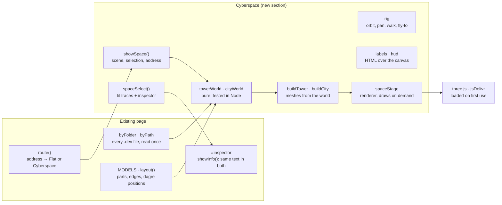

# Cyberspace mode: implementation spec

2026-11-13 · David Hermann Brandt

The design this spec implements is the canvas [Cyberspace explorer in 3D](https://claude.ai/artifact/VDLEAr9k5mUna6aAPuC1Pp). The spec was drafted as a doc ([Cyberspace mode: implementation spec](https://claude.ai/artifact/X4UTWACvWidkSSJHWom9iu)); this file is the copy the repository keeps, and the one to change from now on. Wanted work: backlog item `cyberspace-mode` in [.dev/backlog.json](../.dev/backlog.json). The canvas's artboards, with renders of them, are copied in [cyberspace-design/](cyberspace-design/README.md) for anyone who can't open the canvas. Since 2026-11-15 the look is the Gibson of *Hackers* (1995), which the owner chose (decision `space-gibson-look`) and artboards 11 to 15 draw; it is built by the plan `cyberspace-gibson`. The order of the work, and how each step is checked, is the plan `cyberspace-mode` in [.dev/plan.json](../.dev/plan.json).

## Summary

Add a second way to read a repository, **Cyberspace**, next to today's flat page. It is a WebGL scene inside `index.html` that draws the same `.dev` data in 3D. The look and every number in it come from the design canvas [Cyberspace explorer in 3D](https://claude.ai/artifact/VDLEAr9k5mUna6aAPuC1Pp). This spec says how to build it without breaking any decision, contract or quality requirement already recorded in the repository's `.dev` folder.

The mode has four scenes. In the Gibson look, artboards 13, 11 and 12 on the canvas show the first three, 14 the skyline and 15 a state machine. Artboards 1 to 3 and 7 to 10 drew the same scenes, a use case and a part that opens a folder in the first look: their geometry, cameras and panels still hold where 11 to 15 don't say otherwise, and their colours are history. Artboards 4 to 6, light mode in the first look, are superseded; since 2026-11-18 light mode is the Gibson look by day (decision `theme-switch`, section *Palette*).

| Scene | Canvas artboard | What the reader sees | Built from |
| --- | --- | --- | --- |
| Folder tower | `Gibson-tower.dc.html` (first look: `Strata.dc.html`) | One folder as a stack of glass floors, one floor per `.dev` file, grouped Drawn · Written · Knowledge, each carrying its view's title and what it holds. A floor slides out to be entered. | `byFolder.get(folder)` |
| City | `Gibson-city.dc.html` (`Main.dc.html`) | One drawn view (component diagram first) as a city: groups are raised plates, parts are cyan glass towers carrying their own record on their faces, outside services are magenta beacons, relationships are circuit traces on the floor, which rise as arcs of light when their part is selected. | `MODELS[kind]` + `layout()` |
| Street | `Gibson-street.dc.html` (`Street.dc.html`) | The same city from eye level, walking with W A S D, with a map and a hover card. | Same scene as the city, another camera |
| Skyline | `Gibson-skyline.dc.html` (`Skyline.dc.html`) | A repository with several folders, one level above the towers: every folder a building on a radial tree, its faces carrying its title, purpose and views, with a floor for each of its views. | `byFolder`, `parentOf` |

The 3D ground plan is the flat drawing's dagre layout laid on the floor. A part stands where its plate sits on the flat sheet, so a reader who switches modes finds everything in the same place.

**Done means:**

- [x] A **Flat / Cyberspace** switch in the bar; the choice is in the address and survives reload, back and forward. (Shown since 2026-11-15; in step 7 every row of *Switching modes keeps the place* was pressed both ways in Chrome.)
- [x] The four scenes work for this repository and for any repository the flat page can open, for every drawn kind (component, deployment, class, state, use case, user journey). (Step 8: this repository, and all 142 cities of retro-games, in Chrome, in the first look.)
- [x] Selecting a tower opens the existing inspector with the same content as the flat page.
- [ ] Without WebGL, without three.js, with reduced motion and from the keyboard, the mode degrades as section *Fallbacks, performance budgets, accessibility* says; and it follows the theme, light or dark, as Flat does. (Without WebGL, without three.js, with reduced motion and from the keyboard: checked in step 7, and again in step 8, in Chrome; Safari and Firefox wait on `cross-browser-checks`. Following the theme: decision `theme-switch`, 2026-11-18.)
- [ ] The Gibson look (decision `space-gibson-look`, plan `cyberspace-gibson`), as artboards 11 to 15 draw it.
- [ ] 60 fps on a 2021 MacBook Air (M1) at 1440×900 for this repository; 30 fps or better for a 400-part diagram. (Not measured on an M1 Air: steps 7 and 8 measured on an M1 Pro against half the frame times, and met them; quality requirement `space-frame-rate`.)
- [x] The repository's `.dev` files describe what each step built, in that step's pull request (last section). (Reconciled with the code in step 8.)

## Ground rules

The repository already records how the page must be built; Cyberspace follows those records, and changes one of them (`one-motion`, below). Since 2026-11-15, decision `space-gibson-look` also amends `colour-per-kind` and quality requirement `light-dark` inside Cyberspace, and supersedes `space-light-mode`. Read these files before writing code, in this order:

1. `.dev/backlog.json` → item `design-pass` (what to read in what order).
2. `.dev/decisions.json` — every accepted decision below is binding.
3. `.dev/quality-requirements.json`, `.dev/requirements.json`, `.dev/contracts.json`.
4. `.dev/component-diagram.json` and `.dev/deployment-diagram.json` — where the new parts go.
5. `index.html` around `load`, `route`, `componentModel`, `layout`, `drawDiagram`, `select`, `closeInspector`, `focusPart`.

| Record | What it means for Cyberspace |
| --- | --- |
| decision `one-file` | All code stays in `index.html`. No build step, no bundler, no new files served. The only new network dependency is three.js from jsDelivr, loaded the way dagre is (`import()` of a pinned `+esm` URL). |
| decision `own-drawing` | Draw the scene ourselves with three.js core. Do not add OrbitControls, CSS2DRenderer or any other examples/addons module; write the controls and the label layer (they are small and need to match this page). No post-processing: the Gibson look's glows are geometry with a falloff in their own shaders (*Glow and fog*). |
| decisions `survey-sheet`, `colour-per-kind`, `space-gibson-look` and `theme-switch`, quality requirement `light-dark` | Every colour in the scene comes from CSS custom properties read with `getComputedStyle`: Cyberspace's own tokens (`--space-*`, section *Palette*), with a light and a dark value, and the kind colours (`--k-component` … `--k-knowledge`), which accent. Cyberspace follows `html[data-theme]` as Flat does, and repaints in place when it changes (quality `light-dark`). No colour literals in the scene code. |
| decision `barlow`, `own-icons` | Labels and panels use the existing Barlow stacks and `ic()` icons. |
| decision `tables-always`, requirement `works-without-drawing` | Cyberspace is another way in, never the only one: every fact shown in 3D stays reachable in Flat. |
| decision `address-is-state`, contract `page-address`, requirement `addressable` | The mode and the selected part are in the address; existing forms keep their meaning (section *Routing, state and links*). |
| decision `one-motion` | **Changed by this work.** Camera moves (fly-to, slide a floor out, rise from street to orbit) are new motion. Record the change as a new decision `cyberspace-motion` that supersedes nothing but amends `one-motion`: motion only moves the camera to where the reader asked to go, and all of it is off with reduced motion. |
| quality `safe-content` | Repository text never becomes markup: labels are set with `textContent`, inspector content goes through the existing `esc()` paths. |
| quality `keyboard`, `reduced-motion`, `fallbacks`, `screen-sizes` | See *Fallbacks, performance budgets, accessibility*. Laid out for 15-inch to 34-inch screens. |
| quality `requests` | No extra requests to the repository host. The scene uses what `load()` already read. |
| requirement `token-to-its-host` | three.js is fetched without credentials; nothing in the scene sends repository data anywhere. |

What stays out of scope: editing `.dev` files (limitation `no-edit`), VR/XR, multiplayer, persisting camera positions beyond the address.

## Architecture

Cyberspace is one new section of the existing `<script type="module">`, headed `// ── Cyberspace ──`, placed after the Waiting section. It reads the same `byFolder`, `byPath`, `MODELS` and `layout()` the flat page uses, and writes into one new element. Nothing in the loading path changes.



Cyberspace reuses what the page loaded; three.js is the only new download.

The new section only reads `byFolder` and the models; it writes the scene, the HUD, and the inspector through the same `showInfo()` Flat uses.

**Where it touches the existing code.** Outside the new section, only these change:

- `route()`: the address marker (section *Routing*), and a redraw of Flat (`showFolder`) the first time Flat shows after a stay in Cyberspace, even for the same folder.
- `current`: the models read it (`navFor` and `declaredIn` decide a part's drill-down from it), so `showSpace` sets it to the folder it shows before building a world.
- `plateNode` and `clusterNode` return `ext` (today it only goes into `cls`), `glyph`, and `label`: their `name`, unless the model gives one (a use-case step's is `<n> · <its action>`, a journey stage's `<n> · <its touchpoint>`). `classModel`'s and `stateModel`'s nodes carry `label` (the type's name, the state's id), and `stateModel`'s carry `terminal`.
- `drawDiagram` takes its model and layout from a new `sheetOf(d, folder, W, H)`, which holds the choice it makes today between a left-to-right and a top-to-bottom layout, so that both modes make it alike (*Scene model*). Nothing it draws changes.
- `select()` hands its inspector code to `showInfo(info, onSel)` (Scene 2), and `closeInspector()` also clears the Cyberspace selection.
- The document's Esc listener steps aside while `body.space` is set. Cyberspace has one Esc handler of its own, which consumes the key, so one press never both closes the inspector and goes up a level.
- `status()` gains its optional hint, `ICONS` the new icons, `:root` the new tokens (and the dark block again under `:root.space`), and `package.json` its test script.
- `layoutOne` keeps dagre's points on each edge (`e.pts`, sheet px), which `bounds` and `layout`'s packing shift as they shift `d`: the floor traces follow them (*Traces*). Nothing Flat draws changes.

**New markup** (inside `#layout`, after `<main id="view">`):

```html
<section id="space" hidden aria-label="Cyberspace">
  <canvas id="space-gl" tabindex="0" role="application" aria-label="Cyberspace" aria-describedby="space-help"></canvas>
  <ul id="space-parts" class="sr" aria-label="Parts in this scene"></ul>   <!-- right after the canvas: Tab walks it next -->
  <div id="space-labels" aria-hidden="true"></div>
  <div id="space-hud"></div>      <!-- layers, legend, controls, map, breadcrumb, hover card -->
  <p id="space-help" class="sr">…what the scene shows and how to move…</p>
  <p id="space-live" class="sr" aria-live="polite"></p>
</section>
```

While Cyberspace is on, `body` gets the class `space`, and `html` too (it takes the page's dark tokens, so the whole window is dark): `#view` and `#side` are hidden, `#space` fills the window under the bar and status line, and `#inspector` is restyled as the floating card from the design. The existing `#inspector` element and its `select`/`closeInspector` behaviour are reused, not copied.

**New code units** (all plain functions and closures in the same module, named as below so the component diagram can cite them):

| Unit | Responsibility | Reads | Writes |
| --- | --- | --- | --- |
| `THREE_URL`, `loadThree()` | Imports three.js once, on first entry to Cyberspace; resolves `null` on failure. | — | `three` |
| `spaceTheme()`, `retheme()` | Reads Cyberspace's tokens and the kind colours into a palette object (section *Palette*) in the theme `html[data-theme]` names, on every entry and whenever it changes, and writes the shared uniforms; `retheme` repaints the standing scene in it. | `getComputedStyle(document.documentElement)` | `theme`, `SPACE_U` |
| `routeTraces`, `skylineTraces`, `traceAt` | A city's relationships as circuit traces on the floor, the skyline's lines to parent folders, the trace under a point (section *Traces*). In the `space-world` block. | world specs, dagre's edge points | plain objects |
| `faceText`, `fitSection`, `floorText`, `buildingText`; `infoSections` | What a tower's faces, a floor's top and a building's faces carry, as lines of cells (*The glass and the faces*); `infoSections` reads a part's inspector HTML into plain sections. All but `infoSections` in the `space-world` block. | `n.info` | plain objects |
| `faceAtlas()`, `faceCodes()` | The glyph atlas, made once per stage, and a city's cells as a texture. | `three`, face lines | textures |
| `glowLines(segments)`, `ribbons(list)` | The two glowing geometries: quads turned to the eye for edges and arcs, flat strips for traces and pads (*Glow and fog*, *Traces*). | world specs, `theme` | meshes |
| `towerWorld(folder)` | Folder → floor specs. | `byFolder`, `KIND_ORDER`, `KNOWLEDGE` | plain objects |
| `skylineWorld()` | Every folder → a building on a radial tree. | `byFolder`, `parentOf`, `childrenOf` | plain objects |
| `cityWorld(doc, folder)` | One drawn view → plates, towers, beacons, beams, traces and pads in world units, from the flat layout. | `sheetOf` (`MODELS`, `layout`, `dagre`), `flatRoom` | plain objects |
| `spaceStage` | Owns the `WebGLRenderer`, `Scene`, resize observer, and an on-demand render loop. | `#space-gl` | GPU |
| `buildSkyline(world)`, `buildTower(world)`, `buildCity(world)` | World specs → a `THREE.Group`, plus a `pick` map from mesh id to part key. | `theme`, `three` | scene graph |
| `rig` | The camera: orbit, pan, walk, fly-to; keyboard and pointer input. | input events | `camera` |
| `labels` | DOM labels projected over the canvas each frame, with overlap avoidance. | `camera`, world specs | `#space-labels` |
| `hud` | Layers panel, legend, camera buttons, map, breadcrumb, hover card. | world specs, `space` | `#space-hud` |
| `spaceSelect(key)`, `spaceRoute()` | Selection (lights traces and their arcs, opens the inspector) and the address. | `location.hash` | `#inspector`, address |

**State.** One object, the only mutable state the section adds:

```js
const space = {
  on: false,          // Cyberspace is showing
  scene: null,        // "skyline" | "tower" | "city" | "street"
  folder: null,       // folder being shown
  doc: null,          // the drawn view the city is built from
  world: null,        // output of towerWorld / cityWorld
  selected: null,     // part key
  hovered: null,      // part key
  layers: new Set(),  // views standing beside the one in the address, by cityView's key: the file's path, with "#<entity id>" for a use case or journey
};
```

## Scene model

Every scene is built in two steps: a pure function turns loaded `.dev` data into a **world** (plain objects in world units, no three.js), and a builder turns the world into meshes. Keep the first step free of three.js so it can be unit-tested in Node and reused for the map and the label layer.

**Units and axes.** World units are metres in spirit. `y` is up. The flat sheet lies on the ground: sheet `x` → world `x`, sheet `y` → world `z`, flipped so the top of the sheet is furthest from the default camera. One world unit = 40 sheet px (`SHEET = 1/40`; the page already has a module-level `S`, the icons' fill attributes).

```js
const SHEET = 1 / 40;
const toWorld = (L, b) => ({ x: (b.x - L.w / 2) * SHEET, z: (L.h / 2 - b.y) * SHEET });  // centred on the origin
```

**One frame for every number in this spec.** All positions here (and on the design canvas) use a left-handed frame: the default camera looks along +z with +x to its right. three.js is right-handed, so convert in exactly one place and nowhere else:

```js
const V = (x, y, z) => new THREE.Vector3(x, y, -z);   // spec frame → three.js frame
```

Every geometry builder and camera call goes through `V`; world objects keep spec-frame numbers so tests can compare them with this document.

### City world: `cityWorld(doc, folder)`

1. `{ model, L, dir } = sheetOf(doc, folder, flatRoom(), Math.max(460, innerHeight * 0.76))`: the model, and the layout Flat draws for it in this window. Flat turns a state machine or a deployment top to bottom when that draws larger. A city that always laid out left to right would stand differently from its flat drawing: at 1440 × 900 that is 10 of the 38 state and deployment diagrams of this repository and retro-games, `drawing.state-diagram.json` among them. So `drawDiagram`'s choice moves into a function both modes call, and Cyberspace gives it the room Flat's drawing has:

   ```js
   /** A view's model and the layout Flat draws it with: a state machine or a deployment is turned top to bottom when that draws larger. */
   function sheetOf(d, folder, W, H) {
     const model = MODELS[d.kind](d, folder);
     let L = layout(model, W - 8), dir = model.dir;
     if (d.kind === "state" || d.kind === "deployment") {
       const tb = layout({ ...model, dir: "TB" }, W - 8), fit = (x) => Math.min(1, W / x.w, H / x.h);
       if (fit(tb) > fit(L) * 1.08) { L = tb; dir = "TB"; }
     }
     return { model, L, dir };
   }
   /** The width a drawing has in Flat, worked out while #view is hidden: #layout's last column, less #view's padding and the canvas's border. */
   function flatRoom() {
     const cols = getComputedStyle($("layout")).gridTemplateColumns.split(" "), pad = getComputedStyle($("view"));
     return Math.round(parseFloat(cols[cols.length - 1]) - parseFloat(pad.paddingLeft) - parseFloat(pad.paddingRight) - 2);
   }
   ```

   `getComputedStyle` gives both in pixels while `#view` is hidden: checked in Chrome at 1440 and 1100 px wide, where `flatRoom()` is 1062 and 742, the widths the drawing's `.canvas` measures. For `use-case` and `user-journey`, build one city per entity, as `drawKind()` draws one canvas per entity; the address picks which (section *Routing*).
2. If `dagre` is null there is no layout to ask `sheetOf` for: take `MODELS[doc.kind](doc, folder)` alone, with `dir` left to right, and use the fallback grid: leaf nodes in rows of `ceil(sqrt(n))`, 5 units apart, clusters as plates round their children. Say so in the status line.
3. Classify every node of `model.nodes`:
   - **plate** — `n.cluster` is true. Footprint = its `L.box` × `SHEET`, shrunk 0.2 on every side. Plate thickness `PH = 0.5`. A plate nested in a plate sits on its parent's top: `base = depth × PH`.
   - **beacon** — `n.ext` is true, it is not a cluster, and the view is a component or deployment diagram (component `external`, deployment nodes with a `condition` or of kind `external-service`). `plateNode` and `clusterNode` return `ext` for this (*Architecture*). Position = its box centre; hover height `y = 6.5 + 1.5 × (index among beacons mod 3)`.
   - **tower** — everything else, with the exceptions below. Footprint is square, side `TW = min(2.2, 0.8 × distance to the nearest other tower centre)`, centred on its box. The distance is measured along the ground's axes (the larger of |Δx| and |Δz|): two squares of side 0.8 × their Euclidean distance overlap when they stand diagonally, and along the axes they never do. For towers in a row the two are the same. It stands on the top of its innermost plate (or the ground).
   - **marker** — a node with no `info`: a state machine's start point (`__start`). A ring of radius 0.5 and a dot on the ground (or plate) in `--space-text-bright`; it can't be picked or selected, and its trace starts at its disc.
   - In the other kinds `ext` means something else: a use case's alternative outcome is `ext` only to get its dashed outline. There it draws a **short tower**: height 2.2 whatever its degree, its edges dashed (`LineDashedMaterial`, dash 0.12, gap 0.20).
   - A final state (a `state` node with `terminal`) has a solid top (top face alpha 0.75 in every state) and a second pad ring round its base, 0.32 outside its pad, in the kind colour at 90%, as Flat draws it a second ring. (In the first look these were two round rings; a second band under its top, the first default, couldn't be told from the floor bands.)
   - A part with `n.nav` stands for a folder that has diagrams of its own (Flat draws a badge): its label starts with Flat's badge (the `drill` chevron on a disc of the kind colour), and selecting it offers **Enter its folder** (Scene 2, *Selection*).

   Artboards 8 to 10 on the canvas show these on a state machine, a use case and the Worker (decision `space-other-kinds`).

4. Tower height from its degree, counting every edge of `model.edges` that touches it once, self-loops included: `h = 2.2 + 1.3 × min(degree, 9)` (so 2.2 to 13.9). In this repository Loader has degree 6 and height 10.0.
5. Beams, one per `model.edges` entry, keyed by `e.key` so tooltips and selection match the flat page:
   - anchors: a tower's top centre; a beacon's centre; a plate's centre at its top + 0.2.
   - path: quadratic Bézier, `A` → `B`, control point at the midpoint raised to `max(A.y, B.y) + 1.5 + 0.22 × groundDistance(A, B)`; 32 segments.
   - a self-loop (`e.self`): a vertical circle of radius 1.2 standing on the tower top, in the x–y plane. A second and later loop on the same part (retro-games' chess game has three on `inPlay`) is turned about the vertical by 180° / k each, so the k loops can be told apart.
   - beams that join the same two parts, either way round, would lie on one arc: `opened` and `choosing` in this repository's page state machine have five. They fan out: beam `i` of the `k` between two parts moves its control point sideways by `1.1 × (i − (k − 1) / 2)` units, along the ground normal of the line from the part whose key sorts first to the other, so their crests stand 0.55 apart.
   - colour: violet (`--space-trace`); magenta (`--space-trace-out`) when either end is a beacon.
   - A beam is drawn only while lit, as the arc of its trace (*Meshes and materials*): the quiet arcs went with the Gibson look, and every relationship is a trace on the floor.
6. Bounds = the box round every plate, tower, beacon and start point; used by the camera's limits, the label cut-off and the map. The fit frames the corners of what stands and the lit arcs instead (Scene 2, *Camera*).
7. Traces: `routeTraces(world, edges, dir)` (section *Traces*), with `L`'s edges and their `pts` moved into world units as the boxes are (an empty list without a layout), gives the world its `traces` and `pads`.

Part sizes come from text widths (`tw()`), so a web font that arrives late moves `layout()`'s positions, and `load()` then routes again (`loadingdone`). Drop the memoised worlds at that point and build the scene once more. The direction `sheetOf` chooses depends on the window, as it does in Flat, which chooses when it draws: keep a world with the direction it was built for, and build it again when `sheetOf` would now choose the other.

The world object:

```js
{
  kind, dir, title, file: doc._path,      // dir: "LR" | "TB", the direction sheetOf chose
  plates:  [{ key, name, x0, x1, z0, z1, base, depth }],
  towers:  [{ key, name, x, z, side, base, h, degree, plate, alt, final }],   // name: the node's label
  beacons: [{ key, name, x, y, z }],
  markers: [{ key, x, z, base }],
  beams:   [{ key, from, to, points: [[x,y,z] × 33], ext, dashed, label, tip }],   // tip: the edge's, shown on hover; points: the arc when lit
  traces:  [{ key, from, to, self, ext, dashed, points: [[x,y,z], …] }],   // one per beam, on the floor (routeTraces)
  pads:    [{ key, kind, x, y, z, half }],     // a tower's, a beacon's, and one where a trace reaches a plate
  parts:   Map(key → model node),   // keeps n.info for the inspector, n.tip for hover
  bounds:  { x0, x1, z0, z1, top },
}
```

### Tower world: `towerWorld(folder)`

1. `docs = byFolder.get(folder)`, already sorted by `orderOf`.
2. Group: **Drawn** = `doc.kind in MODELS`; **Written** = in `KIND_ORDER` but not in `MODELS` (capability, feature, operation); **Knowledge** = in `KNOWLEDGE`. Order Drawn → Written → Knowledge, bottom to top, each in `orderOf` order.
3. Floors are 16 × 12 units, 0.14 thick, 1.05 apart, with an extra 1.4 gap between groups. On 2026-11-13 the root's 24 files put the top floor at y = 26.95. The count grows as files are added (the plan adds `plan.json`, step 4 a state diagram), so the tests read a frozen copy (*Automated tests*).
4. What each floor shows on its top face, all real text (`floorText`, *The glass and the faces*): its kind and title framed; its file and how many it holds (`component-diagram.json · 39 parts`); then what it holds, one name after another, `› ` before each, wrapped across the floor and cut with `…` where the floor ends: a drawn view's parts (a component's, a deployment node's or a type's name, a state's id; a use case's or journey's entities), a written view's cards, a knowledge file's records. (In the first look: the layout as tiles, and bars as long as the titles.)
5. The pulled-out floor (one drawn view at a time) slides to `(+20, 0, −12)` relative to its slot, leaving a dashed ghost outline. On it stands the city of that view, scaled about its centre by `k = min(0.36, 15 / width, 11 / depth)` of the city's bounds, so that a large city still stands on its 16 × 12 floor. At 0.36, this repository's component city (40.6 × 47.4 units) would be 17.1 deep; it takes 0.23.

### Skyline world: `skylineWorld()`

When `byFolder.size > 1` the repository also has a skyline: every folder as a building, in a scene of its own one level above the folder towers (*The skyline*). The first rule stood the buildings in the tower scene, round the address folder drawn in full; a 16 × 12 tower with its drawer does not fit a ring of them.

1. One building per folder, all alike: 4.5 units along its ring and 6 towards the centre, one floor plate per `.dev` file 0.5 apart, in the order and the colours of the folder's tower, inside a glass shell 0.3 taller. A building's height says how many views its folder holds: 0.3 + 0.5 × its files. The plates' tops stand at 0.5, 1.0, … 0.5 × files, so the shell reaches 0.3 above the top one. The world takes the folders as `[{ folder, floors: [kind, …] }]`, the floors already in the tower's order (`floorOrder`, which `towerWorldFrom` also uses).
2. The folders are the tree `parentOf` gives. The root stands at the origin; a folder at depth `d` stands on a ring of radius `ring × d`, turned to face the centre. Where several folders have no parent (no views at the repository's root), they are the first ring and the centre is empty.
3. Each folder needs an angle, `need(f, d) = max(6 / (ring × d), Σ need(child, d + 1))`: its own building's 4.5 units and a gap of 1.5 on its ring, or what its children need, whichever is more. The root's children share the full circle in proportion to their needs, in `folders()` order, starting behind the centre (+z) and going clockwise seen from above. Every other folder shares its own span among its children the same way. A folder stands at the middle of its span.
4. `ring` starts at 14 and grows by 0.5 until the root's children need no more than 94% of the circle. This repository's 5 folders keep 14; retro-games' 93 take 20. (Sharing the circle by number of folders on rings 14 apart, the first rule, stood 15 pairs of retro-games' buildings closer together than a building is wide.)
5. A trace on the ground joins each folder to its parent, square to the rings (`skylineTraces`, section *Traces*).

```js
{ ring, buildings: [{ folder, parent, x, z, angle, depth, floors: [kind, …], h }], lines: [[folder, parent], …], bounds }
```

`angle` is in radians from +z, clockwise seen from above (+x is a quarter turn on), so a building stands at `(ring × depth × sin angle, ring × depth × cos angle)`; `buildingCorners(b)` gives its footprint. `folders()` order is `localeCompare`'s, as the page sorts it.

**Layer placement** (*Scene 2, What stands in the city*): `layerOffsets(bounds)`, in the `space-world` block, gives each city standing its offset along x: 0 for the first, and for each next one the offset that starts its bounds 12 units (`LAYER_GAP`) right of the last one's. `districtWorld(stands, lead)` joins the cities standing (`[{ key, world, dx }]`) into one world to walk in and map, each part moved by its offset and marked with its view.

## Rendering

The look is the Gibson of *Hackers* (1995), as the owner chose it on 2026-11-15 (decision `space-gibson-look`; since 2026-11-18 also by day, decision `theme-switch`): cyan-to-teal glass towers whose faces carry their own record in glowing monospace; relationships as glowing circuit traces on a black, slightly glossy floor, between pads at the towers' bases; a black sky going deep indigo at the horizon. Artboards 11 to 15 on the canvas draw it, rendered with three.js from this repository's data by the scratch prototype this section was measured with (*Performance budgets*). Use three.js core only: `WebGLRenderer`, `PerspectiveCamera`, `InstancedMesh`, `InstancedBufferGeometry`, `BufferGeometry`, `DataTexture`, `ShaderMaterial`. No post-processing: every glow is geometry drawn with a falloff in its own shader (*Glow and fog*), and the face text's glow is baked into its atlas. Nothing moves unless the camera does, so rendering on demand and decision `cyberspace-motion` hold as they are.

**Renderer.** `new WebGLRenderer({ canvas, antialias: devicePixelRatio < 2, alpha: false, powerPreference: "high-performance" })`; pixel ratio `min(devicePixelRatio, 2)`; clear colour `--space-void`. The sky is drawn in the scene (below), not in CSS, so that its horizon band stays on the horizon whatever the camera does. Multisampling only below a pixel ratio of 2: at 3440 × 1440 and ratio 2 it cost this repository's street 4.5 of its 7.1 ms a frame in the prototype, and at that pixel size the edges, traces and face text, which anti-alias in their own shaders, look the same without it (*Performance budgets*). Field of view and view offset are set per scene; near 0.6, far 900 (the sky sphere's radius is 800).

### Palette

Cyberspace follows the page's theme, as Flat does (decision `theme-switch`, which supersedes the always-dark rule of `space-gibson-look`): `html[data-theme]` is `light` or `dark`, from the bar's System / Light / Dark switch, or the system's setting while System is chosen, or a host that owns it (`data-theme-host`, the VS Code extension). By night it is the Gibson of the stills; by day the same city stands under a pale sky on a near-white glossy floor, its glass a deeper teal, its traces and edges laid over the floor rather than added to it. The kind colours, `--k-*`, are the page's values for the theme.

Cyberspace's own colours are tokens of their own, with a light value in `:root` and a dark one in `:root[data-theme="dark"]`, beside the page's. `spaceTheme()` reads them with `getComputedStyle` on every entry and again whenever `html[data-theme]` changes (`retheme`, from a `MutationObserver`), and writes the theme into the uniforms every material shares (`SPACE_U`): the glass's colours; `over`, 0 by night, where glow lines and the horizon's band are added (light on the dark), and 1 by day, where they are laid over what is behind them; and `gain`, 1.2 by day, which thickens the glass's alphas so that it reads on the pale floor. Each scene's `paint(colours)` and the stage's `repaint` put the new colours in place without building anything again, so the camera, the selection and the labels stay. `--space-shadow` (not in the table: an `rgb()` with alpha) is the HUD's shadow and the street's vignette: black at 55% by night, ink at 18% by day.

| Token | Dark | Light | What it colours |
| --- | --- | --- | --- |
| `--space-void` | `#020208` | `#e4ebee` | The clear colour: what shows before the first frame and behind a lost context |
| `--space-sky-zenith` | `#010105` | `#c4d6e2` | The sky overhead |
| `--space-sky-mid` | `#04041a` | `#d9e5eb` | The sky from 7° above the horizon (0.12 rad) |
| `--space-sky-horizon` | `#0e0b2c` | `#eef3f6` | The sky at the horizon: the deep indigo of the stills |
| `--space-sky-band` | `#3b2bb0` | `#a99ff0` | A thin band of light on the horizon |
| `--space-fog` | `#03030d` | `#e5ecef` | What the floor and everything far away fade into |
| `--space-floor` | `#020309` | `#f4f7f8` | The floor near the eye: black |
| `--space-floor-sheen` | `#141038` | `#0a0c12` | Added where the eye grazes the floor: its gloss |
| `--space-glass-low` | `#0c9f96` | `#1c7f86` | Glass at a tower's base: teal |
| `--space-glass-high` | `#3fdcff` | `#2f86b8` | Glass at its roof: cyan |
| `--space-glass-glow` | `#25e6d6` | `#0fa496` | The floor's light on a tower's base |
| `--space-text` | `#7eefff` | `#0f6f86` | Face text |
| `--space-text-bright` | `#e9feff` | `#0b2a36` | Names on faces; a start point |
| `--space-text-quiet` | `#3a9fb6` | `#4a7f8f` | Quiet face text: what a relationship says, a path |
| `--space-trace` | `#9b7bff` | `#6146d4` | A trace's core: violet |
| `--space-trace-halo` | `#5148ff` | `#8b7cf5` | Its halo: blue-violet |
| `--space-trace-out` | `#ff5ad6` | `#ad2a8a` | A trace to or from an outside service, and the beacon itself: magenta |
| `--space-trace-out-halo` | `#c837ff` | `#c86ee8` | Its halo |
| `--space-plate` | `#0a2433` | `#d3e1e7` | Plates: dark raised boards |
| `--space-hot` | `#f2fdff` | `#0f1d25` | What is selected or under the pointer, a lit trace's core, an arc's core, the selected label |
| `--space-panel` | `#060a16` | `#f8fafa` | HUD panels and the inspector, at 90% |
| `--space-pill` | `#04050d` | `#ffffff` | Label pills, at 80% |
| `--space-rule` | `#1d3247` | `#c3cfd3` | Borders of panels and pills |

**The kind colour is an accent** (decision `colour-per-kind`, amended): towers are cyan glass whatever their kind, and the kind colour marks a tower's edges, its pad, its label's border when lit, the frames and headings on its faces, plates' rims and names, and the floors of the folder tower and the skyline. A state city's edges and pads are orchid and a component city's blue, so they still differ at a glance; the glass and the traces are the same in both.

The three trace colours of the stills carry meaning: violet between two parts of the city, magenta where one end is outside it (a beacon), and the blue of the halo under both. A dashed relationship (a use case's *otherwise*, a class's *implements* and *uses*, a deployment's *routes* and *runs on*) is a dashed trace.

### Meshes and materials

| Thing | Geometry | Material and numbers |
| --- | --- | --- |
| Sky | `SphereGeometry(800, 48, 24)`, `BackSide`, centred on the eye each frame | Unlit by elevation `e` of the view direction: `--space-sky-horizon` to `-mid` over e 0 to 0.12, to `-zenith` over 0.12 to 0.6; `--space-fog` below the horizon (it shows only past the floor's end); plus the band: `--space-sky-band` × (0.5 e^−(e/0.0035)² + 0.12 e^−(e/0.03)²). Depth test and write off; render order −3. |
| Floor | One 3000 × 3000 plane at y = 0 | `--space-floor` + `--space-floor-sheen` × (1 − abs(v·up))⁴, v the direction to the eye; mixed into `--space-fog` by the fog factor. Writes no depth; render order −2. It replaces the ground grid. |
| Reflections | The towers' instanced mesh again, sharing its geometry and instance attributes, mirrored in y; the edges' glow lines again, mirrored | The towers' own shader with `MIRROR`: everything × 0.20 × e^(y/1.4), so a reflection is faint and gone 3 units under the floor. Render order 0. Two draw calls a city; the skyline mirrors its buildings only. |
| Plates | One `InstancedMesh` of unit boxes | The glass shader with `PLATE`: `--space-plate`, alphas top 0.55, lit sides 0.30, other sides 0.18. Rims are glow lines (below), kind colour 60%. |
| Towers | One `InstancedMesh` of unit boxes | The glass shader with its faces (*The glass and the faces*). Per instance: matrix, state, solid top, the two sections of face text and its grid. |
| Traces, pads, pins and rings | One `BufferGeometry` of flat ribbons (*Traces*) | `ShaderMaterial`, blending `MaxEquation` (so crossing traces and a trace's corners don't add up), depth off. Colours and widths per vertex (a lit trace's wider core and halo, a ring not shown drawn as nothing), rewritten when the selection or the pointer changes: a lit trace costs no draw call. Render order 2. |
| Beacons | `OctahedronGeometry(1.25)`, scaled 1.04 in y, instanced | Glass with `PLATE` in `--space-trace-out`: top 0.42, sides 0.20. Edges glow lines, magenta 90%. An uplink, a glow line from its pad on the floor to its lower point, magenta 55%, core 0.35 px, halo 3.5 px at 25%. Render order 4. |
| Edges | One `InstancedBufferGeometry` of quads, one per segment: every tower's 12 edges, plates' rims, beacons' edges and uplinks, the folder tower's floors' rims and rails, the skyline's buildings | Glow lines (*Glow and fog*). Hairlines: towers in the kind colour 80%, core 0.35 px each side of the line (about 1.5 px across), halo 3 px at 20%; selected or under the pointer, `--space-hot` 100%, core 0.55 px, halo 4.5 px at 35%; `dim`, 30%. Plates' rims core 0.3 px, halo 2.5 px at 15%; beacons' edges core 0.35 px, halo 3 px at 22%. (The first artboards' 0.6 px cores and 5 px halos read too thick, the owner said on 2026-11-15.) An alternative outcome's edges are dashed, dropping 38% of every 0.55. Render order 5. The 1 px `LineSegments` and the floor bands go: a tower's floors are now the rows of its faces. In step G1 a beacon's two rings on the ground (r 1.6 at 60%, r 2.6 at 25%) and a final state's two rings (kind colour 90%) were glow lines too, core 0.3 px, halo 2.5 px at 15%, without joints; since step G2 they are ribbons, a beacon's pad and a final state's second pad ring. |
| Arcs | Glow lines along each lit beam's 33 points (*City world*, beams) | Only for the selected part's relationships: core `--space-hot` 90% over the trace's halo colour, core 0.9 px (1.0 in the street), halo 6 px (9 in the street) at 45%; quads not drawn past their joints, so the arc has no beads. Rebuilt when the selection changes. Render order 6. The quiet beams go. |
| Selection | Ribbons (above) | The selected part's pad in `--space-hot`, and a dashed square ring 0.45 outside it in the kind colour 75%. |
| Final state | Ribbons | A second pad ring 0.32 outside the first, kind colour 90%; the solid top stays. |
| Start point | Ribbons | A ring of radius 0.5 and a dot, `--space-text-bright` 90%. |

Draw order: sky, floor, reflections, plates, ribbons, towers (and the folder tower's floors, the skyline's buildings and their floor slabs), beacons, edges, arcs. A city draws in 9 calls (sky, floor, the two reflections, plates, ribbons, towers, beacons, edges), 10 with a selection's arcs, whatever its size; each further city standing as a layer adds 7 (`cityCalls`). From step G2 until G3 a city draws in 7 calls (sky, floor, plates, ribbons, towers, beacons, edges: no reflections yet), and 9 with a selection, whose lit beams are still the first look's tubes, a core and a glow, until G4 makes them one set of arcs; a lit trace and a trace under the pointer add none, and each further city standing adds 3 to 5 (`cityCalls`).

### The glass and the faces

**The glass shader.** Unlit, premultiplied: it writes colour × alpha and alpha, with blending `ONE, ONE_MINUS_SRC_ALPHA`, so the glass dims what is behind it by its alpha and its text adds light without dimming more. Alpha comes from the face normal as before: top faces `aTop`, faces turned to −x or −z (the spec's frame) `aLit`, the rest `aDark`. The colour runs from `--space-glass-low` at the base to `--space-glass-high` at the roof; alpha × (1 + 0.6 e^(−y/0.9)), y above the base, and the sides add `--space-glass-glow` × 0.10 e^(−y/0.5): towers are brighter where the floor's traces light them, as in the stills. Depth write off, front faces only, towers sorted back to front.

| Tower state | When | Top / lit / dark face alpha | Edges |
| --- | --- | --- | --- |
| `norm` | default | 0.22 / 0.13 / 0.085 | kind colour 80% |
| `near` | joined to the selected part | 0.30 / 0.18 / 0.12 | kind colour 100% |
| `dim` | a layer fading out | 0.08 / 0.05 / 0.03 | kind colour 30% |
| `sel` | selected | 0.55 / 0.34 / 0.24 | `--space-hot` |
| `hover` | under the pointer or focused | as `near` | `--space-hot` |

**The faces.** Every tower face is a grid of monospace cells, 0.08 wide and 0.16 tall, inside a margin of 0.12 at the sides, from 0.25 below the roof to 0.2 above the base: `faceCols(w)` and `faceRows(h)`. Loader, 2.2 wide and 10.0 tall, has 24 columns and 59 rows. What a face shows is the part's own record, as the inspector shows it, never invented text:

- **The record**, on the faces whose normals are ±z (the front, which the opening view and the street's arrival see, and the back): the part's label in uppercase, framed in box-drawing glyphs in the kind colour; its title, where it differs from the label (`Router (index.html)`); its kind and plate (`COMPONENT · REPOSITORY READING`, the kind colour); its description; each heading the inspector has with a paragraph under it (`FOLDER /`, `ITS DIAGRAM …`); and the file it is declared in (`FILE .dev/component-diagram.json`).
- **Its relationships**, on the faces whose normals are ±x: the same framed name, then each list the inspector has, a heading with a rule and the count (`DEPENDS ON ───── 5`, kind colour), and for each item `› ` and the other part's name in uppercase, bright, with what the relationship says under it, quiet. A part with no relationships carries its record on all four faces.

`faceText(part, cols, { where, file })` lays both out as lines of `cols` cells, each line a string and a style per cell (0 body, 1 bright, 2 accent, 3 quiet). It wraps at spaces, breaks a word longer than a line at a slash, draws a glyph the atlas lacks as its letter without accents (`NFD`), else as `·`. The part's sections come from the inspector's own HTML, `n.info.body`, read by `infoSections(html)` with a `<template>`: a paragraph, a heading, a list item (its `.sel-link`, link or `code` text as the name, its `.d` as what it says, its `.kv` before that). `faceText`, `fitSection` and the glyph set are in the `space-world` block; `infoSections` needs the DOM and stands beside `cityWorld`.

**How the text fits the face.** It starts under the roof and runs down. A section longer than its face is cut at the last row that fits, which ends in `…` (`fitSection`); the inspector has the rest. A section shorter than its face repeats down it, one blank row between, every repeat at 36% (the *echo*): the faces stay full, as the stills' towers are, with nothing on them but the part's own text, and the first, bright copy is the one to read. Every face starts with the name, so a reader at any side knows whose it is.

**How it thins out with distance.** Three things, all in the fragment shader, none of them a pass of its own. The atlas is mipmapped and sampled with `textureGrad` from the cell's own derivatives, so a glyph smaller than its cell's few pixels becomes its own average brightness: lines of text become faint stripes, then a haze on the glass, as the stills' distant towers are. The text fades from full at 22 units to 35% at 90 (the city's opening view sees texture, not words; the street reads them). And the fog fades everything with the glass. At the street's arrival 12 units from a part, a cell is 5 × 10 px and the framed name reads; walking up to a tower, its description does.

**The atlas** (`faceAtlas()`, made once per stage and kept while the stage lives): every glyph of the set (ASCII, Latin-1, the box-drawing glyphs, `→ ← … – — ‘ ’ “ ” • ›`; 205 glyphs) drawn once on a 512 × 1024 canvas, 16 to a row, in cells of 32 × 64 texels (so that a glyph is one texel of mip level 5), in `500 40px` of the page's `--mono` stack. Red is the glyph, green the glyph blurred by 3 texels (its glow); box-drawing glyphs are filled rectangles to their cell's edges, so frames join. It is a `DataTexture` (`RGBAFormat`, mipmapped, anisotropy 8, `flipY` false): 2 MiB, 2.7 MiB with its mips, built in 33 to 53 ms in the prototype.

**The codes** (`faceCodes(sections)`, made with the city): every section's cells, one after another, a glyph index and a style per cell, in an `RGFormat` `UnsignedByteType` `DataTexture` 1024 cells wide, read with `texelFetch`. Each tower carries `aText` (where its two sections start and how many rows each has) and `aGrid` (its columns along its ±z and ±x faces, its rows, and its cell scale: 1 in a city, k on the folder tower's pulled-out floor). This repository's component city is 23,432 cells (47 KB); the 400-part city 190,166 (381 KB, 186 rows), built in 4 ms.

A cell's colour: body `--space-text`, bright `--space-text-bright`, accent the kind colour, quiet `--space-text-quiet`; it adds (glyph × 0.95 + glow × 0.32) × that colour × the echo × the thinning to the glass.

### Traces

`routeTraces(world, edges, dir)`, in the `space-world` block, routes every beam of a city as a trace on the floor, from a pin on the source's pad to a pin on the target's, one per beam and in the beams' order. It follows the route dagre gave the edge in the flat drawing, squared off: along the flow inside a rank, across it in the avenue between two ranks. `layoutOne` keeps dagre's points on each edge (`e.pts`, sheet px, shifted with `d`); `cityWorldFrom` moves them into world units as it moves the boxes and passes them in (`edges`: `[{ key, pts: [[x, z], …] }]`, an empty list without a layout), so the router needs no sheet of its own (the prototype's `routeTraces(world, edges, L)` took the layout and moved them itself). The world gains `traces` and `pads`. The numbers below are `TRACE`'s.

1. **Ends.** A tower's pad is its footprint grown by 0.25 on every side; a beacon's, a 2 × 2 square on the floor under it (on a plate's top where it hovers over one); a start point's, its disc. A plate is reached at its rim: the end is where dagre's line meets the plate's edge, moved 0.5 inside it, with a 0.6 pad of its own.
2. **Waypoints.** In flow and cross coordinates (*f*, *c*: x and z for a left-to-right layout; −z and x for a top-to-bottom one): the start pin, dagre's inner points (its points without the first and last, and without any that fall on either end's pad), the end pin.
3. **Pins.** A trace leaves its pad from the side facing its next waypoint along the flow (+f or −f). The traces on one side of a pad are ordered by where they head across the flow, and take pins 0.3 apart round the side's middle (closer, if the side is short). So a pad is a chip with pins, and its traces leave in order without crossing. A pin is drawn as the trace's own end, its stub off the pad.
4. **Squared off.** Between two waypoints, the trace runs along the flow to the middle between them, across to the next waypoint's c, along the flow into it. It leaves and reaches a pin straight for 0.45, or half the way to the waypoint it heads for where that is nearer, at least 0.1. Points in a line are merged. (The first rule, at least 0.45 always, does not fit a top-to-bottom layout, where a tower is 2.2 square but its flat box about 1.2 tall, so the avenue between two ranks' pads can be narrower than two stubs: 0.35 between `flight` and `paused` in retro-games' lodestar `Mode` state machine, where a 0.45 stub put the trace from `flight` to `dying` through `paused`.)
5. **Lanes.** A run's avenue is the gap between the nearest pads either side of it over its span. The runs across the flow in one avenue form a street (where no pad bounds the avenue on a side, those within 0.6 of each other do); each takes the lowest lane free over its span, and the lanes, in the order their runs stood in, stand 0.3 apart round the street's middle, closer where the avenue is narrow, 0.15 clear of its pads. Then the same for runs along the flow. A trace's first and last runs keep their pins, and the runs next to them stay 0.1 out from the pin on the side it faces. (The first rule, runs within 0.6 of each other form a street, cut the 1.47 between `opened` and `choosing` in this repository's page state machine into two streets, each spread round its own middle and pressed back against the pads, so that three of the five traces between them shared a lane.)
6. **Clear of towers.** A run (other than a trace's first and last) that would pass through a tower's pad, its own ends' among them, slides sideways in steps of 0.05 to the nearest place where it and the runs either side of it pass none: between its neighbours where it runs between them, beyond them where it runs beyond both (a U), and 0.1 out from a pin on the side the pin faces. (Its own ends' pads count since lanes spread three traces in the 0.35 between retro-games' chess `yourMove` and `thinking` back into `yourMove`'s pad.)
7. **Plates.** Each point stands at the height of the innermost plate under it; where a run crosses a plate's rim, or starts or ends on it, it climbs or drops the wall there, a vertical run on the wall's face.

A **self-loop** is a hairpin on the pad's downstream side: out of the pad 0.18 above its middle, 0.6 along the flow, across, back in 0.18 below; a second and later loop on the same part 0.3 further out and 0.12 wider each. A **beacon** is reached at its pad on the floor, from which its uplink rises to it. A **nested plate** is reached as any plate is, the trace climbing each wall in turn. **Without a layout** (the fallback grid) there are no inner points: each trace is one Z between its two pins where that passes no tower, and where it would, it goes round by the nearest street across the flow that is clear of towers, along the flow between the avenues beside its two ends: two Zs. (The first rule, one Z slid clear of towers as step 6 says, cannot hold on the grid: a Z between two parts two columns apart in one row runs its stub through the part between them, and a trace's first and last runs never slide. This repository's component city on the grid has 20 traces of each kind.)

Routed on 2026-11-16 in the page for every drawn view of this repository (20 cities, 242 traces) and retro-games (142 cities, 1,204 traces), and for the 400-part city of `perf/400-parts` (474 traces, 14.6 ms in Chrome on an M1 Pro), on dagre's layouts and again on the fallback grid: no trace passes through a tower other than its own ends', none enters its own ends' pads but at its pins, every run is along x or z or up a wall, and every trace starts and ends on its pads. (The prototype routed the same 1,446 in Node, 31 ms for the 400 parts.)

**A trace is drawn** as a ribbon flat on the floor (or a plate's top, or up its wall), 0.035 each side of its line for its core and 0.45 for its halo, widened to at least 0.7 px and 5 px where the eye is far (so a trace never thins out of sight); lit, 0.05 and 0.6, at least 1.1 and 8 px. The fragment draws the core (smoothstep, its own anti-aliasing), and under it the halo, e^−(d/0.45 w)², in the halo colour at 50% (80% lit), d being the distance to the run itself: each run's quad reaches past its ends as far as its halo, so its ends are round and a trace's corners close without spikes (the prototype drew each run 0.25 past its ends, which left a cross at every corner). A dashed trace drops 38% of every 0.55. Where a trace arrives, a bright run 0.12 long between its round ends and 0.18 wide marks the end it leads to. A lit trace's core is `--space-hot`. A pad is a square ring in the same ribbons, kind colour at 85% (core 0.03, halo 0.3; a beacon's magenta), 100% for a neighbour of the selection or the part under the pointer; the selected part's is `--space-hot` (core 0.045, halo 0.45), with its dashed ring. The ribbons are drawn on both sides, so that a ribbon on a wall shows from either.

**Picking a trace.** The pick tubes go: the pointer's ray meets the floor (or a plate's top), and `traceAt(world, x, z)` in the `space-world` block gives the trace with a run nearest that point within 0.3. A trace there is under the pointer ahead of the plate it lies on (it counts 0.05 nearer than the plate's top) and behind any part the ray meets first. A trace under the pointer is lit as a lit trace is, with its tooltip. A lit arc keeps a hidden pick tube, as the beams had.

**In the skyline**, `skylineTraces(world)` routes each folder's line to the folder it is in, square to the rings: from the side of its pad facing the centre, in along its radius to the street halfway between the two rings, round that street to the parent's angle, in to the side of the parent's pad facing out. A folder of the first ring goes straight in along its radius to where it meets the root's pad. The children of one folder share the street, the one furthest round the ring from its parent on the innermost lane, so that no run in crosses another's run round; lanes are 0.35 apart (closer, where a street would not hold them). `skylineWorldFrom` gives the world its `traces`.

### Glow and fog

**Glow lines** (`glowLines(segments)`): each segment is one instance of a quad, its two ends projected in the vertex shader and the quad widened across the segment on the screen, by its halo; an end behind the near plane is moved along the segment to it first. The fragment draws a core of the segment's core half-width (anti-aliased by its own smoothstep over ±0.4 px) and a halo e^−(d/0.42 h)², and the whole is added (`ONE, ONE`). The halo's width and strength fall off with distance, × clamp(25 / d, 0.33, 1): a fixed halo piles up into blots at the skyline's distances. Box edges are drawn 0.6 of a halo past their ends so corners close; arcs aren't, so they have no beads where their segments meet.

**Fog.** Every material fades by 1 − smoothstep(near, far, the distance to the eye), into `--space-fog`: the floor mixes into it, everything else fades out over it. The city: from the label cut-off (*Labels*: 90 units, or the city's far side as fitted) to 230 further (artboard 11 starts it at 90); the street: 28 to 150; the folder tower: 70 to 260; the skyline: 110 to 420.

### Labels

Labels are HTML in `#space-labels`, never textures: they stay sharp, use Barlow, and their text is set with `textContent`. Each frame the camera moved, project every label's anchor, then place them.

- Pill: height 22 px, padding 0 8 px, radius 4 px, `500 13px` Barlow Semi Condensed, background `--space-pill` at 80%, border 1 px `--space-rule`, text `--ink2`.
- Text: the node's `label`, cut with an ellipsis at 150 px. A part with `n.nav` starts with Flat's badge, 14 px. In a use case or a journey the label starts with the node's glyph (person, system or branch), 14 px, in the kind colour: there a label is a number and the start of a sentence.
- Neighbour of the selection, or under the pointer: text `--space-hot`, border kind colour. Selected: background and border `--space-hot`, text `--space-pill`, weight 600. Beacon: text `--space-trace-out`, border the same at 45%.
- Anchor: a tower's top centre (label bottom 10 px above it); a beacon's top point + 1.7 units.
- Overlap: sort by anchor screen y, nearest first; push each label up in 6 px steps until clear of the ones placed (4 px gap), at most 40 steps, else hide it. When pushed more than 12 px, draw a 1 px leader in `--ink3` from the anchor to the label's bottom centre.
- The selected tower's box on screen and the plate names count as placed, so no other label covers them. A neighbour's label that can't be placed clear is hidden like any other: the cut-off below spares it, this rule does not.
- A label that would run under a panel moves sideways, by at most half its width, to clear the panel by 4 px. One that still would is hidden.
- Labels keep inside the canvas (decided in step 7): a label or plate name that the canvas's left or right edge would cut slides in, by at most half its width, to 4 px from the edge; one the edge, or the canvas's top, would still cut is hidden. At the street's arrival by this repository's Loader, `Part interaction`, whose part stands at the left edge, reads whole 4 px from it.
- In the street, a tower nearer than 18 units has no pill: its faces carry its name, framed, in cells about 7 px tall or more from there (*The glass and the faces*). The selected part keeps its pill.
- Hide labels behind the camera, off the canvas, or further than the cut-off: 45 units in the street; in the city 90 units, or the far side of the city as fitted when that is further (the fit distance plus half the diagonal of the bounds on the ground). A fixed 90 hides the far labels of a larger city in its opening view, the selected part's among them: 3 of the 159 drawn views of this repository and retro-games reach past it, this repository's component diagram for one. Fade them over the last 10 units. The selected part's label and its neighbours' stay whatever the distance.
- Beam labels: in a state machine or a deployment, a lit arc shows its edge's `label` (the trigger, the link's kind) at its crest, in a pill 20 px tall, radius 10, `500 12px` Semi Condensed, `--ink` on `--space-pill` at 86%, with a 1 px dashed border in the kind colour at 70%. They are placed with the part labels and are never hidden. A use case's conditions are sentences: they stay in the inspector and the beam's tooltip.
- Plate names: uppercase, `600 13px` Semi Condensed, letter-spacing 0.1em, kind colour with a glow (`text-shadow: 0 0 8px` the kind colour at 60%), then `· N parts` in `--ink3`, counting every tower and beacon standing on the plate or on a plate within it (Screen holds Landing page, so its 7 parts and Landing page's 1 make 8); placed 8 px under the plate's front-left corner: the left end of the edge lowest on the screen. Plate names are placed before the part labels, which keep clear of them; a name that would cover another steps down 6 px at a time (at most 5 times, else it is hidden) and moves off a panel as a label does.
- Font loading: wait for `document.fonts` as `load()` already does; re-measure labels on `loadingdone`.

## Scene 1: the folder tower

The folder tower is where Cyberspace opens: the folder in the address as a stack of floors, the first drawn view already slid out with its city on it. Match `Gibson-tower.dc.html` (artboard 13) for the look and `Strata.dc.html` for anything it doesn't show.

**Camera.** Position (−14, 24, −44), target (8, 11, 2), vertical field of view 49.3°. The design's frame is the whole window, 1440 × 900, bar included; the canvas is its part under the bar. So frame the camera in the window, with the canvas a part of it: `camera.aspect = W / Hw` and `camera.setViewOffset(W, Hw, (720 − 700) × W/1440, (450 − 440) × Hw/900, W, H)`, where `W × H` is the canvas, `Hw = H + top` the window's height and `top` how far down the window the canvas starts. The field of view then spans the window's height, as it does on the canvas, and the projection centre lands at (700, 440) of the window. three.js moves the window right by the offset, so the projection centre lands at W/2 − offset: the first rule's `(700 − 720) …` put it at (740, 460). Framed in the canvas alone, the stack stood 28 px lower and 6% smaller than on artboard 1. On wider screens keep the vertical field of view and let the stack sit left of centre. The pose frames 24 floors, the top one at y = 26.95. A taller stack opens climbed: camera and target rise together by `top − 26.95` units (1.05 for the root's 25 floors), but no further than leaves the bottom floor's label 24 px above the window's bottom edge. Past that the top is out of frame and the reader climbs to it.

**Floors.** Built from `towerWorld(folder)` as section *Scene model* says. Floor slab: one instanced mesh of the glass shader with `TOPTEXT`: cyan glass (`--space-glass-low` and `-high` half and half), top alpha 0.09, sides 0.29; its rims glow lines in the floor's kind colour, 90% (knowledge 70%), core 0.3 px, halo 2.5 px at 18%. Its top carries its view (`floorText`, *Scene model*) in cells 3.75 times a tower's (0.3 × 0.6), read from the stack's front with the first row along the far edge, the accent the floor's kind colour; at the opening distance a cell is about 6 × 12 px. Four vertical rails at the back and front corners, glow lines in `--k-component` at 30% (core 0.3 px, halo 2.5 px at 15%), run from y −0.2 to the top floor + 1.2. Draw floors below eye height bottom-up and those above it top-down, so the nearer slab always paints last. The stack, its floors and the pulled-out city are reflected in the floor as a city is.

**Pulled-out floor.** One drawn floor at a time. Its slot keeps a dashed outline and three dashed drawer lines run from the slot's corners to the floor's: dashed trace ribbons in the floor's kind colour at 60% and 50% (core 0.02, halo 0.2). The soft glow under it goes: its reflection does that work now. Its top carries no text: its city stands there. The city on it is `buildCity(cityWorld(doc))` scaled by `k` (*Scene model*) about its centre, labels off, with Loader-style highlight for whatever is selected; its face cells, ribbons and glows scale by `k` too, their pixel minimums by √k (at least 0.55), so the small city is the large one seen from further off. Its glow lines, whose widths are in pixels, keep at least 0.8 of their cores and 0.6 of their halos (`glowLines`' `k`, as the prototype drew it): scaled by `k` alone, 0.23 for this repository's component city, a 0.35 px core would vanish (step G1).

**Floor labels** (HTML, left of the stack): right-aligned so their right edge is 14 px left of each floor's front-left corner, vertically centred on it. Kind name uppercase `600 11.5px` Semi Condensed, letter-spacing 0.08em, in the kind colour; then the view's `title` in `--ink` 13 px. The empty slot reads `component  pulled out` in `--ink3`, the second word italic. The kind word for knowledge files is the file's own kind (`vision`, `glossary`…), lowercased, hyphens as spaces.

**Group brackets**: a 2 px `--space-rule` line 22 px from the left edge, spanning a group's floors ± 10 px, with the group name and count written vertically beside it (`DRAWN · 7`, `WRITTEN · 3`, `KNOWLEDGE · 14`), `600 11.5px`, `--ink2`.

**Folder card** (right 20 px, top 98 px, 340 px wide, padding 18):

1. `FOLDER` in caps, `--ink2`.
2. The folder's name as its `folder` knowledge record titles it (`entities[0].title`), else its last path segment, else `/`; `700 30px/34px` Barlow Condensed, `--space-hot`.
3. Its path in monospace 12 px, `--ink3`: `./.dev · 24 files` (or `.cyberspace-explorer/<folder> · N files` when the repository keeps one tree).
4. Its purpose, chosen exactly as `showFolder` does (`purpose ?? summary`), 14/21 px, at most five lines.
5. Three equal tiles: count of Drawn, Written, Knowledge files, numbers `700 24px` Condensed.
6. Folders inside it as chips linking to their towers, under `INSIDE` in caps: at most two rows of them, the rest folded into a last chip, `and N more`, which opens the skyline. With none, `No folders inside it.` in `--ink3`.
7. Where the repository has several folders, a button **See the skyline** (`#<folder>|~space:skyline`).

**Pulled-floor card** (300 px wide, 8 px under the folder card, their right edges in line): a 10 px kind swatch and the kind name in caps and kind colour; the view title `700 24px` Condensed; a count line built from the city world, `28 parts · 6 beacons · 40 traces` for this repository's component diagram on 2026-11-15; buttons **Enter the city** (primary, a link to the city address) and **Slide back**.

**Interaction.**

| Input | Effect |
| --- | --- |
| Hover a floor | Its edges to 100% and its label text to `--space-hot`; cursor pointer. |
| Click a drawn floor | Slides it out while the one already out slides back, both in the same 450 ms, ease-out cubic; instant with reduced motion. Its city stands on it as it comes out; the one going back leaves its city at once. A new history entry, `#<folder>\|view:<file>\|~space`. Where the floor, out, stands outside the free rectangle, the camera climbs to it (*Camera and input, Looking at the selection*). |
| Click a written or knowledge floor | Opens the inspector with the view's title, kind, description and a **Read it in Flat** link to `#<folder>\|view:<file>` in flat mode. The inspector takes the cards' place while it is open, and the floor's edges are drawn in `--space-hot`. The address names the floor (`#<folder>\|view:<file>\|~space`; `#<folder>\|entity:<file>#<record id>\|~space` opens it with the record), replacing the history entry; closing it gives the tower's address back. Where the floor stands outside the free rectangle, the camera climbs to it, as for a floor pulled out. |
| Double-click the pulled floor, **Enter the city**, or Enter on it | Flies into Scene 2 (section *Camera and input*). |
| Wheel | Climbs: moves the camera and its target up or down 1.05 units a notch, clamped to the stack. ⌘/Ctrl + wheel or pinch zooms. |
| ↑ / ↓ (on the canvas) | Moves keyboard focus floor by floor, the first press to the pulled-out floor (or the bottom one); in the tower they take the place of the orbit rig's elevation keys. The focus ring is the floor's edges and its label's title in `--space-hot`; where the focused floor stands outside the free rectangle, the camera climbs until it is inside, 24 px in from its top and bottom (*Looking at the selection*). The canvas losing the focus clears it. |
| Enter (on the canvas) | What a click on the focused floor does, except that the pulled-out floor is entered; with no floor focused, enters the pulled-out floor. |
| Esc | Closes an inspector that is open; else slides the pulled floor back (as **Slide back** does); with none out, rises to the skyline where the repository has one (a new history entry). |

Sliding a floor back replaces the history entry with `#<folder>|~space`. That address also means "the first drawn view pulled out", so the tower keeps every floor in only until the reader goes somewhere; reloading it pulls the first drawn view out again.

Status line: `The root folder is a tower of 24 floors, one per view. Pull a floor out to walk through it.`, right side `Scroll to climb · click a floor to pull it out`. For another folder, `<folder> is a tower of N floors…`. A folder with no drawn views has no floor to pull out, so its tower says what it offers instead (step 7): `.github is a tower of 3 floors, one per view. Nothing here is drawn: open a floor to read it.`, right side `Scroll to climb · click a floor to read it`.

## Scene 2: the city

The city is one drawn view standing on the ground: what the flat page draws as plates and lines, raised into towers on a floor of traces. Match `Gibson-city.dc.html` (artboard 11), drawn from this repository on 2026-11-15, for the look, and `Main.dc.html` (2026-11-13) for anything it doesn't show.

**What the artboard shows.** Artboard 11: the component diagram of 2026-11-15, 5 plates (Landing page is one, standing on Screen), 28 towers, 6 beacons and 40 traces, Loader selected: its six traces lit and risen as arcs. Artboard 2: the component diagram of 2026-11-13, 4 plates, 23 towers, 5 beacons and 29 beams. Plates come only from clusters in the model. A part no cluster contains stands on the bare ground where dagre put it, as Router and Worker do, and a nested plate stands on its parent's top (section *Scene model*). The first artboard 2 was drawn by hand, with an older diagram and an invented fourth plate, *Loose parts*; it was drawn again from the repository on 2026-11-14.

**Camera.** An orbit camera, elevation 33.6°, azimuth −40° (from the front left), vertical field of view 54.1°. Fit: choose the distance at which the corners of what stands all project inside the *free rectangle* — the canvas minus the layers panel, the inspector (when open) and the bottom bars — with 24 px to spare. What stands is each plate's box, each tower's box, each beacon's box (from the ground its tether reaches to its top point), each start point's square, and each lit arc's quarter points (its 9th, 17th and 25th), so that the arcs stay in the frame: about 4,600 points at 400 parts. The bounds' own eight corners, which the first rule fitted, are often bare ground nearest the eye, and left the bottom third of the frame empty; the bounds stay what the camera limits, the label cut-off and the map use. Then shift the projection centre to the free rectangle's centre with `setViewOffset(W, H, W/2 − cx, H/2 − cy, W, H)`, where (cx, cy) is that centre: three.js moves the window right by the offset, so the projection centre lands at W/2 − offset. Aimed at the bounds' centre, the points project lopsided (the near bottom reaches the margin while the top of the frame stays empty), so the fit takes the least distance at which the points *can* stand inside the margins, and moves the target across the view, in the camera's right and up directions, to stand them in the middle. The camera still looks from azimuth −40° and elevation 33.6°; only the point it turns about is off the centre, within the limits below. A label stands 32 px above its tower's top, and the back rows' labels are pushed further up to clear the front ones, into the status line, where they are hidden. So the fit places the labels, counts those hidden above the free rectangle's top, and fits again with 28 px more room left at the top, up to 30% of the free rectangle's height; it keeps the least room that leaves the fewest out (none, for this repository's component, `page.state-diagram.json` and `use-case.json` cities at 1440 × 900; a city of 400 parts still culls by distance and overlap). F, **Fit everything** and a resize fit the same way. The free rectangle is worked out from the panels showing: each takes the side of the room that costs least to give up, so the Layers panel and the inspector join it by being visible, and the status line over the canvas's top counts as a bar. The inspector opens on a selection, and the camera turns toward the part, which ends at the centre of the room the inspector leaves; it closes as the selection is cleared, and nothing moves (*Camera and input, Looking at the selection*). Through step 7 the camera refitted, or kept its pose with the projection centred on the new room, over 300 ms each time the inspector opened or closed, so a part selected from the keyboard list or a link could stay off to the side or under a panel.

The first design looked from the front, −4.4°, at a city placed by hand. In a real layout the parts of one rank stand in a line, and from the front they hide each other. Over the 130 drawn views of this repository and retro-games with four parts or more, towers cover each other least from about −40°: 0.079 of their area on screen against 0.140 from the front in left-to-right layouts, 0.068 against 0.111 in top-to-bottom ones. Labels are pushed 2 px further on average.

**What stands in the city.** The view in the address, always. The **Layers** panel lists the folder's other cities and can stand them beside it: each one ticked is built with `cityWorld` and placed to the right of the last, 12 units apart, in its own kind colour. `space.layers` holds them and starts empty.

A drawn kind with one city is a row with a tick box. A kind with several (three state diagrams; a file's six use cases) is a heading with a chevron and a count, open for the kind being flown, over one row per city, so the panel says which is standing. A view in a file of its own has a tick box. The use cases or journeys of a file have radio buttons: choosing one changes the address to it (a new history entry), which is how a reader reaches a file's second use case; standing several side by side waits for decision `per-entity-cities`. The view in the address is ticked and stays so. Counts are `countOf`'s, as in the folder tree: a use-case file counts its use cases.

Written and knowledge kinds are listed with their counts but disabled, with the hint `Written views and knowledge stand as floors in the folder tower`. Untick a drawn view and its district fades to the `dim` state for 200 ms, then is removed.

Several cities standing (decided in step 6; the cities standing are a `buildDistrict`, which the stage stands as one thing):

- **Placement.** In the order they were stood, each 12 units right of the last (`layerOffsets`). When an unticked city goes, the ones right of it close up at once, after its fade. The panel's view in the address is ticked and stays so.
- **The draw-call budget** (decided in step 7). Each city standing is its own meshes, and a city scene may take 40 draw calls (*Performance budgets*). So the panel counts them: `cityCalls(world)` gives what a city takes, from its world: its two reflections, its ribbons, towers and edges, and its plates and beacons where it has them (7 for this repository's component city and its deployment diagram, 5 for a state machine or a use case); the scene keeps 3 for the sky, the floor and a selection's arcs (a lit trace and a trace under the pointer are recoloured in place). In the first look a city took 4 to 10 and the scene kept 7. From step G1 until G2 a city still draws its quiet beams, their end dots, the discs under beacons and at start points, and the selection's three rings, its edges one set of glow lines: `cityCalls` gives 7 for this repository's component city and its deployment diagram, 5 for a state machine and 4 for a use case, and the scene keeps 8 (the sky, the floor, the rings, the lit beams' core and glow, and the beam under the pointer); in Chrome the component city stood with its deployment diagram and three state machines in 36 calls with Loader selected, and the fourth state machine's tick box was disabled. From step G2 until G3 a city's traces, pads and rings are one geometry of ribbons, recoloured in place: `cityCalls` gives 5 for this repository's component city and its deployment diagram and 3 for a state machine or a use case, and the scene keeps 4 (the sky, the floor, and the lit beams' core and glow until G4); in Chrome all six of this repository's drawn views stood together in 26 calls with Loader selected and a trace under the pointer, and no tick box was disabled. A tick box whose city would take the scene past 40 (`layerFits`) is disabled, with the tooltip `Untick another view first: one more would slow the scene down` and, under the rows, `Untick a view to stand another: more cities at once would slow the scene down.`; a radio button counts the city it would replace. This repository's component diagram stands with its deployment diagram and all four of its state machines (37 with Loader selected); a use case or journey waits until one is unticked. It is the simplest rule that holds 40: sharing meshes between cities would save a call or two a city at the cost of picking, marking and fading by city, which every city now does on its own meshes.
- **Picking and labels** belong to a city and a part: two views can share a part's key. The pointer finds what it is over in any city; labels are made for every city standing, each in its own kind's colour.
- **Selecting a part of a layer** makes that view the address's: `#F|<kind>:<key>|~space:city`, replacing the entry as a selection does. The view that was in the address stays standing as a layer. The camera turns toward the part, as for any selection; the traces that light are that city's, and the legend and the status line follow it.
- **Fitting.** A camera the reader hasn't moved fits again, over 300 ms, to everything standing when a layer is ticked or unticked (after the fade); one they have moved keeps its pose, as on a resize. F and **Fit everything** fit everything standing.
- **The street** walks among every city standing: walking, collision, plates as steps, labels, the map and the hover card cover them all (`districtWorld`). **Walk** with nothing selected walks to the centre of them all. The street hides the Layers panel (its breadcrumb is in the same place); rising back to the city shows it again with the same layers.
- **The address.** Layers are not in it. They last while the reader stays in that folder's city and its street. When the address names another view of the folder (a radio button, Back or Forward between that folder's city addresses, a link in the inspector), a view standing as a layer becomes the address's where it stands, and the one that was there stays as a layer; a view not standing takes the address view's place, and the other layers stay. Leaving the city for the tower, the skyline, another folder or Flat, and reloading, stand the address's view alone.

**Selection.** Clicking a tower, plate or beacon calls `spaceSelect(key)`:

1. The part gets state `sel`, every part joined to it by a beam gets `near`, and their traces light (their colours rewritten in place) and rise as arcs (*Meshes and materials*). Everything else stays `norm`; nothing is dimmed, because the city must stay readable. The state table's alphas are a tower's: a selected or neighbouring plate or beacon keeps its glass and takes the table's edge colour (`--space-hot` selected, the kind colour at 100% as a neighbour). Which parts are near and which traces light is `cityNeighbours(world, key)`, in the `space-world` block.
2. Its pad lights, with a dashed ring outside it (*Meshes and materials*, Selection).
3. The inspector opens with the same content the flat page shows for that part. Refactor `select()` so the part that writes `#inspector` from `n.info` is a function, `showInfo(info, onSel)`, used by both modes; `onSel` is `select` in Flat and `spaceSelect` in Cyberspace, so the inspector's own part links stay in the mode the reader is in.
4. The view turns toward the part (*Camera and input, Looking at the selection*): the point the camera turns about glides to the part's middle, which comes to the centre of the free rectangle the inspector leaves. Distance, azimuth and elevation stay.
5. Cyberspace adds, under the inspector's title: `in <plate name> · <degree> traces · height <h>` (`on the ground · …` for a part no plate holds; a beacon's height is how high it hovers, and a plate, half a unit thick, gives none; `1 trace` for one), and at its foot two actions: **Walk to \<name>** (primary, goes to Scene 3) and **Open flat** (goes to `#<folder>|<kind>:<key>` in flat mode).
6. A part with `n.nav` shows the folder it opens. The body the models write carries Flat's **Open \<folder>** link, which would leave Cyberspace; in its place, under the description, stands an *Its folder* block: a miniature of that folder's tower (one band per view, in its kind's colour), `ITS FOLDER` in caps, the folder's title `700 22px` Condensed, its path and number of files in monospace, a line saying what the tower holds (`A tower of its own: 2 drawn, 3 written and 8 knowledge floors. Its component diagram is pulled out.`), and the primary button **Enter its folder** (`#<folder>|~space`). Every other link in the body that leads within the page (an `href` starting with `#`) gains the mode marker, so the reader stays in Cyberspace.
7. The address gains the part (section *Routing*). Clicking empty ground or pressing Esc clears the selection; nothing moves.

**Hover.** A tower or beacon under the pointer gets state `hover` and shows its tooltip: the model's `n.tip` HTML (already escaped by the models) in the page's existing tooltip element, `showTip()`, placed as Flat places it (14 px right of the pointer, 18 px below). A trace under the pointer lights and shows its `e.tip`. Picking uses a `Raycaster` against the instanced meshes; for traces, the floor (or a plate's top) and `traceAt` (*Traces*); for a lit arc, a hidden tube (r 0.3); at most once per animation frame.

**Panels** (positions from the canvas, 1440 × 900):

| Panel | Where | Content |
| --- | --- | --- |
| Layers | left 20, top 98, 232 wide | `LAYERS`; `Folder . · 24 views`; the rows *What stands in the city* gives, 32 px each: tick box (accent = kind colour) or chevron (the `drill` icon, turned down when open), 10 px swatch, kind name, count in monospace. A heading's rows are indented 26 px, in 13 px type, with a 14 px tick box or radio button and the view's title, wrapped. |
| Inspector | right 20, top 98, 340 wide | The existing `#inspector`, restyled as a floating card (radius 10, `--space-panel` at 90%, 1 px `--space-rule`, shadow 0 12 32 rgba(0,0,0,.55)). Kind chip (the model's subtitle, `info.sub`, which for a component is its kind), title `700 34px/38px` Condensed in `--space-hot`, the extra line, the model body, the two actions at its foot, which stays in view. Scrolls inside itself past `100vh − 180 px`, so that it ends 10 px above the legend and camera controls: at `100vh − 120 px`, the first rule, a long body such as Loader's ran over the end of the legend at 1440 × 900. |
| Camera controls | left 20, bottom 20 | Orbit (pressed), Pan, Walk; divider; Zoom in, Zoom out, Fit everything. 40 px icon buttons with `aria-label` and `aria-pressed`. |
| Legend | left 340, bottom 20, 52 tall | Five items: tower `Part · its record on its faces`; plate `Plate · what contains them`; beacon `Beacon · outside the browser`; trace `Trace · depends on`; arc `Arc · the selected part's, lit` (the arc item only while a part is selected). Words per kind come from `LEGENDS` where they exist (a deployment city says *connects to*, a journey *next stage*); a class diagram's are tower `Type · its record on its faces` and trace `Trace · extends, implements or uses`, a journey's tower `Stage · its record on its faces`. The plate and beacon items show only where the city has plates or beacons. A state machine's are start `Start`; tower `State · taller with more transitions`; `Final state · ringed twice, solid top`; trace `Trace · leads to`. A use case's are tower `Step · its record on its faces`; dashed tower `Alternative outcome`; trace `Next step`; dashed trace `Otherwise`. The icons are the new `trace` and `arc` (*HUD and overlays*). A city with a part that opens a folder adds the badge, `Has views of its own`. |

Status line: `Read <n> views in <m> folders. Flying the <kind name>: drag to orbit, scroll to fly, click a tower to read it.` Right side: `Esc goes up a level` (the switch in the bar returns to Flat; Esc does not).

## Scene 3: walking a district

The street scene is the city's own meshes seen from eye height, with walking controls, a map and a hover card. It adds no geometry: switching between Scene 2 and Scene 3 only swaps the camera rig and the HUD. Match `Gibson-street.dc.html` (artboard 12) for the look and `Street.dc.html` for the arrival. Artboard 12 is the scene the stills show: the eye in the avenue between Loader's rank and the next, 31 units up it (−0.75, 1.7, 10), looking down it to Loader at its end (−4.4, 4.5, −21.2), with the faces of the towers either side legible, the traces' bus running down the avenue's floor and Token store under the pointer. It is a place the reader walks to, not where **Walk to** arrives.

**Arriving.** **Walk to \<name>** puts the eye near that part, looking up at it:

1. Direction `d` = across the layout's flow, so that the flow runs left to right in front of the reader as it does in Flat, turned 20° upstream: (−sin 20°, 0, −cos 20°) for a left-to-right layout (`world.dir`), (−cos 20°, 0, sin 20°) for a top-to-bottom one. The first rule came from the orbit camera's side, which hides a part's dependencies behind it whenever the reader looks down the flow, as the opening view now does.
2. Eye = part base + 12 × `d`, at the ground height there + 1.7. If that point is inside any tower's footprint grown by 0.6, step 1 unit further along `d` until it is clear.
3. Look at the part's centre line at `base + min(0.55 × h, 6.5)`. A beacon's `h` is its top's height (`y + 1.3`, from a base on the ground), a plate's is its thickness; **Walk** with nothing selected walks to the centre of the bounds, its `h` the bounds' `top`.
4. Vertical field of view 61.2°; projection centre at (700, 520) of 1440 × 900, so the horizon sits low and towers rise into the frame. As in the tower, 1440 × 900 is the whole window, bar included, so frame the camera in the window: `camera.aspect = W / Hw` and `camera.setViewOffset(W, Hw, (720 − 700) × W/1440, (450 − 520) × Hw/900, W, H)`, with `W × H` the canvas and `Hw = H + top` the window. Artboard 3 draws the horizon at y = 792.7, which this framing gives (794 from the rounded pose below); framed in the canvas alone, with `H/900`, it would be about 14 px higher and the scene about 6% smaller.

For this repository on 2026-11-13 that put the eye at (−14.1, 1.7, −31.2), looking at (−10.0, 6.0, −20.0): artboard 3's view, with Loader centred and both adapters and the GitHub and GitLab beacons to its right, wherever the orbit camera was. Cyberspace's own parts have joined the component diagram since (a fifth plate, five towers and the three.js beacon), and its layout is wider: on 2026-11-14 Loader stands at (−4.4, −21.2), 5.6 units right of and 1.2 nearer than on the artboard, so the eye arrives at (−8.5, 1.7, −32.4), looking at (−4.4, 6.0, −21.2). The view is artboard 3's still. The unit test keeps the artboard's numbers.

Arriving, the inspector closes, as artboard 3 has it, and what was selected stays lit; a click on a part opens it again. In the street it ends 10 px above the map.

**Walking.**

| Input | Effect |
| --- | --- |
| W A S D or arrow keys | Walk at 6 units/s; with Shift, 14 units/s. Arrow keys turn instead of strafing when the canvas has focus and Alt is held, at 90°/s. W A S D and Z are read by the key's place on the keyboard (`KeyboardEvent.code`), as games do. |
| Drag | Look: 0.25° per px, the scene following the pointer; pitch clamped to ±60°. |
| Space / Z | Rise / sink at 4 units/s; eye height 1.7 to 30 above the ground under it. |
| Click | Select what is under the pointer (as in the city). The eye stays where it stands and turns to face the part (*Camera and input, Looking at the selection*). |
| Enter | Select what is under the crosshair: it is ahead already, so nothing turns. |
| Tab / Shift+Tab, Enter | The parts in `#space-parts`, as in the city. Focusing one out of view or under a panel turns the eye just enough to bring it in; Enter selects it, and the eye turns to face it. |
| Esc | Clear the selection; with none, rise back to the city orbit. |

**Where the walking keys work** (decided in step 7). They are read on the whole page while the street stands, not only on the canvas, so that a click in the inspector or on the map doesn't stop them; but never where they mean something else. W A S D and Z walk wherever the focus is, except in a text field (an `input`, a `textarea`, a `select` or an editable element), where they type. The arrows and Space walk only from the canvas or with nothing focused (`document.body`): a focused button, link or tick box uses Space, and the arrows scroll the inspector and move between radio buttons. Shift and Alt are read with them. A key let go anywhere stops, and the window losing the focus stops every key. Tab still leaves the canvas for the list of parts and the panels (*Accessibility*).

Towers are solid: the eye is a circle of radius 0.4 and slides along a footprint it walks into, below that tower's top. Plates are steps: the eye's ground height eases to the plate top under it over 150 ms. Beams and beacons are not solid. Walking ends at the world bounds grown by 30 units. Each frame moves the eye by the real time since the last, cut into steps of at most 0.2 units so that a fast one can't pass through a thin tower (`walkStep`, in the `space-world` block).

The address has no place for the eye, so walking replaces the history entry with the same address and the eye's place in the entry's state (`history.state.walk`), at most four times a second. Back or Forward to a street entry puts the eye where the reader walked in it, or, in an entry not walked in yet, where Walk to puts it.

**Look.**

- The fog runs from 28 to 150 units.
- A CSS vignette over the canvas: radial, transparent to 60%, black at 55% by the edge; street scene only.
- A crosshair at the projection centre: four 7 px strokes, 1.5 px, `--space-hot` at 70%, 8 px gap from the centre.
- Labels only within 45 units, and none on a tower nearer than 18 (its faces name it).
- Arcs at the street's weight: core 1.0 px, halo 9 px (*Meshes and materials*, Arcs). Traces keep their world widths, so the avenue's bus is wide at the eye's feet and thin at its end.

**Panels** (from the canvas):

| Panel | Where | Content |
| --- | --- | --- |
| Breadcrumb | left 20, top 98, 36 tall | `<repository> › <kind name> › <plate> › <part>`; the first two are links to the tower and the city, the plate is plain text, the part (selected, else the one under the crosshair) is `--space-hot`, weight 600. A `<nav aria-label="Where you are">`. |
| Hover card | 18 px right of the hovered tower's top right corner (the corner of its top face furthest right on the screen), its top 24 px above that corner; 280 wide. A beacon's corners are its equator's, at its top's height. Where that would pass the canvas's 20 px margin it goes 18 px left of the tower's top left corner instead; where the breadcrumb, the map or the key hints are in its way it slides up or down, whichever is nearer, to clear them by 8 px. It is never under the inspector: while that is open, its left edge less 20 px is the right margin, so the card goes left of its tower, and one that would still reach the inspector moves left until it clears it by 20 px. | Kind icon, the part name `700 20px` Condensed, its `n.tip` text, then `<degree> traces · click to read it` in `--ink3`. Labels it would cover are hidden. Border in the kind colour. |
| Key hints | left 20, bottom 20, 52 tall | Key caps for W A S D *walk*, Drag *look*, Space *rise*, Click *read a part*, Esc *orbit*. |
| Map | right 20, bottom 20, 260 wide | Plan view of the world bounds: plates as rounded rectangles (`--space-plate`, stroke kind colour 50%), the traces as hairlines (violet or magenta at 55%, lit ones `--space-hot`), towers as 5 px squares in `--space-glass-high` (selected in `--space-hot`), beacons as magenta diamonds, the eye as a 4.5 px `--space-hot` dot ringed in `--space-pill` (kept on the map's edge while the eye walks beyond the bounds), and a view cone of ±24° reaching 36 units. Clicking the map flies the eye there, as high above the ground as it walks, facing the way it faces, out of any tower. `role="img"`, `aria-label` *Map of the city with your position*. |

The card gives the number of a part's traces, not their names: a list gets long for a busy part. Artboard 3 has the card left of its tower, artboard 6 right of it.

Status line: `Walking through <plate>, eye level at the plate.` while the eye is over a plate, and `Walking on open ground near <plate>.` while it is not (the plate of the nearest part, or that part where it stands on none): arriving 12 units from a part usually lands beside its plate. Then `<Selected> is selected; its traces are lit.` (dropped with nothing selected). Right side: `Esc rises back to orbit`.

## The skyline

The skyline is the level above the folder towers, for a repository with several folders: `skylineWorld()` seen from above the folder in the address. It is a scene of its own, `~space:skyline`, so a `~space` address still opens the tower of the folder it names, and this repository, which has five folders, still opens on its root tower. Match `Gibson-skyline.dc.html` (artboard 14) for the look and `Skyline.dc.html` for anything it doesn't show.

**Camera.** The orbit rig, aimed at the address folder's building at height 2: azimuth −40°, elevation 24°, distance `6.25 × ring`, vertical field of view 54.1°, the projection centred 40 px under the centre of the free rectangle (the canvas minus the folder card and the bottom bars). That frames the address folder with the rings next to it and lets the outer rings run to the horizon; fitted whole, retro-games' 93 buildings would each be 20 px wide. **Fit everything** (F) shows them all, from the same angles. As in the tower and the street, the design's frame is the whole window, so the field of view spans the window (`top`, *Scene 1, Camera*), not the canvas alone; framed in the canvas, the skyline stood about 6% smaller than on artboard 7. A camera the reader hasn't moved opens there again after a resize.

**What stands there.** Every folder's building. The address folder's is lit and ringed like a selected tower.

**How a building looks.** A glass box, 4.5 along its ring and 6 towards the centre, the towers' cyan glass, its edges glow lines in `--k-component` at 55%, core 0.5 px, halo 4.5 px at 20% (the prototype's widths); the address folder's glass as a neighbour's and its edges `--space-hot` at 90%; under the pointer, as a part under the pointer. Its faces carry the folder (`buildingText`, *The glass and the faces*): on the two facing along the radius, its title framed, its path and number of files, its purpose; on the other two, its views, each its kind (accent) and title (bright). In cells 1.6 times a tower's, with no echo (a building's text ends where the folder's does), at 55% of a tower's brightness, fading from 40 to 150 units to 30%: 93 buildings of text at 125 units are otherwise a white glare. Its floors are slabs 0.05 thick in their kind's colour at 7%, each with its top's outline a glow line in that colour at 60% and no halo (halos 0.5 units apart pile up at that distance). Its pad, a ring 0.35 outside its footprint in `--k-component`, is lit for the address folder, with a dashed ring 0.8 outside. Lines to parent folders are traces (`skylineTraces`). The skyline draws in 7 calls: sky, floor, the buildings' reflection, the buildings, the slabs, the ribbons, the edges. (From step G2 until G3 there is no reflection: 6 calls. In step G1 the lines to parent folders were dashed glow lines in `--k-component` at 55%, core 0.3 px, halo 2 px at 15%, and the address folder kept the first look's two rings: 7 calls, the rings' two in place of the reflection and the ribbons.)

**Labels.** Pills as in the city: the folder's title (its `folder` record's, else its last path segment), then that segment and a slash in monospace 11.5 px, `--ink3`. The address folder, its ancestors, the folders up to two levels below it and the one under the pointer are labelled, at any distance.

**Folder card** (right 20, top 98, 340 wide): the tower scene's card for the address folder, without **See the skyline**; then, under a rule, `The repository: <n> folders, <m> views. Each building is a folder, one floor per view, in the colour of its kind.` and the primary button **Enter \<folder's title>**.

**Interaction.**

| Input | Effect |
| --- | --- |
| Hover a building | Its shell lights, and a hover card opens, placed as the street's is and clear of the folder card: folder icon, the folder's title `700 20px` Condensed, its path and number of files in monospace, its purpose (at most three lines), then `<a> drawn · <b> written · <c> knowledge · <n> folders inside · click to fly in` in `--ink3`; the folders inside are every folder below it, as artboard 7 counts Hivestorm's six. The card lies over the labels rather than hiding those it covers, as the street's does, so that the label of the building it is about stays. |
| Click a building, Enter on it, or **Enter …** | Flies into that folder's tower (`#<folder>\|~space`). Enter on the canvas takes the building under the pointer or focused, else the address folder's. |
| Tab / Shift+Tab | Next / previous building, in `folders()` order: the buttons of `#space-parts`, one per building (*Accessibility*). The building focused lights as under the pointer and its hover card opens. Step 6 had the canvas take Tab itself; since step 7 the list does, so it works whether or not the canvas has the focus, and Tab past the last building goes on to the panels. A building focused out of view or under the folder card is brought just inside the free rectangle (*Camera and input, Looking at the selection*); the pointer's hover never moves the camera. |
| Drag, wheel, arrows, + −, F | The orbit rig (*Camera and input*). Walk is disabled. |
| Esc | Nothing: the skyline is the top. |

**Panels.** Camera controls as in the city. Legend (left 340, bottom 20): building `Building · a folder, its faces its own text`; four swatches `Floor · the colour of its kind`; trace `Trace · to the folder it is in`.

Status line: `<repository> has <n> folders with views: a building for each, a floor for each view. Click a building to fly into its tower.` Right side: `Drag to orbit · click a building to enter it`.

## Camera and input

One `rig` object owns the camera and has three modes — **orbit**, **pan**, **walk** — plus a tween for flying between poses. Write it yourself (decision `own-drawing`); it is about 250 lines.

```js
rig = {
  mode: "orbit",                 // "orbit" | "pan" | "walk"
  target: [x, y, z],             // orbit and pan
  azimuth, elevation, distance,  // orbit and pan, degrees and units
  eye: [x, y, z], yaw, pitch,    // walk
  fov, offset: [dx, dy],         // per scene
  tween: null,                   // { from, to, t0, ms } while flying
  set(pose), fit(bounds, rect), flyTo(pose, ms), frame(now),
  aim(target), turnTo(angles), reveal(points, at), hold(),   // Looking at the selection
};
```

**Orbit and pan** (the skyline and Scenes 1 and 2):

| Input | Orbit mode | Pan mode |
| --- | --- | --- |
| Drag (left button, one finger) | Azimuth 0.3°/px, elevation 0.3°/px | Moves the target across the ground under the pointer |
| Right-drag, Shift + drag, two fingers | Pans | Orbits |
| Wheel, pinch | Dollies towards the point under the pointer, distance × 1.0015^deltaY | same |
| Trackpad sideways scroll (`deltaX`) | Azimuth 0.2°/px | same |
| ← → | Azimuth ±5° | Pans 2 units |
| ↑ ↓ | Elevation ±5° | Pans 2 units |
| + / − | Distance ÷/× 1.25 | same |
| F | Fit everything | same |
| Tab / Shift+Tab | Next / previous part, in the order of `#space-parts`; one out of view or under a panel is brought just inside the free rectangle | same |
| Enter | Select the focused part; the view turns toward it | same |

Limits: elevation 8° to 85°; distance 8 units to 3 × the fit distance; the target stays within the world bounds grown by 20. A drag that moves under 4 px is a click.

**Walk** is Scene 3's mode (that section has its keys). Choosing **Walk** in the city's camera controls is the same as **Walk to** the selected part, or to the centre of the bounds with nothing selected.

**Flying between poses.** `flyTo(pose, ms)` interpolates target, eye, angles and field of view with ease-in-out cubic, and lifts the eye on an arc that peaks 0.15 × the travel distance above the straight path. Duration `clamp(400 + 12 × distance, 500, 1200)` ms. Input during a flight cancels it where it is. With `prefers-reduced-motion: reduce`, every flight, slide and fade is instant.

The scene changes:

1. **Tower → city.** Fly to the pulled-out floor until it fills the free rectangle (600 ms). Then, in one frame, swap the scene for the full-size city and put the camera at the equivalent pose: the same view of the floor divided by the floor's scale, `k`, relative to the city's centre. The tower fades out over 200 ms behind it. Reverse it to go back up.
2. **City → street.** Fly from the orbit pose to the street pose (section *Scene 3*), swapping the HUD when the flight lands.
3. **Street → city.** Fly back to the orbit pose the reader left, or the fit pose if there was none. A camera the reader hadn't moved before going down is fitted again to the room as it now is, as it would have been had they stayed (the inspector they had open has closed on arriving).
4. **Tower ↔ skyline.** Rising, fly up and back from the tower's pose for 600 ms while the tower fades out and the skyline in, and land on the skyline's pose aimed at that folder's building. Entering a building is the reverse.

**Looking at the selection.** Selecting is asking to go somewhere (decision `cyberspace-motion`), so the view turns toward what the reader selects, by every way there is to select: a click, Enter at the pointer, the keyboard list `#space-parts`, an inspector link to another part, a part of a standing layer, and a part's address opened directly or reached by Back and Forward. It glides as `flyTo` flies, eased in and out, but without the arc; input on the way stops it where it is, and with reduced motion it is instant. It writes no history entry beyond what the selection already does. Afterwards the camera counts as moved, so a resize keeps the new view. The owner asked for it on 2026-11-15: a part selected from the keyboard list, a link, a layer or an address could be off to the side, behind a panel, or out of view.

- **The city.** The point the orbit camera turns about glides to the part's middle (`orbitTarget`, in the `space-world` block): a tower's or a plate's centre half way up it, a beacon's diamond where it hovers, moved where its city stands among the layers. At the same time the projection's centre glides to the middle of the free rectangle as it is with the inspector open, so the part ends at the centre of the room beside the inspector. Distance, azimuth and elevation stay; the target stays within the rig's limits. It takes as long as a flight over the same distance, `clamp(400 + 12 × distance, 500, 1200)` ms. A part's address opened directly lands that way at once, from the fit's distance and angles, rather than on the fit pose; one reached from the tower glides there after the flight down lands.
- **The street.** The eye stays where it stands and turns, the shorter way round, to face the part's centre line `min(0.55 × h, 6.5)` above its base, the height *Arriving* aims at (`faceAngles`, `streetAim`), its pitch within ±60°. The turn takes `clamp(250 + 3 × degrees, 250, 700)` ms (`turnMs`), the degrees being the angle between where the eye looked and where it will look: a glance aside is quick and a turn round takes 0.7 s, where a flight's 500 ms floor would make the short ones drag. Walking or a drag stops it. Enter at the crosshair selects what is already ahead, so nothing turns.
- **The tower.** Selecting a floor (pulling a drawn one out, opening a written or knowledge one, an address naming one) climbs, as the wheel does, until the floor's slab stands inside the free rectangle, 24 px in from its top and bottom, if it doesn't already (`towerReach`). The pulled-out floor is reached where it stands out. Keyboard focus on a floor (↑ ↓, the list) climbs the same way.
- **Clearing the selection moves nothing.** The inspector closes, and the pose and the projection's centre stay where they are on the screen until the camera next goes to the room (a selection, F, a resize, a layer coming or going); a turn under way stops where it is.
- **Keyboard focus is not selection.** Focusing a part or a building from `#space-parts` moves the camera only when what it names is out of view or under a panel, and then just far enough to bring it into the free rectangle, 24 px in from its edges, not to centre it (`leastMove`). In a city and the skyline the target moves across the ground, as panning does, distance and angles kept (`rig.reveal`); in the street the eye turns where it stands until the part's corners, at the height it is looked at, stand 40 px inside the room (`leastTurn`). The pointer's hover never moves the camera.

Checked on 2026-11-15 in Chrome for Testing on an M1 Pro at 1440 × 900, in the first look (before plan `cyberspace-gibson`; the camera's moves don't depend on it). In this repository's component city, HUD at the left edge (clicked), Browser storage under the inspector (from the list), Token store (an inspector link), Reader's browser on a standing deployment layer, and Loader and Router by Back and Forward each ended within 0.5 px of the free rectangle's centre, and `#|component:loader|~space:city` opened directly lands with Loader there; focusing Browser storage from the list brought it inside the room, 374 px from its centre; clearing left Loader where it was to the pixel. In the street, after **Walk to Loader** and a turn of 110°, focusing Browser storage, 167° round, turned the eye 141° in 0.64 s, and Enter turned it the last 29° in 337 ms to face it; Renderer, then to its side, took 30° on focus and 38° in 371 ms on Enter; the eye did not move. In the tower, the root's top floor, wheeled out of view, and a drawn floor pulled out from the top of the stack each came to rest 24 px inside the room. In retro-games' skyline, a building focused 1,200 px left of the canvas came to rest 24 px inside its left and bottom edges. A frame of a glide took 0.39 to 0.68 ms on average and 0.7 ms at worst, of a turn in the street 0.45 to 0.66 ms (1.0), against 0.48 to 0.98 ms (3.0) for the flight down to the street; with reduced motion a selection asked for 2 animation frames, against 65 without.

**Rendering on demand.** Request a frame only when something changed: input, a flight, a fade, a label being placed, a resize. Nothing in the Gibson look moves on its own: no glow pulses and no text scrolls. When nothing moves, no frames are drawn. Stop completely while `#space` is hidden or `document.hidden` is true. Resize with a `ResizeObserver` on `#space`, then refit: a camera the reader hasn't moved is fitted again; one they have moved, or turned toward a selection, keeps its pose, with the projection centred on the new free rectangle.

## HUD and overlays

Every panel is ordinary HTML over the canvas, built from the page's own CSS variables, icons and fonts; the scene sections say what each panel holds, this section says what they share.

**The mode switch in the bar.** Between the repository name and **Tokens**, a group `role="group" aria-label="View mode"` of two buttons, **Flat** and **Cyberspace**, each with `aria-pressed`. Group: 2 px padding, 1 px `--rule` border, radius 6. Buttons: 28 px tall, 0 12 px padding, `600 13px` Semi Condensed; pressed = `--rule` background and `--hot` text, else transparent and `--ink2`. Hidden on the landing page and when WebGL is unavailable (section *Fallbacks*); shown when three.js couldn't load, so that a later press can work. It was hidden for everyone while the steps were built, when only a `~space` address opened Cyberspace, and has been shown since 2026-11-15, when the owner had it shown after step 6, ahead of step 7 (decision `cyberspace-launch`). Each press changes the address, nothing else; `route()` does the rest.

**Status line.** The existing `status()` keeps its job and wording rules; Cyberspace only writes its scene sentence when the loader has nothing to report. Its other messages (`Loading Cyberspace's 3D library…` on a first entry, and those in *Fallbacks*) follow whatever the loader said, which is left alone again when they no longer apply. Over the canvas it is translucent: `--paper` (the dark block's) at 88%, bottom border `--grid`. The right-hand hint is a new optional `<span class="hint">` in `--ink3`.

**Panel style** (one CSS class, `.hud`): background `--space-panel` at 90%, 1 px `--space-rule`, radius 10, padding 16, shadow `0 12px 32px rgb(0 0 0 / .55)`, `backdrop-filter: blur(6px)` where supported. Panel titles are `.caps`: `600 12px` Semi Condensed, letter-spacing 0.08em, uppercase, `--ink2`. Buttons reuse the page's button styles; the primary button is `--k-<kind>` with `--space-pill` text. The bar keeps the page's own styles, in its dark tokens.

**New icons** for `ICONS`, on the 24-unit grid, `stroke-width 1.6`, round caps (decision `own-icons`); the canvas has a drawing of each but the space icon (artboard 7 has `building`):

| Name | Drawing |
| --- | --- |
| `orbit` | an ellipse 18 × 8 round a 5 px dot, with a short tick on its right end |
| `pan` | a cross of four arrows |
| `walk` | a walking figure |
| `plus`, `minus` (Zoom in, Zoom out) | plus and minus: Flat's zoom buttons' icons, already in `ICONS` |
| `fit` (Fit everything) | four corner brackets: Flat's, already in `ICONS` |
| `beacon` | a diamond on its uplink |
| `trace` | a run, a turn up, a run, a turn down, a run, ending in a square pad (the legend's trace) |
| `arc` | an arc with its glow under it (the legend's lit arc) |
| `tower` | a glass tower with two floor bands |
| `space` | the mode itself: three stacked floors in perspective |
| `building` | a folder's building: four floor lines between two faint rails (the skyline's legend, and **See the skyline**) |

**Stacking order** in `#space`: canvas 0, labels 1, HUD panels 2, hover card 3, inspector 4 (it is outside `#space` but above it), the token panel and tooltips keep their current z-index above everything.

**Screen sizes** (quality `screen-sizes`, 15-inch laptop to 34-inch monitor):

- From 1280 px wide up, panels sit as on the canvas, at fixed pixel sizes; wider screens give the scene more room, never bigger panels.
- Below 1280 px, the Layers panel collapses to a 40 px button that opens it as a popover, and the legend shows icons only with their words as tooltips. Built in step 7: the button (the `sliders` icon, `aria-expanded`, `aria-controls`) stands where the panel's corner stands, left 20 and top 98; the panel opens 8 px under it, over the scene, and leaves the free rectangle as it is, so opening it moves no camera. Esc, a press on the scene or the button again closes it; ticking a view in it leaves it open.
- Below 900 px tall, the map shrinks to 180 px wide.
- Checked in step 7 in every scene at 1280 × 800, 1440 × 900, 2560 × 1440 and 3440 × 1440: no panel overlaps another or leaves the window, the inspector included.

## Routing, state and links

The mode, the scene and the selection live in the address as a **last `|` segment**, so every existing form keeps its meaning (contract `page-address`) and a Cyberspace link opened by an older copy of the page still lands on the same folder and part in Flat.

```
#<folder>[|<focus>]|~space[:<scene>]
```

The mode is the last segment, when it starts with `~space`. No focus starts with `~`, so `#|~space` (two segments) is the root's tower, and `#|view:component-diagram.json|~space` (three) is the same tower with that view pulled out. Segments are encoded as `folderHash` encodes them today (`encodeURI` for the folder, `encodeURIComponent` for the focus), so `#|component%3Aloader|~space:city` and `#|component:loader|~space:city` are one address; `spaceHash` writes the first. `#~waiting|~space` opens the root's tower: Waiting has no 3D form.

| Address | Shows |
| --- | --- |
| `#\|~space` | Tower of the root folder, first drawn view pulled out |
| `#\|view:component-diagram.json\|~space` | Tower of the root, that view pulled out |
| `#\|view:capability.json\|~space` | Tower of the root, the capability floor's inspector open (a written view or a knowledge file); the floor out stays out, or the first drawn view comes out |
| `#\|entity:backlog.json#cyberspace-mode\|~space` | The same, the backlog floor's inspector open on that record, the camera climbed to the floor if it stands outside the room |
| `#\|component:loader\|~space` | Tower of the root, the component diagram pulled out with Loader lit in its city |
| `#\|view:component-diagram.json\|~space:city` | City of that view, nothing selected |
| `#\|component:loader\|~space:city` | City of the folder's component diagram, Loader selected and at the centre of the room beside the inspector, seen from the fit's distance and angles |
| `#\|component:loader\|~space:street` | Street scene, walked to Loader, Loader selected |
| `#worker\|~space:skyline` | The skyline, the building of `worker` lit and ringed |
| `#\|view:use-case.json#<entity id>\|~space:city` | City of one use case of a per-entity file |
| `#\|component:loader` | Flat, exactly as today |

`<scene>` is `tower` (the default, may be left out), `city`, `street` or `skyline`. A scene the page doesn't know opens the tower, so a copy of the page from before step 6 shows the folder's tower for a skyline link. `<focus>` is any form `focusPart` already accepts; in the city the part form is required for a selection, and the `view:` form names the view without one. The `view:<file>#<entity id>` form is new and is added to the contract.

**`route()` changes.** Split the hash on `|`; when the last part starts with `~space` it is the mode, and the parts before it are the folder and the focus. When there is a mode and Cyberspace can run, call `showSpace(folder, focus, scene)` and return; otherwise hide `#space`, remove `body.space` and run today's code unchanged. `showSpace` reuses what is already built: same folder and view → only the selection or camera changes; same folder, other view → rebuild the city; other folder → rebuild everything.

**History.** A new entry (`location.hash = …`) for: switching mode, changing scene, changing folder, pulling out another floor. Replace the entry (`history.replaceState`) for: selecting or clearing a part, opening or closing a floor's inspector in the tower, sliding a floor back, walking. So Back undoes a move, not every click; Forward redoes it.

**Switching modes keeps the place.**

| From | To |
| --- | --- |
| Flat, folder F, tab K open, part P selected | `#F\|K:P\|~space:city` |
| Flat, folder F, tab K open, nothing selected | `#F\|view:<first file of K>\|~space` when K is drawn; `#F\|~space` otherwise |
| Flat, Waiting | `#\|~space` |
| Cyberspace, any scene, part P of kind K selected | `#F\|K:P` |
| Cyberspace, no selection, view V | `#F\|view:V` |
| Cyberspace, the skyline, folder F | `#F` |

Flat keeps the open tab and the selected part out of the address (limitation `selection-not-linked`), so the switch reads them from `shownKind` and the part pinned in `drawn`, not from `location.hash`.

No preference is stored: the address alone says which mode a link opens in (decision `address-is-state`).

## Fallbacks, performance budgets, accessibility

Cyberspace must never be the reason a repository can't be read (quality `fallbacks`): whenever it can't run, the page says why in the status line and shows Flat.

### Fallbacks

| Situation | Detect | What the reader gets |
| --- | --- | --- |
| No WebGL | `canvas.getContext("webgl2")` null, tested once at start-up on a canvas never added to the page, whose context is then released (`WEBGL_lose_context`), so a reader who stays in Flat holds none. Only WebGL 2 counts: three.js has needed it since r163. A `WebGLRenderer` that can't be made later is treated the same way. | The mode switch is hidden. A `~space` address shows Flat, and the status line says `Cyberspace needs WebGL, which this browser has turned off. Showing the flat view.` |
| three.js fails to load | `loadThree()` resolves `null` (network, blocked CDN) | Flat, with `Cyberspace couldn't load its 3D library. Showing the flat view.` The switch stays, so a later try can work. |
| dagre fails to load | `dagre === null` (already detected) | The city uses the fallback grid (section *Scene model*); the status line adds `The parts are set in a grid because the drawing library couldn't load.` |
| dagre can't lay a view out | `sheetOf` throws (dagre 3.1.3 throws *Not possible to find intersection inside of the rectangle* on some dense compound graphs with many edges between clusters; Flat then shows tables) | The city uses the fallback grid; the status line adds `The parts are set in a grid because the drawing library couldn't lay this view out.` |
| A folder with no drawn views, in the city | `#<folder>\|~space:city` finds no drawn view | The bare ground, and `<folder> has no drawn views, so it has no city. Its views are written; read them in Flat.` |
| WebGL context lost | `webglcontextlost` on the canvas | Stop the loop, show `The 3D view stopped. Restore it` with a button that rebuilds the stage on `webglcontextrestored` or on press. |
| A view the models can't build | `MODELS[kind]` throws | That floor stays in the tower; entering it opens the inspector with the error and a **Read it in Flat** link, as `drawDiagram` does for a drawing. |
| A folder with no drawn views | `towerWorld` finds none | The tower has no drawer and no city; the pulled-floor card says `Nothing here is drawn. Its views are written; read them in Flat.` |
| A repository with one folder | `byFolder.size === 1` | No skyline: a `~space:skyline` address opens the tower, and the folder card has no **See the skyline**. |

Every row was checked again in step 7, with all four scenes built, in Chrome: `--disable-3d-apis`; three.js and dagre blocked (`Network.setBlockedURLs`), and three.js let through again for a later try; a dagre that throws on the component diagram's graph; `.github`, which has no drawn views; a state diagram whose `states` is not a list; `WEBGL_lose_context.loseContext()` in a city with Loader selected (**Restore it** builds that city again with Loader selected) and in the tower (`restoreContext()` builds it again by itself); and the `worker` folder opened on its own. Checked again in step G2 (2026-11-16), with the traces on the floor: `--disable-3d-apis`; three.js blocked and let through again; dagre blocked, where the component city's 40 traces on the grid are 20 single Zs and 20 that go round by a street, none through a tower; `loseContext()` with Loader selected, restored by `restoreContext()` and by **Restore it**, the ribbons back with Loader's six traces lit.

### Performance budgets

| Measure | Budget | How |
| --- | --- | --- |
| Draw calls, city of 400 parts | ≤ 40 | Instancing for towers, plates and beacons; one ribbon geometry for every trace, pad and ring; one instanced quad geometry for every glowing edge; the face text drawn in the towers' own shader from one atlas and one code texture. 9 calls with nothing selected, 10 with a selection's arcs, whatever the size (Gibson prototype, 2026-11-15); 7 and 9 from step G2 until G3 (*Measured in step G2*). |
| Draw calls, skyline of 100 folders | ≤ 8 | Sky, floor, the buildings' reflection, the buildings, their floor slabs, the ribbons (traces and pads) and the edges: 7, however many folders. The prototype drew artboard 14 (retro-games' 93) in 8, with the edges' reflection too, which the skyline leaves out. Six in the first look. |
| Draw calls, a city with its layers | ≤ 40, whatever stands, is selected or is under the pointer | In the Gibson look each city standing is 5 to 7 draw calls and the scene keeps 3 (*Scene 2, What stands in the city*): this repository's component, deployment and four state diagrams stand together in 37. In the first look, each city standing was its own meshes, 4 to 10 draw calls. The first rule asked for this repository's six drawn views standing together; they draw in 39 with nothing selected (step 6), and in 45 with a part selected and a beam under the pointer. So since step 7 the Layers panel disables a tick box whose city would pass 40 (`cityCalls`, `layerFits`, *Scene 2, What stands in the city*): five of the six stand, in 34, and 40 with Loader selected and a beam under the pointer. |
| Frame time, this repository, 1440 × 900, M1 MacBook Air | ≤ 16 ms | On-demand rendering; labels placed only on frames where the camera moved. |
| Frame time, 400 parts | ≤ 33 ms | Same; labels beyond the cut-off culled before placing. |
| First Cyberspace frame after a click on the switch | ≤ 1.5 s on a cold cache, ≤ 300 ms warm | three.js fetched once and cached by the browser; worlds built on demand, memoised per `doc._path` and direction. |
| Extra requests on page load in Flat | none | three.js is `import()`ed on first entry to Cyberspace. The Cyberspace code itself is inline (decision `one-file`), so `index.html` grows by roughly 3,000–3,500 lines, about 35 KB compressed. |
| GPU memory when leaving Cyberspace | released | Dispose every geometry, material and texture, the face atlas (2.7 MiB with its mips) and the code textures among them; keep the renderer for 60 s, then `forceContextLoss()`. |
| Face text | in the budgets above | One atlas per stage, 512 × 1024 RGBA, built in 33 to 53 ms; one code texture per city, 2 bytes a cell: 47 KB for this repository's component city, 381 KB for 400 parts. Laying the text out (`faceText`) takes 4.7 ms for 400 parts, routing the traces 31 ms in the prototype and 14.6 ms in the page (step G2). |

**Measured in the Gibson prototype**, on 2026-11-15, on the same M1 Pro (targets 8 and 16 ms), in Chrome for Testing headless over ANGLE's Metal backend, at device pixel ratio 2, a frame being the render and a one-pixel read back (*Measuring*), the mean of a 120-frame orbit with the worst in brackets. Without multisampling, as the Gibson renderer has it at this pixel ratio; with it, in the last column:

| Scene | 1440 × 900 | 3440 × 1440 | 3440 × 1440, multisampled |
| --- | --- | --- | --- |
| This repository's component city, Loader selected (10 calls) | 1.74 ms (3.4) | 2.15 ms (4.3) | 7.41 ms (9.8) |
| Its street, walking toward Loader (artboard 12) | — | 2.64 ms (6.1) | 7.09 ms (8.9) |
| The 400-part city of `perf/400-parts` (9 calls) | 2.10 ms (4.2) | 2.15 ms (4.6) | 7.69 ms (10.8) |
| Its street, by its busiest part | 2.14 ms (5.7) | 3.63 ms (5.0) | 8.33 ms (9.7) |
| The root folder's tower (10 calls) | 2.01 ms (3.4) | 2.32 ms (6.0) | 6.68 ms (9.6) |
| retro-games' skyline (8 calls; 7 without the edges' reflection) | 1.48 ms (3.1) | 2.22 ms (4.4) | 6.79 ms (8.1) |

Of the street's 7.09 ms multisampled, multisampling was 4.45, the reflections 0.3, the sky 0.5 and the face text 0.1. The first frame, its shaders compiled, came 35 to 56 ms after the meshes were built (7 ms for this repository, 28 ms for 400 parts), and 394 to 539 ms after the page was opened on a cold cache, three.js fetched from jsDelivr among it.

**Measured in step 7** (quality requirement `space-frame-rate`, which has every number), in the first look, on 2026-11-15 on an M1 Pro, where the frame-time targets are 8 and 16 ms, with the readout below, in Chrome for Testing driven through the DevTools protocol:

| Measure | Target on an M1 Pro | Measured |
| --- | --- | --- |
| Frame time, this repository's component city and its street, orbiting and walking, 1440 × 900 and 3440 × 1440 at device pixel ratio 2 | ≤ 8 ms | 0.34 to 0.53 ms on average, 2.4 ms at worst; walking, a frame every 16.9 to 17.0 ms (60 Hz) |
| Frame time, the 400-part city (`perf/400-parts`) and its street, the same | ≤ 16 ms | orbiting the city 4.28 ms (5.8 at worst) at 1440 × 900 and 3.91 ms (4.4) at 3440 × 1440; its street 0.39 to 0.52 ms |
| Draw calls, a city of 400 parts | ≤ 40 | 10 with nothing selected |
| Draw calls, a skyline | ≤ 8 | 6, retro-games' 93 buildings |
| Draw calls, a city with its layers | ≤ 40 | 34 for five views, 40 with Loader selected and a beam under the pointer; the sixth view's tick box disabled |
| First frame after the address asks for Cyberspace, as the switch does | ≤ 1.5 s cold, ≤ 300 ms warm | 158 to 247 ms cold (three.js fetched from jsDelivr), 150 to 257 ms warm, 13 to 20 ms coming back within the minute |
| Requests on a page load in Flat | none for Cyberspace | 59 requests, none for three.js |
| GPU memory on leaving | released | 0 geometries, 0 textures, 0 GPU buffers, programs and vertex arrays after each of ten trips through all four scenes; the context lost 61 s after leaving |
| The panels' `backdrop-filter` blur, 3440 × 1440 at device pixel ratio 2 | keeps the frame rate | every frame 16.7 ms walking with the inspector open, with the blur and without it: the blur stays |

The readout's frame time ended at `gl.finish()`, meant to wait for the GPU to finish the WebGL commands. In the Gibson prototype, in Chrome over ANGLE's Metal backend, it returned before the GPU had finished: 0.07 ms a frame for 400 parts, against 2.9 ms with one pixel read back. So the step 7 times above may be lower than the GPU's own, and the readout reads a pixel back from step G1 of plan `cyberspace-gibson` on, which measures the first look again with it before changing it. The browser's compositing (the blur among it) comes after either, which is why the frame interval while walking, held at the display's 60 Hz, is given beside it.

**Measured in step G1**, on 2026-11-15 on the same M1 Pro (targets 8 and 16 ms), with the readout reading a pixel back: the first look again (the corrected step 7 numbers), then the Gibson look's first step. Chrome for Testing 1254 headless over ANGLE's Metal backend, driven through the DevTools protocol, at device pixel ratio 2; each frame's own time (`last`, from the frame's start, the labels' placing included, to the pixel read back), the mean over a 3 s drag (orbiting; in the street, looking) or W held 1.5 s then A 1.5 s (walking), the worst in brackets. The first look had multisampling at every pixel ratio; G1 has none at 2.

| Scene (draw calls: first look → G1) | 1440 × 900, first look | 1440 × 900, G1 | 3440 × 1440, first look | 3440 × 1440, G1 |
| --- | --- | --- | --- | --- |
| The root folder's tower, orbiting (18 → 18) | 6.18 ms (10.4) | 3.75 ms (8.2) | 12.15 ms (55.0) | 5.95 ms (12.0) |
| This repository's component city, orbiting (10 → 9) | 5.96 ms (9.3) | 3.53 ms (8.4) | 11.21 ms (35.0) | 5.40 ms (11.4) |
| The same, Loader selected (15 → 14) | 5.64 ms (15.3) | 3.83 ms (8.2) | 12.06 ms (60.0) | 6.19 ms (19.6) |
| Its street by Loader, looking (15 → 14) | 5.61 ms (20.5) | 3.64 ms (8.0) | 11.93 ms (63.8) | 6.30 ms (20.0) |
| Its street by Loader, walking | 4.69 ms (7.4) | 2.95 ms (6.4) | 11.18 ms (18.5) | 5.34 ms (8.8) |
| retro-games' skyline of 93 buildings, orbiting (6 → 7) | 5.91 ms (15.4) | 4.08 ms (8.7) | 11.88 ms (48.2) | 4.67 ms (8.6) |
| The 400-part city of `perf/400-parts`, orbiting (10 → 9) | 8.59 ms (16.1) | 7.00 ms (11.9) | 14.20 ms (32.6) | 7.78 ms (27.3) |
| Its street (walked to the middle of its bounds), looking | 6.10 ms (12.8) | 3.97 ms (9.7) | 11.91 ms (37.7) | 5.46 ms (10.7) |
| Its street, walking | 5.67 ms (6.9) | 3.65 ms (5.5) | 10.41 ms (16.2) | 5.96 ms (9.2) |

So step 7's frame times were 11 to 33 times lower than the GPU's own (2 to 4 times for the 400-part city's orbit), and the first look did not meet the 8 ms target on an M1 Pro for this repository at 3440 × 1440 (11.2 to 12.2 ms), which step 7 had recorded as met; the 400-part city met its 16 ms. G1 meets both at both sizes, on average; single frames reach 20 ms at 3440 × 1440 (27 ms in the 400-part city). Walking, a frame came every 16.6 to 16.9 ms (60 Hz) in both. Dragging, the driver's pace gave a frame every 33 ms. The G1 times are 1.9 to 3.6 times the prototype's, which timed the render alone, without the labels the page places on every frame the camera moves. The first frame after the address asks for Cyberspace, from the page in Flat, cold (a fresh browser profile, three.js fetched from jsDelivr): 220 to 225 ms to the root tower and 173 to 175 ms to the component city with Loader selected in the first look, 207 to 216 and 147 to 150 ms in G1; warm (the page loaded again), 42 to 48 ms and 41 to 46 ms; coming back within the minute, 52 to 71 ms and 40 to 44 ms. Draw calls in G1: 9 for either city with nothing selected, 7 for the skyline, and 36 for the component city with its deployment diagram and three state machines standing and Loader selected.

**Measured in step G2**, on 2026-11-16, the same way as in step G1 (the same M1 Pro and Chrome for Testing 1254 headless over ANGLE's Metal backend, device pixel ratio 2, each frame's own time with a pixel read back, averaged over a 3 s drag or W held 1.5 s then A 1.5 s, the worst in brackets), with the traces on the floor in place of the quiet beams, their dots, the discs and the rings:

| Scene (draw calls: G1 → G2) | 1440 × 900, G1 | 1440 × 900, G2 | 3440 × 1440, G1 | 3440 × 1440, G2 |
| --- | --- | --- | --- | --- |
| The root folder's tower, orbiting (18 → 16) | 3.75 ms (8.2) | 3.17 ms (4.4) | 5.95 ms (12.0) | 5.61 ms (7.3) |
| This repository's component city, orbiting (9 → 7) | 3.53 ms (8.4) | 3.03 ms (3.8) | 5.40 ms (11.4) | 5.78 ms (8.9) |
| The same, Loader selected (14 → 9) | 3.83 ms (8.2) | 2.94 ms (4.8) | 6.19 ms (19.6) | 5.23 ms (6.2) |
| Its street by Loader, looking (14 → 9) | 3.64 ms (8.0) | 3.24 ms (4.3) | 6.30 ms (20.0) | 6.26 ms (8.3) |
| Its street by Loader, walking | 2.95 ms (6.4) | 3.63 ms (5.4) | 5.34 ms (8.8) | 7.26 ms (10.9) |
| retro-games' skyline of 93 buildings, orbiting (7 → 6) | 4.08 ms (8.7) | 3.06 ms (7.0) | 4.67 ms (8.6) | 5.45 ms (7.8) |
| The 400-part city of `perf/400-parts`, orbiting (9 → 7) | 7.00 ms (11.9) | 6.73 ms (7.8) | 7.78 ms (27.3) | 8.15 ms (13.8) |
| Its street (walked to the middle of its bounds), looking | 3.97 ms (9.7) | 3.20 ms (5.0) | 5.46 ms (10.7) | 6.16 ms (13.0) |
| Its street, walking | 3.65 ms (5.5) | 3.56 ms (5.0) | 5.96 ms (9.2) | 6.69 ms (9.0) |

G2 meets both targets at both sizes, on average. At 1440 × 900 it takes 0.1 to 1.0 ms less than G1 in every scene but the walk by Loader (0.7 ms more), the tubes and dots it no longer draws having cost more than the ribbons; at 3440 × 1440, where the ribbons fill more pixels, the tower, the city with Loader selected and its street looking take as long or less, the rest 0.4 to 0.8 ms more, and the walk by Loader 1.9 ms more (7.26 ms, 0.74 ms under its 8 ms target), because the traces at the eye's feet are drawn as wide as their halos and cover much of the window. A run on the router before its last change gave times within 1.1 ms of these; a frame came every 16.7 ms throughout. Draw calls: 7 for either city with nothing selected, 9 with Loader selected, a trace under the pointer adding none; 6 for the skyline; 26 for this repository's six drawn views standing together with Loader selected and a trace under the pointer. Routing the 400-part city's 474 traces takes 14.6 ms in the page (the median of 7 runs, 13.7 to 18.7), and building its world with them 16.3 ms, after dagre's 606 ms layout. The first frame after the address asks for Cyberspace, from the page in Flat, on a cold cache: 273 to 284 ms to the root tower and 216 to 253 ms to the component city with Loader selected, against 282 and 231 ms for `main` measured alongside; warm, 54 to 136 and 41 to 101 ms (`main` 58 to 218 and 59 to 203). On leaving for Flat, 0 geometries and 0 textures are left.


**Measuring.** With `?spacestats` in the page's address, a corner readout shows the frame time (from the start of a frame to the GPU finishing it: the readout reads one pixel back with `readPixels`, which waits for it, so only with `?spacestats` (since step G1; until then it called `gl.finish()`, which returned early); averaged over the last frames, so the slow first frame, which compiles the shaders, weighs on it for a while; the latest frame's own time, `last`; and the interval between frames while they come one after another), the draw calls (`renderer.info.render.calls`) and the world's counts of plates, towers, beacons and traces. The budgets and the acceptance numbers are checked with it. Since step 7 it also gives `renderer.info.memory` (`15 draw calls · 15 geometries · 0 textures`) and, on leaving for Flat, what is left of it (`left on leaving: 0 geometries, 0 textures`). It stands in the bottom right corner, where no panel is: where a panel reaches the corner (a long legend at 1440 px), it stands above the bottom bars, left of the inspector's column; while the inspector is open, left of its column too, since a long inspector reaches 82 px above the window's bottom (at 1200 × 800 the corner readout stood 4 px over it until step 8); and in the street left of the map. The first rule put it top right, over the folder card's title in the tower and the skyline and over the inspector in the city. On an M1 Pro, whose GPU is about twice an M1 Air's, the frame-time targets are half the ones above.

### Accessibility

- **Keyboard** (quality `keyboard`): the canvas is focusable and takes the keys in *Camera and input*. Tab walks the parts in `#space-parts`, a visually hidden list right after the canvas with one `<button>` per part named after it: in a city and its street every part of every city standing (plates, towers and beacons; the address's city first, a layer's parts named `<part>, in <view>`), in the order `partOrder` gives (along the flow, a rank at a time, as the flat drawing reads, a plate before what stands on it); in the tower one per floor (`<title>, <kind> floor`, `, pulled out` for the drawer); in the skyline one per building, in `folders()` order. Focusing one moves the scene's focus ring (edges in `--space-hot`: a part's hover state, a floor's focus, a building's hover with its card, and in the street the part's hover card), brings what it names into view when it is out of view or under a panel (*Camera and input, Looking at the selection*), and announces nothing extra; Enter, or a click, does what a click on it does: selects a part, pulls a drawn floor out, enters the pulled-out one or opens a written one, flies into a building. The list is made again when what stands changes, the focus kept on its button; a button whose scene went leaves the focus on the canvas. The inspector, panels and switch are ordinary HTML in tab order, after the list.
- **Screen readers:** the canvas has `role="application"`, `aria-label="Cyberspace"` and `aria-describedby="space-help"`, which says, per scene, what the scene shows and how to move (for the tower, for example: `Cyberspace explorer as a tower of 26 floors, one per view: drawn views at the bottom, then written views, then knowledge. Its component diagram is pulled out, with its city standing on it. Tab walks the floors, and Enter pulls a drawn one out, enters the city on the one pulled out, or opens a written one to read it. On the 3D view ↑ and ↓ go from floor to floor, the wheel climbs, and Esc slides the floor back, then rises to the skyline. Everything here can be read in the flat view too.`). When a selection changes, an `aria-live="polite"` region says `Loader selected. 6 traces. In Repository reading.` (`On the ground.` for a part no plate holds; `<title> selected.` for a floor; `Nothing selected.`). Everything in the scene is also in Flat, which stays one press away.
- **Reduced motion** (quality `reduced-motion`): flights, slides, fades and the glow's shimmer (if any is added later) are all instant. Walking still moves, because the reader drives it. Checked in step 7 by counting the animation frames each move asks for in the 0.9 to 1.6 s after it: 42 to 187 with motion, 1 to 3 with reduced motion, for every flight (tower ↔ city, city ↔ street, the map, tower ↔ skyline, building to building), slide (a floor out and back), fade (a layer going) and refit (the inspector opening, a layer coming or going); walking asked for 63 either way. A flight that lands at once never becomes the `trip` under way. A turn toward a selection, and a move to bring a focused part, floor or building into view, are instant too: a selection in the city asked for 2 frames with reduced motion, against 65 without (2026-11-15).
- **Light and dark** (decisions `theme-switch` and `space-gibson-look`, quality `light-dark`): Cyberspace follows `html[data-theme]`, as Flat does. A change of theme while it shows (the bar's switch, the system's setting under System, or a host) reaches `retheme()` through a `MutationObserver`: `spaceTheme()` is read again, the shared uniforms change, and the stage and the standing scene repaint in place, keeping the camera, the selection and the labels. (Between step G1 and 2026-11-18 Cyberspace was always dark.)
- **Contrast:** label text at least 4.5:1 against its pill. `test/space.test.js` reads the light `:root` and the dark `:root[data-theme="dark"]` blocks from `index.html`, which hold Cyberspace's tokens too, checks that they define the same tokens, and checks each pill (`--space-pill` at 80% over `--space-sky-horizon`, `-mid`, `-zenith`, `-band` and `--space-fog`) against a part's (`--ink2`: 7.9:1 at the least, on the band), a neighbour's (`--space-hot`, 18.1:1), a beacon's (`--space-trace-out`, 6.9:1) and a building segment's text, a beam label (`--ink` on the pill at 86%, 15.1:1), and the selected label (`--space-pill` on `--space-hot`, 19.6:1), in Cyberspace's dark values and again in its light ones (decision `theme-switch`); and Flat's own labels in both themes (a part's name and kind on its plate, a relationship's label on its tab). In the first look, with light mode, two of Cyberspace's own rules failed it and changed in step 7: a beacon's label in light mode was `--k-deployment` mixed 75% with `--ink`, and a skyline building's folder segment became `--ink2`, not `--ink3`. Step G1 took light mode out, and with it the mix: a beacon's label is `--space-trace-out`.
- **Pointer size:** buttons 40 px or more; the hidden pick tube makes a lit beam 0.6 units thick to the pointer, and a trace on the floor is found within 0.3 of the point the pointer is over (0.6 across).

## Build order, tests and acceptance

Build it in eight steps, each a change that leaves the page working and could ship on its own behind the switch. Each step is one pull request into `main`, and merging deploys, so the switch stayed hidden while they were built; the owner had it shown on 2026-11-15, after step 6, ahead of step 7's finishing work (decision `cyberspace-launch`). Each step's pull request also updates the `.dev` files for what it built, as `AGENTS.md` asks; step 8 reconciles them. Step 2 may split in two: world, meshes and rig; then labels and fit.

1. **Plumbing.** The switch (hidden), the address marker, `route()` and `showSpace`, `#space` and `body.space`, `loadThree()`, the WebGL check and every fallback message, and the changes in *Where it touches the existing code* that it needs (`current`, Esc). Cyberspace shows only the sky and the ground grid.
2. **City, still.** `sheetOf` and `flatRoom`, `cityWorld`, `buildCity`, the glass shader, edges and bands, beams, beacons, plate names, labels with overlap avoidance, fit to the free rectangle. Orbit, pan and zoom.
3. **Selection.** Picking, hover tooltips, `spaceSelect`, the `showInfo` refactor of `select()`, lit beams, selection rings, the inspector card, the address for selections.
4. **Folder tower.** `towerWorld`, floors and their real contents, labels and brackets, the folder and pulled-floor cards, sliding floors, tower → city and back.
5. **Street.** Walk controls, collision, the map, the breadcrumb, the hover card, city → street and back.
6. **Layers and many folders.** Several drawn views in one city, and the Layers panel's rows; the skyline scene, **See the skyline** and Esc from the tower.
7. **Finish.** Light mode, reduced motion, keyboard and screen-reader paths, screen sizes, context loss, disposal, the performance budgets. The switch was to appear here; it was shown on 2026-11-15, after step 6.
8. **Records.** Every `.dev` file reconciled with the code, the README (last section), and the acceptance numbers worked out again.

### The Gibson look

On 2026-11-15 the owner chose a new look for Cyberspace (decision `space-gibson-look`): this section's *Rendering* and the scenes' look paragraphs say it, and artboards 11 to 15 draw it. It is built in four more pull requests, plan `cyberspace-gibson` in [.dev/plan.json](../.dev/plan.json), each one leaving the page working, checked as the eight steps were, and merged only on the owner's word. Each is a reviewable change to `index.html` and its tests:

- **G1 · Dark and palette.** `html.space` and the dark block under `:root.space`; Cyberspace's tokens in place of the sky and grid tokens; `spaceTheme()` read once, `retheme` and the scheme listener removed; the sky sphere and the glossy floor in place of the CSS sky and the ground grid; fog in every material; the glass shader's new colours, gradient and premultiplied blending; `glowLines` for every edge (towers, plates, beacons and their uplinks, the folder tower's floors and rails, the skyline's buildings), in place of the 1 px lines and the floor bands; beacons magenta; multisampling below a pixel ratio of 2 only; the HUD's panels, pills and inspector in Cyberspace's tokens; `?spacestats` reading a pixel back, the first look measured again with it before the change and the new one after. The beams stay as they are until G2 and G4. Built on 2026-11-15. Beyond the words above, so that the page looks of one piece until G2 to G4: what is magenta is magenta everywhere, a beacon's label, its legend icon, its diamond on the map and its hover card's border as well as its glass, edges, uplink (solid, in place of the dotted tether) and rings, and the quiet beams to it; the pills' colours (`--space-pill`, `--space-rule`, `--space-hot`) are the tokens' already, while their shape and wording wait for G4; a beacon's and a final state's rings on the ground are glow lines until G2's pads (*Meshes and materials*, Edges); the plates' dashed inset rings go; the map's plates, towers and eye take the palette.
- **G2 · Floor traces.** `layoutOne` keeping dagre's points; `routeTraces`, `skylineTraces` and `traceAt` in the `space-world` block, with their tests; the ribbons (traces, pads, pins, arrival squares, the selection's and a final state's rings, start points) in place of the quiet beams, the rings and the discs; lit traces recoloured in place; picking traces on the floor; the map's traces; the skyline's lines as traces; `cityCalls` and `layerFits` counted again. Built on 2026-11-16. Beyond the words above, so that the page reads of one piece until G3 and G4: the lit beams stay the first look's tubes, a core and a glow, with their pick tube, until G4 makes them arcs, and only the quiet beams, their dots, the beacons' rings and discs, the start points' discs, the final states' glow-line rings and the selection's three ring meshes go; the fit still frames every beam's quarter points, as the first look drew them, until G4 frames the lit arcs alone (*Scene 2, Camera*); the words (*beams* in the legend, the inspector, the hover card and the status line) wait for G4; the pulled-out floor's 1 px dashed drawer lines stay. The router departs from the first rule in four places, each said in *Traces*: its stubs, its streets, the pads it keeps clear of, and the fallback grid; and it takes dagre's points in world units.
- **G3 · Faces.** `faceText`, `fitSection`, `floorText`, `buildingText` and the glyph set in the `space-world` block, with their tests; `infoSections`; `faceAtlas` and `faceCodes`; the glass shader's faces (the cells, the echo, the thinning); the folder tower's floors carrying their views; the skyline's buildings carrying their folders; the reflections.
- **G4 · Arcs, labels and HUD.** The lit beams as arcs (`glowLines`), with their pick tube; the labels' new look and the street's rule for near towers; plate names' glow; the legend's words and the `trace` and `arc` icons; the hover card's and status line's words (*traces*); the README's Cyberspace paragraph; the `.dev` records (decision `space-gibson-look` built, the plan's steps done); and the acceptance checklist run again in the new look.

### Automated tests

Keep the world builders pure so Node can test them without a browser. Put them between two marker comments in `index.html`, `/* space-world:start */` and `/* space-world:end */`, written as functions of their inputs only, page constants included (`KIND_ORDER`, `KNOWLEDGE` and the drawn kinds are arguments): `cityWorldFrom(model, L, kind, dir)`, `towerWorldFrom(docs, kinds)` and `skylineWorldFrom(folders)`; `cityWorld`, `towerWorld` and `skylineWorld` are thin wrappers that pass in `sheetOf()`'s model and layout and `byFolder`. A new `test/space.test.js` reads `index.html`, slices the block between the markers and runs it in `node:vm`. Change the `test` script in `package.json` to `node --test test/*.test.js` (Node rejects a directory argument).

| Test | Expect |
| --- | --- |
| A model of 2 clusters, 6 leaves (1 external) and 7 edges with a hand-written `L` | 2 plates, 5 towers, 1 beacon, 7 beams; heights `2.2 + 1.3 × degree`; a nested plate's base = its parent's top |
| The same with the degree of one leaf at 12 | height capped at 13.9 |
| Towers placed 2 units apart | side shrinks to 1.6 (0.8 × 2); no two footprints overlap |
| A self-loop edge | one beam whose points form a closed circle of radius 1.2 above the tower |
| Five edges between the same two towers, three one way and two the other | five beams on five arcs, their crests 0.55 units apart, in the same order whichever end sorts first |
| `towerWorldFrom` on a frozen copy of the root's 24 `.dev` files of 2026-11-13 (`test/fixtures/space/`: each file's kind, path and titles) | groups 7 / 3 / 14 in that order; bottom floor `component`; top floor at y = 26.95; opening climb 0, and 1.05 with a 25th file |
| Fallback grid (`L` null) for 9 leaves | 3 rows of 3, 5 units apart |
| `skylineWorldFrom` on a frozen list of retro-games' 93 folders of 2026-11-13 (`test/fixtures/space/retro-folders.json`: each folder's path and its files' kinds) | 93 buildings; `ring` = 20; no two footprints overlap; a building's height = 0.3 + 0.5 × its files. This repository's 5 folders keep `ring` = 14. One folder gives one building at the origin |
| `parseSpaceHash` / `spaceHash` for every row of the address table | round-trips exactly; a two-segment hash yields `mode: "flat"` |
| Mode switching table | each *From* state maps to its *To* address |
| A small model of every drawn kind, with an external part, a `__start`, a final state, a use case's alternative and a `nav` part | no NaN anywhere; one beam per edge; beacons only in component and deployment; `__start` a marker; the alternative a short tower; the final state `final`; every tower's `name` its node's `label` |
| Both spellings of every address, and `#~waiting\|~space` | parse alike; `~waiting` gives the root's tower |
| `orbitTarget`, `partStand`, `faceAngles`, `turnBy`, `turnDegrees`, `turnMs`, `leastMove`, `leastTurn` (*Looking at the selection*) | a tower's and a plate's middle half way up, a beacon's at its diamond, moved by its city's offset; the angles an eye faces a point at put the eye back where it stood, and the street's arrival already faces its part; turns go the shorter way, for 250 to 700 ms; the least move is none for a box inside, and centres one larger than the rectangle; the least turn brings a part 40° right of a window reaching 30° to its edge |
| `routeTraces` on this repository's component city of 2026-11-16, frozen with dagre's points (`test/fixtures/space/component-city.json`: its model's nodes and edges and the layout Flat draws it with in a 1440 × 900 window), through `cityWorldFrom` (G2) | one trace per beam; every run along x or z (or a wall's vertical); every trace starts on its source's pad and ends on its target's; no run through a tower other than its own ends'; Loader's five outgoing traces leave its downstream side 0.3 apart, ordered by where they head |
| `routeTraces` on a hand-written model: a self-loop, two loops on one part, a beacon, a part on a nested plate, three edges between the same two parts, and no layout (G2) | the loops are hairpins on the downstream side, the second 0.3 further out; the beacon's trace ends on its 2 × 2 pad; the nested part's trace climbs both walls; the three parallel traces take three lanes 0.3 apart; without a layout (nine parts in rows of three) each trace is one Z, or two by a street where one would cross a tower, clear of towers |
| `skylineTraces` on retro-games' 93 folders (G2) | one trace per folder but the root, to its parent; each run along a radius or round a ring; each starting at its pad's side facing the centre and ending at its parent's; siblings' runs round a ring on lanes 0.35 apart, none crossing another's run in; a folder of the first ring straight in |
| `traceAt` (G2) | the nearest trace within 0.3 of a point, else none |
| `faceText` and `fitSection` on Loader, frozen (G3) | 24 columns; the record framed `LOADER`, then `COMPONENT · REPOSITORY READING`, its description, `FOLDER /`, `FILE .dev/component-diagram.json`; the relationships `DEPENDS ON … 5` and `USED BY … 1`, each item `› ` and the name; every line at most 24 cells; a section longer than its rows cut with `…` |
| `faceText` with a glyph outside the set, a word longer than a line, no relationships (G3) | `é` drawn as `e`, `→` kept, `漢` as `·`; the word broken at a slash; the record on all four faces |
| The token blocks | every token of the light `:root` has a dark value under `:root[data-theme="dark"]` and the other way round; every `--space-*` token the spec's palette names is defined once in each, at the palette's dark and light values, and no other `--space-*` token is left; every pill stands 4.5:1 in Cyberspace's light and dark values, and Flat's labels in both themes (*Accessibility*, Contrast) |

### Acceptance checklist

Run against `?url=https://github.com/david-brandt-the-icelander/cyberspace-explorer&spacestats` in current Chrome, Safari and Firefox (decision `cross-browser-checks`), on a 15-inch laptop and a 27-inch monitor, with the system in dark mode and again in light mode: Cyberspace is dark in both. The numbers below are this repository's on 2026-11-15, worked out again in step 8 from `?spacestats` and the `.dev` files; they move whenever the records do, so take them from the readout and the files of the day. (On 2026-11-13 the root had 24 files, `DRAWN · 7`, `WRITTEN · 3`, `KNOWLEDGE · 14`, and the component city 4 plates, 23 towers, 5 beacons and 29 beams.)

Step 8 ran every item in Chrome for Testing, driven through the DevTools protocol, on 2026-11-15, in the first look, which Cyberspace keeps until step G1 of plan `cyberspace-gibson` lands: at 1440 × 900 in dark mode, and the tower, the city, the street and the skyline again at 2560 × 1440 in light mode, which the first look follows. The ticks are Chrome's. The items that say how the Gibson look appears (decision `space-gibson-look`) stay unticked until steps G1 to G4 build it, and G4 runs the whole checklist again; where step 8's run passed the rest of such an item in the first look, its result is in brackets.

- [x] **Cyberspace** in the bar, from a fresh load of the root in Flat, opens the root folder's tower (`#|view%3Acomponent-diagram.json|~space`, the open tab's first view): 26 floors, one per root `.dev` file, with brackets `DRAWN · 8`, `WRITTEN · 3`, `KNOWLEDGE · 15`, the component diagram pulled out with its small city, its card reading `28 parts · 6 beacons · 40 beams`.
- [x] **See the skyline** on the folder card rises to five buildings (the root, `.github`, `crates`, `test`, `worker`), the root's lit and ringed; clicking `worker` flies into its tower of 13 floors.
- [ ] **Enter the city** flies into the component city: 5 plates (Screen, Landing page, Repository reading, Drawing, Cyberspace), 28 towers, 6 magenta beacons (GitHub, GitLab, dagre 3.1.3, three.js 0.187.0, Barlow typefaces, Browser storage) and 40 traces on the floor. It is seen from the front left, every part has its label, and no trace runs through a tower. (Step 8, in the first look: the 5 plates, 28 towers, 6 amber beacons and 40 beams, seen from the front left, with every label shown: 34 pills and 5 plate names, none hidden or cut by the canvas's edge.)
- [x] Selecting Worker shows its badge and the *Its folder* block (`A tower of its own: 2 drawn, 3 written and 8 knowledge floors.`); **Enter its folder** opens the Worker's tower.
- [ ] Loader is the tallest tower (height 10.0, from its 6 beams; Router comes next, with 5); clicking it lights its 6 traces, which rise as arcs, and opens the inspector with the same text as Flat. Its faces carry that text too: its framed name, kind and description on its front and back, its relationships on its sides. (Step 8, in the first look: the tallest at 10.0; clicking it lights its 6 beams and opens the inspector with the same text as Flat.)
- [x] The address after that is `#|component%3Aloader|~space:city` (`spaceHash` writes the encoded spelling; `#|component:loader|~space:city` is the same address); reloading it shows the same thing; opening it in a copy of the page from before Cyberspace (`index.html` at 41a3c18) shows Loader selected in Flat, in either spelling.
- [ ] **Walk to Loader** lands at street level looking up at Loader, whichever way the city was turned before, with both adapters and the GitLab beacon labelled in front and the GitHub beacon in view too, 64 units off, too far for a label (the street labels what is within 45); its framed name reads on its face; W A S D walks; walking into a tower slides along it; walking up the avenue between Loader's rank and the next looks as artboard 12 does. (Step 8, in the first look: the eye at (−8.5, 1.7, −32.4) from the opening pose and after turning the city either way; the GitHub beacon low behind the Icons tower at about (883, 728) of the window; W stops the eye 0.4 from Loader's face, the eye's radius, and carries it along the face and round the corner.)
- [x] Esc goes street → city → tower → skyline: in the street the first press clears the selection and the next rises to the city; in the tower the first slides the floor back and the next rises to the skyline. Back and Forward retrace scene changes but not each click.
- [x] In a 1440 × 900 window the cities of `drawing.state-diagram.json` and `page.state-diagram.json` stand top to bottom, and those of `space.state-diagram.json`, `token-panel.state-diagram.json` and `deployment-diagram.json` left to right, each as Flat draws it. (On 2026-11-13 Flat drew the page's state machine left to right; it has grown, and both modes now turn it.)
- [ ] In the city of `page.state-diagram.json`, `empty` has a doubled pad and a solid top, the five transitions between `opened` and `choosing` are five traces in five lanes, and selecting `listing` lights its four traces as arcs with its four triggers; edges and pads are orchid, the glass cyan. (Step 8, in the first look: `empty` is the one final state, ringed twice with a solid top; the five transitions between `opened` and `choosing` stand on five arcs; selecting `listing` shows its four triggers.)
- [x] Switching to Flat with Loader selected shows the component tab with Loader selected.
- [x] With WebGL turned off (`--disable-3d-apis`), with jsDelivr blocked for three.js, with dagre blocked: the messages and behaviour in *Fallbacks*. Without WebGL the switch is hidden; with three.js blocked it stays, and pressed once three.js is let through it opens the tower.
- [ ] With reduced motion on, nothing animates; with it off, nothing moves but the camera. (Step 8, in the first look: with reduced motion every flight, slide and refit asks for 2 animation frames, against 36 to 148 with motion.)
- [ ] With the switch on Light, on Dark and on System (the system in light, then in dark), Cyberspace and the window round it take that theme, and a change while it shows repaints the scene without moving the camera.
- [x] Every part can be reached and selected from the keyboard alone: Tab from the canvas walks the component city's 39 buttons in order, and Enter on each selects it.
- [x] Every drawn kind (component, deployment, class, state, use case, user journey) stands as a city, on retro-games, which has all six and many folders: all 142 of its cities (36 component, 7 deployment, 35 class, 26 state, 25 use case, 13 user journey) stand, none with an error, and none past 40 draw calls. Its skyline has 93 buildings on rings 20 units apart, none touching another.
- [x] The 400-part diagram on the branch `perf/400-parts` (`?url=https://github.com/david-brandt-the-icelander/cyberspace-explorer/tree/perf/400-parts`: 36 plates, 352 towers, 12 beacons, 474 beams) stays at 30 fps or better while orbiting: 5.1 ms a frame by the readout, in 10 draw calls, a frame every 33.3 ms (headless Chrome's own rate) on an M1 Pro. None of the owner's repositories has a drawn view over 44 parts, so the branch holds a generated one in a `.cyberspace-explorer/` tree; it is never merged.
- [x] Leaving Cyberspace for Flat and waiting 60 s releases the WebGL context: the readout ends `left on leaving: 0 geometries, 0 textures`, and 62 s later the old canvas's context is lost and the canvas is off the page.

In Safari and Firefox, every item above (waiting on decision `cross-browser-checks`, backlog item `safari-firefox-checks`):

- [ ] Safari
- [ ] Firefox

## Records to update, and open questions

The repository describes itself, so the change is not done until its `.dev` files describe Cyberspace too. Each step's pull request updates the files for what it built ([the plan](../.dev/plan.json) says which); step 8 reconciles them. Follow the schemas the skills in `Meta/Agents/Skills` and the catalogue in `Meta/Agents/Knowledge` define, and set `evidenceStatus` to `source-verified` only for what you checked against the new code.

| File | Change |
| --- | --- |
| `component-diagram.json` | A group **Cyberspace** containing *World builders*, *Stage*, *Camera rig*, *Labels*, *HUD*; an external **three.js** (with its pinned version in the name, as dagre has). Relationships: Router → Cyberspace; World builders → Diagram models and Layout; Stage → three.js; Cyberspace → Inspector; HUD → Icons. Cite the new symbols in `sources`. |
| `deployment-diagram.json` | jsDelivr serves three.js too: update its description and the page → jsDelivr relationship. |
| `decisions.json` | New `cyberspace-mode` (a second way in; its ground plan is the flat layout; three.js core only, our own controls and labels). New `cyberspace-motion`, amending `one-motion`. Update `one-file` (jsDelivr now serves dagre, three.js and the typefaces). New `space-gibson-look` (2026-11-15), superseding `space-light-mode` and amending `colour-per-kind`; step G4 records it built. |
| `contracts.json` | `page-address`: add the third segment and the `view:<file>#<entity id>` form as guarantees. |
| `requirements.json` | New `works-without-webgl`: without WebGL or three.js everything is still readable in Flat. |
| `quality-requirements.json` | New `space-frame-rate` with the budgets in *Fallbacks, performance budgets, accessibility*. `light-dark` amended: it applied to Flat alone and Cyberspace was always dark (G1), until decision `theme-switch` (2026-11-18) gave Cyberspace both themes again. |
| `feature.json`, `capability.json`, `use-case.json`, `user-journey.json` | A *Fly through a repository in 3D* feature and capability; a use case and journey for *walk to a part and read it*. |
| new `space.state-diagram.json` | States Flat, Skyline, Tower, City, Street, and the WebGL-missing state, with the transitions in *Camera and input* and *Routing*. |
| `glossary.json` | Cyberspace, folder tower, floor, pulled-out floor, city, plate, tower, beacon, beam, street, skyline. |
| `limitations.json` | New `needs-webgl`; check whether `inspector-covers` and `wide-screens-unused` change. |
| `backlog.json` | New items for each open question below that stays open. |
| `README.md` | A *Cyberspace* paragraph under *Using it*, with the new address forms. |

### Open questions

The questions still open are `status: open` records in [.dev/decisions.json](../.dev/decisions.json), so they show under **Waiting**:

- **Per-entity views** (`per-entity-cities`). A use-case file with many use cases becomes one city per use case. The Layers panel lists a file's use cases as radio buttons, so one stands at a time and a reader can reach each. Whether several can stand side by side, as tick boxes, is decided after step 6. What step 6 found: standing views side by side works without new rules, since every city is placed by its bounds and picked, labelled and walked by its view and part; but each city is its own meshes, 6 to 10 draw calls, so this repository's six drawn views standing together take 39 of the 40 a city may use, and a file's six use cases beside its other views would pass it. Ticking several use cases would need their cities merged into shared meshes, or a lower cap on what stands. Since step 7 the Layers panel disables a view whose city would take the scene past 40 calls (`layerFits`), which lets about four to six cities stand at once. Backlog item `side-by-side-entities` holds the work.
- **Safari and Firefox** (`cross-browser-checks`). Either the owner runs the acceptance checklist in them, or the owner approves installing Playwright's WebKit and Firefox builds so an agent can. The checklist has passed in Chrome (step 8); backlog item `safari-firefox-checks` holds the rest.

Settled: step 1 pins three.js to the newest stable release on that day (0.187.0 on 2026-11-13), as an exact version in `THREE_URL` like `DAGRE`. jsDelivr's `+esm` build can't carry a subresource-integrity hash, the same trust the page already gives dagre. A shared link opens in whatever mode it says, and the landing page's example keeps opening Flat.

Settled on 2026-11-13, when the owner accepted artboards 4 to 10 and this spec as it follows them: the skyline (decision `space-skyline`, artboard 7), light mode (`space-light-mode`, artboards 4 to 6), and how state machines, use cases and parts that open a folder stand (`space-other-kinds`, artboards 8 to 10).

Settled on 2026-11-15, when the owner chose the Gibson look (decision `space-gibson-look`, artboards 11 to 15): Cyberspace is always dark, which supersedes light mode; relationships are circuit traces on the floor that rise as arcs when lit; towers are cyan glass with the kind colour as an accent; and tower faces carry their own record, standing still.

Settled on 2026-11-18, when the owner asked for the explorer to fully support dark and light mode (decision `theme-switch`): the bar has a System / Light / Dark switch, kept in the browser, and Cyberspace follows it in both themes, which supersedes always dark.
