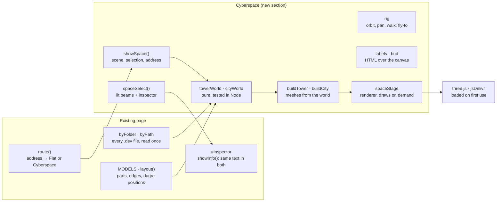

# Cyberspace mode: implementation spec

2026-11-13 · David Hermann Brandt

The design this spec implements is the canvas [Cyberspace explorer in 3D](https://claude.ai/artifact/VDLEAr9k5mUna6aAPuC1Pp). The spec was drafted as a doc ([Cyberspace mode: implementation spec](https://claude.ai/artifact/X4UTWACvWidkSSJHWom9iu)); this file is the copy the repository keeps, and the one to change from now on. Wanted work: backlog item `cyberspace-mode` in [.dev/backlog.json](../.dev/backlog.json). The canvas's artboards, with renders of them, are copied in [cyberspace-design/](cyberspace-design/README.md) for anyone who can't open the canvas. The order of the work, and how each step is checked, is the plan `cyberspace-mode` in [.dev/plan.json](../.dev/plan.json).

## Summary

Add a second way to read a repository, **Cyberspace**, next to today's flat page. It is a WebGL scene inside `index.html` that draws the same `.dev` data in 3D. The look and every number in it come from the design canvas [Cyberspace explorer in 3D](https://claude.ai/artifact/VDLEAr9k5mUna6aAPuC1Pp). This spec says how to build it without breaking any decision, contract or quality requirement already recorded in the repository's `.dev` folder.

The mode has four scenes. Artboards 1 to 3 on the canvas show the first three and artboard 7 the skyline; 4 to 6 show the first three in light mode, and 8 to 10 a state machine, a use case and a part that opens a folder:

| Scene | Canvas artboard | What the reader sees | Built from |
| --- | --- | --- | --- |
| Folder tower | `Strata.dc.html` | One folder as a stack of glass floors, one floor per `.dev` file, grouped Drawn · Written · Knowledge. A floor slides out to be entered. | `byFolder.get(folder)` |
| City | `Main.dc.html` | One drawn view (component diagram first) as a city: groups are raised plates, parts are glass towers, outside services are amber beacons, relationships are arcs of light. | `MODELS[kind]` + `layout()` |
| Street | `Street.dc.html` | The same city from eye level, walking with W A S D, with a map and a hover card. | Same scene as the city, another camera |
| Skyline | `Skyline.dc.html` | A repository with several folders, one level above the towers: every folder a building on a radial tree, with a floor for each of its views. | `byFolder`, `parentOf` |

The 3D ground plan is the flat drawing's dagre layout laid on the floor. A part stands where its plate sits on the flat sheet, so a reader who switches modes finds everything in the same place.

**Done means:**

- [ ] A **Flat / Cyberspace** switch in the bar; the choice is in the address and survives reload, back and forward.
- [ ] The four scenes work for this repository and for any repository the flat page can open, for every drawn kind (component, deployment, class, state, use case, user journey).
- [ ] Selecting a tower opens the existing inspector with the same content as the flat page.
- [ ] Without WebGL, without three.js, with reduced motion, from the keyboard and in light mode, the mode degrades as section *Fallbacks, performance budgets, accessibility* says.
- [ ] 60 fps on a 2021 MacBook Air (M1) at 1440×900 for this repository; 30 fps or better for a 400-part diagram.
- [ ] The repository's `.dev` files describe what each step built, in that step's pull request (last section).

## Ground rules

The repository already records how the page must be built; Cyberspace follows those records, and changes only one of them (`one-motion`, below). Read these files before writing code, in this order:

1. `.dev/backlog.json` → item `design-pass` (what to read in what order).
2. `.dev/decisions.json` — every accepted decision below is binding.
3. `.dev/quality-requirements.json`, `.dev/requirements.json`, `.dev/contracts.json`.
4. `.dev/component-diagram.json` and `.dev/deployment-diagram.json` — where the new parts go.
5. `index.html` around `load`, `route`, `componentModel`, `layout`, `drawDiagram`, `select`, `closeInspector`, `focusPart`.

| Record | What it means for Cyberspace |
| --- | --- |
| decision `one-file` | All code stays in `index.html`. No build step, no bundler, no new files served. The only new network dependency is three.js from jsDelivr, loaded the way dagre is (`import()` of a pinned `+esm` URL). |
| decision `own-drawing` | Draw the scene ourselves with three.js core. Do not add OrbitControls, CSS2DRenderer or any other examples/addons module; write the controls and the label layer (they are small and need to match this page). |
| decisions `survey-sheet` and `colour-per-kind`, quality requirement `light-dark` | Every colour in the scene comes from the page's CSS custom properties (`--k-component` … `--k-knowledge`, `--paper`, `--ink` …), read with `getComputedStyle` and re-read when `prefers-color-scheme` changes. No colour literals in the scene code. |
| decision `barlow`, `own-icons` | Labels and panels use the existing Barlow stacks and `ic()` icons. |
| decision `tables-always`, requirement `works-without-drawing` | Cyberspace is another way in, never the only one: every fact shown in 3D stays reachable in Flat. |
| decision `address-is-state`, contract `page-address`, requirement `addressable` | The mode and the selected part are in the address; existing forms keep their meaning (section *Routing, state and links*). |
| decision `one-motion` | **Changed by this work.** Camera moves (fly-to, slide a floor out, rise from street to orbit) are new motion. Record the change as a new decision `cyberspace-motion` that supersedes nothing but amends `one-motion`: motion only moves the camera to where the reader asked to go, and all of it is off with reduced motion. |
| quality `safe-content` | Repository text never becomes markup: labels are set with `textContent`, inspector content goes through the existing `esc()` paths. |
| quality `keyboard`, `reduced-motion`, `fallbacks`, `screen-sizes` | See *Fallbacks, performance budgets, accessibility*. Laid out for 15-inch to 34-inch screens. |
| quality `requests` | No extra requests to the repository host. The scene uses what `load()` already read. |
| requirement `token-to-its-host` | three.js is fetched without credentials; nothing in the scene sends repository data anywhere. |

What stays out of scope: editing `.dev` files (limitation `no-edit`), VR/XR, multiplayer, persisting camera positions beyond the address.

## Architecture

Cyberspace is one new section of the existing `<script type="module">`, headed `// ── Cyberspace ──`, placed after the Waiting section. It reads the same `byFolder`, `byPath`, `MODELS` and `layout()` the flat page uses, and writes into one new element. Nothing in the loading path changes.



Cyberspace reuses what the page loaded; three.js is the only new download.

The new section only reads `byFolder` and the models; it writes the scene, the HUD, and the inspector through the same `showInfo()` Flat uses.

**Where it touches the existing code.** Outside the new section, only these change:

- `route()`: the address marker (section *Routing*), and a redraw of Flat (`showFolder`) the first time Flat shows after a stay in Cyberspace, even for the same folder.
- `current`: the models read it (`navFor` and `declaredIn` decide a part's drill-down from it), so `showSpace` sets it to the folder it shows before building a world.
- `plateNode` and `clusterNode` return `ext` (today it only goes into `cls`), `glyph`, and `label`: their `name`, unless the model gives one (a use-case step's is `<n> · <its action>`, a journey stage's `<n> · <its touchpoint>`). `classModel`'s and `stateModel`'s nodes carry `label` (the type's name, the state's id), and `stateModel`'s carry `terminal`.
- `drawDiagram` takes its model and layout from a new `sheetOf(d, folder, W, H)`, which holds the choice it makes today between a left-to-right and a top-to-bottom layout, so that both modes make it alike (*Scene model*). Nothing it draws changes.
- `select()` hands its inspector code to `showInfo(info, onSel)` (Scene 2), and `closeInspector()` also clears the Cyberspace selection.
- The document's Esc listener steps aside while `body.space` is set. Cyberspace has one Esc handler of its own, which consumes the key, so one press never both closes the inspector and goes up a level.
- `status()` gains its optional hint, `ICONS` the new icons, `:root` the new tokens, and `package.json` its test script.

**New markup** (inside `#layout`, after `<main id="view">`):

```html
<section id="space" hidden aria-label="Cyberspace">
  <canvas id="space-gl" tabindex="0" aria-describedby="space-help"></canvas>
  <div id="space-labels" aria-hidden="true"></div>
  <div id="space-hud"></div>      <!-- layers, legend, controls, map, breadcrumb, hover card -->
  <p id="space-help" class="sr">…keyboard help text…</p>
  <ul id="space-parts" class="sr" aria-label="Parts in this scene"></ul>
</section>
```

While Cyberspace is on, `body` gets the class `space`: `#view` and `#side` are hidden, `#space` fills the window under the bar and status line, and `#inspector` is restyled as the floating card from the design. The existing `#inspector` element and its `select`/`closeInspector` behaviour are reused, not copied.

**New code units** (all plain functions and closures in the same module, named as below so the component diagram can cite them):

| Unit | Responsibility | Reads | Writes |
| --- | --- | --- | --- |
| `THREE_URL`, `loadThree()` | Imports three.js once, on first entry to Cyberspace; resolves `null` on failure. | — | `three` |
| `spaceTheme()` | Turns the page's CSS custom properties into a palette object (section *Rendering*). Re-run on `prefers-color-scheme` change. | `getComputedStyle(document.documentElement)` | `theme` |
| `towerWorld(folder)` | Folder → floor specs. | `byFolder`, `KIND_ORDER`, `KNOWLEDGE` | plain objects |
| `skylineWorld()` | Every folder → a building on a radial tree. | `byFolder`, `parentOf`, `childrenOf` | plain objects |
| `cityWorld(doc, folder)` | One drawn view → plates, towers, beacons, beams in world units, from the flat layout. | `sheetOf` (`MODELS`, `layout`, `dagre`), `flatRoom` | plain objects |
| `spaceStage` | Owns the `WebGLRenderer`, `Scene`, resize observer, and an on-demand render loop. | `#space-gl` | GPU |
| `buildSkyline(world)`, `buildTower(world)`, `buildCity(world)` | World specs → a `THREE.Group`, plus a `pick` map from mesh id to part key. | `theme`, `three` | scene graph |
| `rig` | The camera: orbit, pan, walk, fly-to; keyboard and pointer input. | input events | `camera` |
| `labels` | DOM labels projected over the canvas each frame, with overlap avoidance. | `camera`, world specs | `#space-labels` |
| `hud` | Layers panel, legend, camera buttons, map, breadcrumb, hover card. | world specs, `space` | `#space-hud` |
| `spaceSelect(key)`, `spaceRoute()` | Selection (lights beams, opens the inspector) and the address. | `location.hash` | `#inspector`, address |

**State.** One object, the only mutable state the section adds:

```js
const space = {
  on: false,          // Cyberspace is showing
  scene: null,        // "skyline" | "tower" | "city" | "street"
  folder: null,       // folder being shown
  doc: null,          // the drawn view the city is built from
  world: null,        // output of towerWorld / cityWorld
  selected: null,     // part key
  hovered: null,      // part key
  layers: new Set(),  // views standing beside the one in the address: "<file>" or "<file>#<entity id>"
};
```

## Scene model

Every scene is built in two steps: a pure function turns loaded `.dev` data into a **world** (plain objects in world units, no three.js), and a builder turns the world into meshes. Keep the first step free of three.js so it can be unit-tested in Node and reused for the map and the label layer.

**Units and axes.** World units are metres in spirit. `y` is up. The flat sheet lies on the ground: sheet `x` → world `x`, sheet `y` → world `z`, flipped so the top of the sheet is furthest from the default camera. One world unit = 40 sheet px (`SHEET = 1/40`; the page already has a module-level `S`, the icons' fill attributes).

```js
const SHEET = 1 / 40;
const toWorld = (L, b) => ({ x: (b.x - L.w / 2) * SHEET, z: (L.h / 2 - b.y) * SHEET });  // centred on the origin
```

**One frame for every number in this spec.** All positions here (and on the design canvas) use a left-handed frame: the default camera looks along +z with +x to its right. three.js is right-handed, so convert in exactly one place and nowhere else:

```js
const V = (x, y, z) => new THREE.Vector3(x, y, -z);   // spec frame → three.js frame
```

Every geometry builder and camera call goes through `V`; world objects keep spec-frame numbers so tests can compare them with this document.

### City world: `cityWorld(doc, folder)`

1. `{ model, L, dir } = sheetOf(doc, folder, flatRoom(), Math.max(460, innerHeight * 0.76))`: the model, and the layout Flat draws for it in this window. Flat turns a state machine or a deployment top to bottom when that draws larger. A city that always laid out left to right would stand differently from its flat drawing: at 1440 × 900 that is 10 of the 38 state and deployment diagrams of this repository and retro-games, `drawing.state-diagram.json` among them. So `drawDiagram`'s choice moves into a function both modes call, and Cyberspace gives it the room Flat's drawing has:

   ```js
   /** A view's model and the layout Flat draws it with: a state machine or a deployment is turned top to bottom when that draws larger. */
   function sheetOf(d, folder, W, H) {
     const model = MODELS[d.kind](d, folder);
     let L = layout(model, W - 8), dir = model.dir;
     if (d.kind === "state" || d.kind === "deployment") {
       const tb = layout({ ...model, dir: "TB" }, W - 8), fit = (x) => Math.min(1, W / x.w, H / x.h);
       if (fit(tb) > fit(L) * 1.08) { L = tb; dir = "TB"; }
     }
     return { model, L, dir };
   }
   /** The width a drawing has in Flat, worked out while #view is hidden: #layout's last column, less #view's padding and the canvas's border. */
   function flatRoom() {
     const cols = getComputedStyle($("layout")).gridTemplateColumns.split(" "), pad = getComputedStyle($("view"));
     return Math.round(parseFloat(cols[cols.length - 1]) - parseFloat(pad.paddingLeft) - parseFloat(pad.paddingRight) - 2);
   }
   ```

   `getComputedStyle` gives both in pixels while `#view` is hidden: checked in Chrome at 1440 and 1100 px wide, where `flatRoom()` is 1062 and 742, the widths the drawing's `.canvas` measures. For `use-case` and `user-journey`, build one city per entity, as `drawKind()` draws one canvas per entity; the address picks which (section *Routing*).
2. If `dagre` is null there is no layout to ask `sheetOf` for: take `MODELS[doc.kind](doc, folder)` alone, with `dir` left to right, and use the fallback grid: leaf nodes in rows of `ceil(sqrt(n))`, 5 units apart, clusters as plates round their children. Say so in the status line.
3. Classify every node of `model.nodes`:
   - **plate** — `n.cluster` is true. Footprint = its `L.box` × `SHEET`, shrunk 0.2 on every side. Plate thickness `PH = 0.5`. A plate nested in a plate sits on its parent's top: `base = depth × PH`.
   - **beacon** — `n.ext` is true, it is not a cluster, and the view is a component or deployment diagram (component `external`, deployment nodes with a `condition` or of kind `external-service`). `plateNode` and `clusterNode` return `ext` for this (*Architecture*). Position = its box centre; hover height `y = 6.5 + 1.5 × (index among beacons mod 3)`.
   - **tower** — everything else, with the exceptions below. Footprint is square, side `TW = min(2.2, 0.8 × distance to the nearest other tower centre)`, centred on its box. The distance is measured along the ground's axes (the larger of |Δx| and |Δz|): two squares of side 0.8 × their Euclidean distance overlap when they stand diagonally, and along the axes they never do. For towers in a row the two are the same. It stands on the top of its innermost plate (or the ground).
   - **marker** — a node with no `info`: a state machine's start point (`__start`). A disc of radius 0.5 on the ground (or plate) in `--ink` at 60%; it can't be picked or selected, and its beam starts at its centre.
   - In the other kinds `ext` means something else: a use case's alternative outcome is `ext` only to get its dashed outline. There it draws a **short tower**: height 2.2 whatever its degree, its edges dashed (`LineDashedMaterial`, dash 0.12, gap 0.20).
   - A final state (a `state` node with `terminal`) has a solid top (top face alpha 0.75 in every state) and two rings on the ground round its base, of radius 0.8 × its side and that + 0.45, in the kind colour at 90%, as Flat draws it a second ring. A second band under its top, the first default, can't be told from the floor bands at city distance.
   - A part with `n.nav` stands for a folder that has diagrams of its own (Flat draws a badge): its label starts with Flat's badge (the `drill` chevron on a disc of the kind colour), and selecting it offers **Enter its folder** (Scene 2, *Selection*).

   Artboards 8 to 10 on the canvas show these on a state machine, a use case and the Worker (decision `space-other-kinds`).

4. Tower height from its degree, counting every edge of `model.edges` that touches it once, self-loops included: `h = 2.2 + 1.3 × min(degree, 9)` (so 2.2 to 13.9). In this repository Loader has degree 6 and height 10.0.
5. Beams, one per `model.edges` entry, keyed by `e.key` so tooltips and selection match the flat page:
   - anchors: a tower's top centre; a beacon's centre; a plate's centre at its top + 0.2.
   - path: quadratic Bézier, `A` → `B`, control point at the midpoint raised to `max(A.y, B.y) + 1.5 + 0.22 × groundDistance(A, B)`; 32 segments.
   - a self-loop (`e.self`): a vertical circle of radius 1.2 standing on the tower top, in the x–y plane. A second and later loop on the same part (retro-games' chess game has three on `inPlay`) is turned about the vertical by 180° / k each, so the k loops can be told apart.
   - beams that join the same two parts, either way round, would lie on one arc: `opened` and `choosing` in this repository's page state machine have five. They fan out: beam `i` of the `k` between two parts moves its control point sideways by `1.1 × (i − (k − 1) / 2)` units, along the ground normal of the line from the part whose key sorts first to the other, so their crests stand 0.55 apart.
   - colour: the drawn kind's colour; amber (deployment colour) when either end is a beacon.
6. Bounds = the box round every plate, tower, beacon and start point; used by the camera's limits, the label cut-off and the map. The fit frames the corners of what stands and the beams' arcs instead (Scene 2, *Camera*).

Part sizes come from text widths (`tw()`), so a web font that arrives late moves `layout()`'s positions, and `load()` then routes again (`loadingdone`). Drop the memoised worlds at that point and build the scene once more. The direction `sheetOf` chooses depends on the window, as it does in Flat, which chooses when it draws: keep a world with the direction it was built for, and build it again when `sheetOf` would now choose the other.

The world object:

```js
{
  kind, dir, title, file: doc._path,      // dir: "LR" | "TB", the direction sheetOf chose
  plates:  [{ key, name, x0, x1, z0, z1, base, depth }],
  towers:  [{ key, name, x, z, side, base, h, degree, plate, alt, final }],   // name: the node's label
  beacons: [{ key, name, x, y, z }],
  markers: [{ key, x, z, base }],
  beams:   [{ key, from, to, points: [[x,y,z] × 33], ext, dashed, label, tip }],   // tip: the edge's, shown on hover
  parts:   Map(key → model node),   // keeps n.info for the inspector, n.tip for hover
  bounds:  { x0, x1, z0, z1, top },
}
```

### Tower world: `towerWorld(folder)`

1. `docs = byFolder.get(folder)`, already sorted by `orderOf`.
2. Group: **Drawn** = `doc.kind in MODELS`; **Written** = in `KIND_ORDER` but not in `MODELS` (capability, feature, operation); **Knowledge** = in `KNOWLEDGE`. Order Drawn → Written → Knowledge, bottom to top, each in `orderOf` order.
3. Floors are 16 × 12 units, 0.14 thick, 1.05 apart, with an extra 1.4 gap between groups. On 2026-11-13 the root's 24 files put the top floor at y = 26.95. The count grows as files are added (the plan adds `plan.json`, step 4 a state diagram), so the tests read a frozen copy (*Automated tests*).
4. What each floor shows on its top face (all real data, never random):
   - Drawn: the view's own flat layout, scaled to fit 13 × 9 units, nodes as small tiles and edges as lines. Per-entity kinds show their first entity.
   - Written: one bar per card, at most 4, length ∝ the card title's length.
   - Knowledge: one line per record, at most 6, length ∝ the record title's length.
5. The pulled-out floor (one drawn view at a time) slides to `(+20, 0, −12)` relative to its slot, leaving a dashed ghost outline. On it stands the city of that view, scaled about its centre by `k = min(0.36, 15 / width, 11 / depth)` of the city's bounds, so that a large city still stands on its 16 × 12 floor. At 0.36, this repository's component city (40.6 × 47.4 units) would be 17.1 deep; it takes 0.23.

### Skyline world: `skylineWorld()`

When `byFolder.size > 1` the repository also has a skyline: every folder as a building, in a scene of its own one level above the folder towers (*The skyline*). The first rule stood the buildings in the tower scene, round the address folder drawn in full; a 16 × 12 tower with its drawer does not fit a ring of them.

1. One building per folder, all alike: 4.5 units along its ring and 6 towards the centre, one floor plate per `.dev` file 0.5 apart, in the order and the colours of the folder's tower, inside a glass shell 0.3 taller. A building's height says how many views its folder holds.
2. The folders are the tree `parentOf` gives. The root stands at the origin; a folder at depth `d` stands on a ring of radius `ring × d`, turned to face the centre. Where several folders have no parent (no views at the repository's root), they are the first ring and the centre is empty.
3. Each folder needs an angle, `need(f, d) = max(6 / (ring × d), Σ need(child, d + 1))`: its own building's 4.5 units and a gap of 1.5 on its ring, or what its children need, whichever is more. The root's children share the full circle in proportion to their needs, in `folders()` order, starting behind the centre (+z) and going clockwise seen from above. Every other folder shares its own span among its children the same way. A folder stands at the middle of its span.
4. `ring` starts at 14 and grows by 0.5 until the root's children need no more than 94% of the circle. This repository's 5 folders keep 14; retro-games' 93 take 20. (Sharing the circle by number of folders on rings 14 apart, the first rule, stood 15 pairs of retro-games' buildings closer together than a building is wide.)
5. A dashed ground line joins each folder to its parent.

```js
{ ring, buildings: [{ folder, x, z, angle, depth, floors: [kind, …], h }], lines: [[folder, parent], …], bounds }
```

## Rendering

The look is glass wireframe on a dark survey grid: translucent faces, crisp edges, light only where the reader is looking. Use three.js core only: `WebGLRenderer`, `PerspectiveCamera`, `InstancedMesh`, `BufferGeometry`, `LineSegments`, `TubeGeometry`, `QuadraticBezierCurve3`, `ShaderMaterial`. No post-processing. Core only also means no `BufferGeometryUtils.mergeGeometries`: merge the beam tubes by concatenating their positions, normals and indices, which takes a few lines. WebGL draws `LineSegments` 1 px wide whatever `linewidth` says, so every edge is 1 px, the selected one included.

**Renderer.** `new WebGLRenderer({ canvas, antialias: true, alpha: true, powerPreference: "high-performance" })`; pixel ratio `min(devicePixelRatio, 2)`; transparent clear colour. The sky is CSS on `#space` (below), so the canvas only draws the world. Field of view and view offset are set per scene (the scene sections give them); near 0.6, far 600.

### Palette

`spaceTheme()` reads these custom properties. Artboards 1 to 3 show the dark values, artboards 4 to 6 the light ones.

| Role | Token | Dark | Light |
| --- | --- | --- | --- |
| Sky centre → edge (CSS radial gradient at 50% 35%, radius 75%) | derived | `#1b3340` → `#122027` → `#0b1216` | `#ffffff` → `#f8fafa` → `#e3eaeb` |
| Ground grid, minor (every 2 units) | `--grid` | `#22333b` | `#d9e1e3` |
| Ground grid, major (every 10 units) | `--edge` at 45% | `#2c4652` | `#b9c6c9` |
| Horizon line | `--k-<kind>` at 18% |  |  |
| Part glass, edges, beams | `--k-<kind>` of the drawn view | component `#6cb2d6` | component `#2c6e8e` |
| Beacons, external beams | `--k-deployment` | `#e0a54a` | `#a26a14` |
| Selected part edge, lit beam core, selected label | `--hot` | `#eef4f4` | `#1d2b33` |
| Labels text / quiet / faint | `--ink`, `--ink2`, `--ink3` | `#dce5e5` / `#9aabb1` / `#6c7f87` | `#1d2b33` / `#56666e` / `#84949b` |
| Panels | `--sheet` at 90%, border `--rule` | `#152128`, `#2a3a42` | `#f8fafa`, `#c9d3d5` |

In light mode `--hot` is the ink colour, so what is lit turns dark: the selected tower's edges, a lit beam's core, the selected label. Flat's lit lines do the same, and artboards 4 to 6 show it. The glow under a lit beam keeps the kind colour.

The two sky ramps and the major grid colour are new: add them as tokens `--space-sky-1`, `--space-sky-2`, `--space-sky-3`, `--space-grid-major` in both blocks of `:root`, beside the others, so limitation `colours-outside-tokens` does not grow.

### Meshes and materials

| Thing | Geometry | Material and numbers |
| --- | --- | --- |
| Ground grid | One 600 × 600 plane at y = 0 | `ShaderMaterial`: anti-aliased lines with `fwidth`, minor every 2 units, major every 10; alpha fades from 1 at 40 units from the camera to 0 at 140. Writes no depth. |
| Plates | One `InstancedMesh` of unit boxes, scaled per plate | Glass shader (below), alphas top 0.10, lit sides 0.20–0.24, other sides 0.14; edges at 55%. A dashed inset outline 0.5 in from the top edge: `LineDashedMaterial`, dash 0.12, gap 0.30, 28% alpha. |
| Towers | One `InstancedMesh` of unit boxes | Glass shader, per-instance colour and state (table below). |
| Tower edges and floor bands | One merged `LineSegments`: the 12 box edges plus a horizontal ring every 1.0 unit up each tower | `LineBasicMaterial({ vertexColors: true, transparent: true })`; colours and alpha rewritten in the attribute when selection changes. Bands at 35% of the edge alpha. |
| Beacons | `OctahedronGeometry(1.25)`, scaled 1.04 in y | Upper faces 34%, lower 16%, edges 90%, all `--k-deployment`. A dashed tether to the ground (dash 0.12, gap 0.20, 54%) and two ground rings, r 1.6 (fill 6%, stroke 60%) and r 2.6 (stroke 25%). |
| Beams | `TubeGeometry(QuadraticBezierCurve3, 32, r, 6)` | Quiet: r 0.035, 42% alpha. Lit: a core r 0.06 in `--hot` plus a glow tube r 0.25 in the kind colour, 35% alpha, `AdditiveBlending` (normal blending in light mode). End dot: sphere r 0.12, where the beam arrives (none on a self-loop). A dashed beam (a use case's *otherwise*, a class's *implements* and *uses*, a deployment's *routes* and *runs on*) keeps every other of its 32 segments. |
| Selection rings | Two rings on the plate top round the selected tower | r 2.0 filled `--hot` 8%, stroked 80%; r 3.0 dashed (4/6) kind colour 50%. |
| Final-state rings | Two rings on the ground round a final state's base | r 0.8 × its side and that + 0.45, kind colour 90%. |
| Skyline buildings | One `InstancedMesh` of unit boxes for every floor plate, one for the shells, and one merged `LineSegments` for their edges and the ground lines | Plate: 0.05 thick, its kind's colour, top 0.18, edges 80%. Shell: `--k-component`, sides 0.05, edges 25%. The address folder's: sides 0.16, edges `--hot` 90%, and the selection rings at r 4.3 and r 5.2. Under the pointer: sides 0.12, edges `--hot`. Ground lines: dashed 0.12/0.20, `--k-component` 55%. |

**The glass shader.** Unlit. Alpha comes from the face normal so every tower reads the same from any side: top faces `aTop`, faces whose normal points to −x or −z `aLit`, the rest `aDark`. Depth write off, `transparent: true`, front faces only. Render order: grid 0, plates 1, towers 2, beacons 3, beams 4, glow 5.

| Tower state | When | Top / lit / dark face alpha | Edge colour, alpha |
| --- | --- | --- | --- |
| `norm` | default | 0.30 / 0.16 / 0.10 | kind colour, 75% |
| `near` | joined to the selected part by a beam | 0.42 / 0.24 / 0.14 | kind colour, 100% |
| `dim` | a layer or filter hides its kind | 0.12 / 0.07 / 0.04 | kind colour, 35% |
| `sel` | selected | 0.85 / 0.55 / 0.36 | `--hot`, 100% |
| `hover` | under the pointer | as `near` | `--hot`, 100% |

### Labels

Labels are HTML in `#space-labels`, never textures: they stay sharp, use Barlow, and their text is set with `textContent`. Each frame the camera moved, project every label's anchor, then place them.

- Pill: height 22 px, padding 0 8 px, radius 4 px, `500 13px` Barlow Semi Condensed, background `--paper` at 78%, border 1 px `--rule`, text `--ink2`.
- Text: the node's `label`, cut with an ellipsis at 150 px. A part with `n.nav` starts with Flat's badge, 14 px. In a use case or a journey the label starts with the node's glyph (person, system or branch), 14 px, in the kind colour: there a label is a number and the start of a sentence.
- Neighbour of the selection: text `--hot`, border kind colour. Selected: background and border `--hot`, text `--paper`, weight 600. Beacon: text `--k-deployment`, border the same at 40%.
- Anchor: a tower's top centre (label bottom 10 px above it); a beacon's top point + 1.7 units.
- Overlap: sort by anchor screen y, nearest first; push each label up in 6 px steps until clear of the ones placed (4 px gap), at most 40 steps, else hide it. When pushed more than 12 px, draw a 1 px leader in `--ink3` from the anchor to the label's bottom centre.
- The selected tower's box on screen and the plate names count as placed, so no other label covers them. A neighbour's label that can't be placed clear is hidden like any other: the cut-off below spares it, this rule does not.
- A label that would run under a panel moves sideways, by at most half its width, to clear the panel by 4 px. One that still would is hidden.
- Hide labels behind the camera, off the canvas, or further than the cut-off: 45 units in the street; in the city 90 units, or the far side of the city as fitted when that is further (the fit distance plus half the diagonal of the bounds on the ground). A fixed 90 hides the far labels of a larger city in its opening view, the selected part's among them: 3 of the 159 drawn views of this repository and retro-games reach past it, this repository's component diagram for one. Fade them over the last 10 units. The selected part's label and its neighbours' stay whatever the distance.
- Beam labels: in a state machine or a deployment, a lit beam shows its edge's `label` (the trigger, the link's kind) at its crest, in a pill 20 px tall, radius 10, `500 12px` Semi Condensed, `--ink` on `--paper` at 86%, with a 1 px dashed border in the kind colour at 70%. They are placed with the part labels and are never hidden. A use case's conditions are sentences: they stay in the inspector and the beam's tooltip.
- Plate names: uppercase, `600 13px` Semi Condensed, letter-spacing 0.1em, kind colour, then `· N parts` in `--ink3`, counting every tower and beacon standing on the plate or on a plate within it (Screen holds Landing page, so its 7 parts and Landing page's 1 make 8); placed 8 px under the plate's front-left corner: the left end of the edge lowest on the screen. Plate names are placed before the part labels, which keep clear of them; a name that would cover another steps down 6 px at a time (at most 5 times, else it is hidden) and moves off a panel as a label does.
- Font loading: wait for `document.fonts` as `load()` already does; re-measure labels on `loadingdone`.

## Scene 1: the folder tower

The folder tower is where Cyberspace opens: the folder in the address as a stack of floors, the first drawn view already slid out with its city on it. Match `Strata.dc.html`.

**Camera.** Position (−14, 24, −44), target (8, 11, 2), vertical field of view 49.3°. The design centres the projection at (700, 440) in a 1440 × 900 frame, so set `camera.setViewOffset(W, H, (700 − 720) × W/1440, (440 − 450) × H/900, W, H)`. On wider screens keep the vertical field of view and let the stack sit left of centre. The pose frames 24 floors, the top one at y = 26.95. A taller stack opens climbed: camera and target rise together by `top − 26.95` units (1.05 for the root's 25 floors), but no further than leaves the bottom floor's label 24 px above the window's bottom edge. Past that the top is out of frame and the reader climbs to it.

**Floors.** Built from `towerWorld(folder)` as section *Scene model* says. Floor slab: glass shader with top/underside alpha 0.13 (knowledge floors 0.10), side alpha ×2.2, edges at 85% (knowledge 70%), in the floor's kind colour. Four vertical rails at the back and front corners, kind-neutral `--k-component` at 18%, run from y −0.2 to the top floor + 1.2. Draw floors below eye height bottom-up and those above it top-down, so the nearer slab always paints last.

**Pulled-out floor.** One drawn floor at a time. Its slot keeps a dashed outline (dash 4/6 px equivalent: 0.12/0.20 units) and three dashed drawer lines run from the slot's corners to the floor's. Under the pulled floor sits a soft glow: the same quad in the kind colour at 25% with a 10 px blur. Implement the blur as a second, larger quad with a radial alpha texture made once on a 64 × 64 canvas, not a post-process. The city on it is `buildCity(cityWorld(doc))` scaled by `k` (*Scene model*) about its centre, labels off, with Loader-style highlight for whatever is selected.

**Floor labels** (HTML, left of the stack): right-aligned so their right edge is 14 px left of each floor's front-left corner, vertically centred on it. Kind name uppercase `600 11.5px` Semi Condensed, letter-spacing 0.08em, in the kind colour; then the view's `title` in `--ink` 13 px. The empty slot reads `component  pulled out` in `--ink3`, the second word italic. The kind word for knowledge files is the file's own kind (`vision`, `glossary`…), lowercased, hyphens as spaces.

**Group brackets**: a 2 px `--rule` line 22 px from the left edge, spanning a group's floors ± 10 px, with the group name and count written vertically beside it (`DRAWN · 7`, `WRITTEN · 3`, `KNOWLEDGE · 14`), `600 11.5px`, `--ink2`.

**Folder card** (right 20 px, top 98 px, 340 px wide, padding 18):

1. `FOLDER` in caps, `--ink2`.
2. The folder's name as its `folder` knowledge record titles it (`entities[0].title`), else its last path segment, else `/`; `700 30px/34px` Barlow Condensed, `--hot`.
3. Its path in monospace 12 px, `--ink3`: `./.dev · 24 files` (or `.cyberspace-explorer/<folder> · N files` when the repository keeps one tree).
4. Its purpose, chosen exactly as `showFolder` does (`purpose ?? summary`), 14/21 px, at most five lines.
5. Three equal tiles: count of Drawn, Written, Knowledge files, numbers `700 24px` Condensed.
6. Folders inside it as chips linking to their towers, under `INSIDE` in caps: at most two rows of them, the rest folded into a last chip, `and N more`, which opens the skyline. With none, `No folders inside it.` in `--ink3`.
7. Where the repository has several folders, a button **See the skyline** (`#<folder>|~space:skyline`).

**Pulled-floor card** (300 px wide, 8 px under the folder card, their right edges in line): a 10 px kind swatch and the kind name in caps and kind colour; the view title `700 24px` Condensed; a count line built from the city world, `23 parts · 5 beacons · 29 beams` for this repository's component diagram on 2026-11-13; buttons **Enter the city** (primary, a link to the city address) and **Slide back**.

**Interaction.**

| Input | Effect |
| --- | --- |
| Hover a floor | Its edges to 100% and its label text to `--hot`; cursor pointer. |
| Click a drawn floor | Slides it out (the one already out slides back first); 450 ms, ease-out cubic; instant with reduced motion. Updates the address. |
| Click a written or knowledge floor | Opens the inspector with the view's title, kind, description and a **Read it in Flat** link to `#<folder>\|view:<file>` in flat mode. |
| Double-click the pulled floor, **Enter the city**, or Enter on it | Flies into Scene 2 (section *Camera and input*). |
| Wheel | Climbs: moves the camera and its target up or down 1.05 units a notch, clamped to the stack. ⌘/Ctrl + wheel or pinch zooms. |
| ↑ / ↓ | Moves keyboard focus floor by floor (focus ring: the floor's edges in `--hot`). |
| Esc | Slides the pulled floor back; with none out, rises to the skyline where the repository has one. |

Status line: `The root folder is a tower of 24 floors, one per view. Pull a floor out to walk through it.`, right side `Scroll to climb · click a floor to pull it out`. For another folder, `<folder> is a tower of N floors…`.

## Scene 2: the city

The city is one drawn view standing on the ground: what the flat page draws as plates and lines, raised into towers and beams. Match `Main.dc.html`: its positions are `cityWorld`'s, for this repository on 2026-11-13.

**What the artboard shows.** The component diagram of 2026-11-13: 4 plates (Landing page is one, standing on Screen), 23 towers, 5 beacons and 29 beams. Plates come only from clusters in the model. A part no cluster contains stands on the bare ground where dagre put it, as Router and Worker do, and a nested plate stands on its parent's top (section *Scene model*). The first artboard 2 was drawn by hand, with an older diagram and an invented fourth plate, *Loose parts*; it was drawn again from the repository on 2026-11-14.

**Camera.** An orbit camera, elevation 33.6°, azimuth −40° (from the front left), vertical field of view 54.1°. Fit: choose the distance at which the corners of what stands all project inside the *free rectangle* — the canvas minus the layers panel, the inspector (when open) and the bottom bars — with 24 px to spare. What stands is each plate's box, each tower's box, each beacon's box (from the ground its tether reaches to its top point), each start point's square, and each beam's quarter points (its 9th, 17th and 25th), so that the arcs stay in the frame: about 4,600 points at 400 parts. The bounds' own eight corners, which the first rule fitted, are often bare ground nearest the eye, and left the bottom third of the frame empty; the bounds stay what the camera limits, the label cut-off and the map use. Then shift the projection centre to the free rectangle's centre with `setViewOffset(W, H, W/2 − cx, H/2 − cy, W, H)`, where (cx, cy) is that centre: three.js moves the window right by the offset, so the projection centre lands at W/2 − offset. Aimed at the bounds' centre, the points project lopsided (the near bottom reaches the margin while the top of the frame stays empty), so the fit takes the least distance at which the points *can* stand inside the margins, and moves the target across the view, in the camera's right and up directions, to stand them in the middle. The camera still looks from azimuth −40° and elevation 33.6°; only the point it turns about is off the centre, within the limits below. A label stands 32 px above its tower's top, and the back rows' labels are pushed further up to clear the front ones, into the status line, where they are hidden. So the fit places the labels, counts those hidden above the free rectangle's top, and fits again with 28 px more room left at the top, up to 30% of the free rectangle's height; it keeps the least room that leaves the fewest out (none, for this repository's component, `page.state-diagram.json` and `use-case.json` cities at 1440 × 900; a city of 400 parts still culls by distance and overlap). F, **Fit everything** and a resize fit the same way. The free rectangle is worked out from the panels showing: each takes the side of the room that costs least to give up, so the Layers panel and the inspector join it by being visible, and the status line over the canvas's top counts as a bar. Refit when the inspector opens or closes, animated over 300 ms (instant with reduced motion).

The first design looked from the front, −4.4°, at a city placed by hand. In a real layout the parts of one rank stand in a line, and from the front they hide each other. Over the 130 drawn views of this repository and retro-games with four parts or more, towers cover each other least from about −40°: 0.079 of their area on screen against 0.140 from the front in left-to-right layouts, 0.068 against 0.111 in top-to-bottom ones. Labels are pushed 2 px further on average.

**What stands in the city.** The view in the address, always. The **Layers** panel lists the folder's other cities and can stand them beside it: each one ticked is built with `cityWorld` and placed to the right of the last, 12 units apart, in its own kind colour. `space.layers` holds them and starts empty.

A drawn kind with one city is a row with a tick box. A kind with several (three state diagrams; a file's six use cases) is a heading with a chevron and a count, open for the kind being flown, over one row per city, so the panel says which is standing. A view in a file of its own has a tick box. The use cases or journeys of a file have radio buttons: choosing one changes the address to it (a new history entry), which is how a reader reaches a file's second use case; standing several side by side waits for decision `per-entity-cities`. The view in the address is ticked and stays so. Counts are `countOf`'s, as in the folder tree: a use-case file counts its use cases.

Written and knowledge kinds are listed with their counts but disabled, with the hint `Written views and knowledge stand as floors in the folder tower`. Untick a drawn view and its district fades to the `dim` state for 200 ms, then is removed.

**Selection.** Clicking a tower, plate or beacon calls `spaceSelect(key)`:

1. The part gets state `sel`, every part joined to it by a beam gets `near`, and those beams switch to lit (core + glow). Everything else stays `norm`; nothing is dimmed, because the city must stay readable. The state table's alphas are a tower's: a selected or neighbouring plate or beacon keeps its glass and takes the table's edge colour (`--hot` selected, the kind colour at 100% as a neighbour). Which parts are near and which beams light is `cityNeighbours(world, key)`, in the `space-world` block.
2. The selection rings appear round its base.
3. The inspector opens with the same content the flat page shows for that part. Refactor `select()` so the part that writes `#inspector` from `n.info` is a function, `showInfo(info, onSel)`, used by both modes; `onSel` is `select` in Flat and `spaceSelect` in Cyberspace, so the inspector's own part links stay in the mode the reader is in.
4. Cyberspace adds, under the inspector's title: `in <plate name> · <degree> beams · height <h>` (`on the ground · …` for a part no plate holds; a beacon's height is how high it hovers, and a plate, half a unit thick, gives none; `1 beam` for one), and at its foot two actions: **Walk to \<name>** (primary, goes to Scene 3) and **Open flat** (goes to `#<folder>|<kind>:<key>` in flat mode).
5. A part with `n.nav` shows the folder it opens. The body the models write carries Flat's **Open \<folder>** link, which would leave Cyberspace; in its place, under the description, stands an *Its folder* block: a miniature of that folder's tower (one band per view, in its kind's colour), `ITS FOLDER` in caps, the folder's title `700 22px` Condensed, its path and number of files in monospace, a line saying what the tower holds (`A tower of its own: 2 drawn, 3 written and 8 knowledge floors. Its component diagram is pulled out.`), and the primary button **Enter its folder** (`#<folder>|~space`). Every other link in the body that leads within the page (an `href` starting with `#`) gains the mode marker, so the reader stays in Cyberspace.
6. The address gains the part (section *Routing*). Clicking empty ground or pressing Esc clears the selection.

**Hover.** A tower or beacon under the pointer gets state `hover` and shows its tooltip: the model's `n.tip` HTML (already escaped by the models) in the page's existing tooltip element, `showTip()`, placed as Flat places it (14 px right of the pointer, 18 px below). A beam under the pointer thickens to r 0.06 and shows its `e.tip`. Picking uses a `Raycaster` against the instanced meshes and a hidden fat tube per beam (r 0.3), at most once per animation frame.

**Panels** (positions from the canvas, 1440 × 900):

| Panel | Where | Content |
| --- | --- | --- |
| Layers | left 20, top 98, 232 wide | `LAYERS`; `Folder . · 24 views`; the rows *What stands in the city* gives, 32 px each: tick box (accent = kind colour) or chevron (the `drill` icon, turned down when open), 10 px swatch, kind name, count in monospace. A heading's rows are indented 26 px, in 13 px type, with a 14 px tick box or radio button and the view's title, wrapped. |
| Inspector | right 20, top 98, 340 wide | The existing `#inspector`, restyled as a floating card (radius 10, `--sheet` at 90%, 1 px `--rule`, shadow 0 12 32 rgba(0,0,0,.35)). Kind chip (the model's subtitle, `info.sub`, which for a component is its kind), title `700 34px/38px` Condensed in `--hot`, the extra line, the model body, the two actions at its foot, which stays in view. Scrolls inside itself past `100vh − 180 px`, so that it ends 10 px above the legend and camera controls: at `100vh − 120 px`, the first rule, a long body such as Loader's ran over the end of the legend at 1440 × 900. |
| Camera controls | left 20, bottom 20 | Orbit (pressed), Pan, Walk; divider; Zoom in, Zoom out, Fit everything. 40 px icon buttons with `aria-label` and `aria-pressed`. |
| Legend | left 340, bottom 20, 52 tall | Four items: tower `Part · taller with more beams`; plate `Plate · what contains them`; beacon `Beacon · outside the browser`; beam `Beam · depends on`. Words per kind come from `LEGENDS` where they exist (a deployment city says *connects to*, a journey *next stage*); a class diagram's are tower `Type · taller with more beams` and beam `Beam · extends, implements or uses`, a journey's tower `Stage · taller with more beams`. The plate and beacon items show only where the city has plates or beacons. A state machine's are disc `Start`; tower `State · taller with more transitions`; `Final state · ringed twice, solid top`; beam `Transition · leads to`. A use case's are tower `Step · taller with more beams`; dashed tower `Alternative outcome`; beam `Next step`; dashed beam `Otherwise`. A city with a part that opens a folder adds the badge, `Has views of its own`. |

Status line: `Read <n> views in <m> folders. Flying the <kind name>: drag to orbit, scroll to fly, click a tower to read it.` Right side: `Esc goes up a level` (the switch in the bar returns to Flat; Esc does not).

## Scene 3: walking a district

The street scene is the city's own meshes seen from eye height, with walking controls, a map and a hover card. It adds no geometry: switching between Scene 2 and Scene 3 only swaps the camera rig and the HUD. Match `Street.dc.html`.

**Arriving.** **Walk to \<name>** puts the eye near that part, looking up at it:

1. Direction `d` = across the layout's flow, so that the flow runs left to right in front of the reader as it does in Flat, turned 20° upstream: (−sin 20°, 0, −cos 20°) for a left-to-right layout (`world.dir`), (−cos 20°, 0, sin 20°) for a top-to-bottom one. The first rule came from the orbit camera's side, which hides a part's dependencies behind it whenever the reader looks down the flow, as the opening view now does.
2. Eye = part base + 12 × `d`, at the ground height there + 1.7. If that point is inside any tower's footprint grown by 0.6, step 1 unit further along `d` until it is clear.
3. Look at the part's centre line at `base + min(0.55 × h, 6.5)`.
4. Vertical field of view 61.2°; projection centre at (700, 520) of 1440 × 900, so the horizon sits low and towers rise into the frame.

For this repository that puts the eye at (−14.1, 1.7, −31.2), looking at (−10.0, 6.0, −20.0): artboard 3's view, with Loader centred and both adapters and the GitHub and GitLab beacons to its right, wherever the orbit camera was.

**Walking.**

| Input | Effect |
| --- | --- |
| W A S D or arrow keys | Walk at 6 units/s; with Shift, 14 units/s. Arrow keys turn instead of strafing when the canvas has focus and Alt is held. |
| Drag | Look: 0.25° per px; pitch clamped to ±60°. |
| Space / Z | Rise / sink at 4 units/s; eye height 1.7 to 30 above the ground under it. |
| Click | Select what is under the pointer (as in the city). |
| Enter | Select what is under the crosshair. |
| Esc | Clear the selection; with none, rise back to the city orbit. |

Towers are solid: the eye is a circle of radius 0.4 and slides along a footprint it walks into, below that tower's top. Plates are steps: the eye's ground height eases to the plate top under it over 150 ms. Beams and beacons are not solid. Walking ends at the world bounds grown by 30 units.

**Look.**

- The ground grid fades from 60 to 200 units instead of 40 to 140.
- A CSS vignette over the canvas: radial, transparent to 60%, black at 55% by the edge; street scene only, and not in light mode (use `--ink` at 12% there).
- A crosshair at the projection centre: four 7 px strokes, 1.5 px, `--hot` at 70%, 8 px gap from the centre.
- Labels only within 45 units.

**Panels** (from the canvas):

| Panel | Where | Content |
| --- | --- | --- |
| Breadcrumb | left 20, top 98, 36 tall | `<repository> › <kind name> › <plate> › <part>`; the first two are links to the tower and the city, the plate is plain text, the part (selected, else the one under the crosshair) is `--hot`, weight 600. A `<nav aria-label="Where you are">`. |
| Hover card | 18 px right of the hovered tower's top right corner, 24 px above it; 280 wide. Where that would pass the canvas's 20 px margin it goes 18 px left of the tower's top left corner instead; where the breadcrumb, the map or the key hints are in its way it slides up or down, whichever is nearer, to clear them by 8 px. | Kind icon, the part name `700 20px` Condensed, its `n.tip` text, then `<degree> beams · click to read it` in `--ink3`. Labels it would cover are hidden. Border in the kind colour. |
| Key hints | left 20, bottom 20, 52 tall | Key caps for W A S D *walk*, Drag *look*, Space *rise*, Click *read a part*, Esc *orbit*. |
| Map | right 20, bottom 20, 260 wide | Plan view of the world bounds: plates as rounded rectangles (kind colour 12%, stroke 50%), towers as 5 px squares (selected in `--hot`), beacons as amber diamonds, the eye as a 4.5 px `--hot` dot ringed in `--paper`, and a view cone of ±24° reaching 36 units. Clicking the map flies the eye there. `role="img"`, `aria-label` *Map of the city with your position*. |

The card gives the number of a part's beams, not their names: a list gets long for a busy part. Artboard 3 has the card left of its tower, artboard 6 right of it.

Status line: `Walking through <plate>, eye level at the plate.` while the eye is over a plate, and `Walking on open ground near <plate>.` while it is not (the plate of the nearest part, or that part where it stands on none): arriving 12 units from a part usually lands beside its plate. Then `<Selected> is selected; its beams are lit.` (dropped with nothing selected). Right side: `Esc rises back to orbit`.

## The skyline

The skyline is the level above the folder towers, for a repository with several folders: `skylineWorld()` seen from above the folder in the address. It is a scene of its own, `~space:skyline`, so a `~space` address still opens the tower of the folder it names, and this repository, which has five folders, still opens on its root tower. Match `Skyline.dc.html`.

**Camera.** The orbit rig, aimed at the address folder's building at height 2: azimuth −40°, elevation 24°, distance `6.25 × ring`, vertical field of view 54.1°, the projection centred 40 px under the centre of the free rectangle (the canvas minus the folder card and the bottom bars). That frames the address folder with the rings next to it and lets the outer rings run to the horizon; fitted whole, retro-games' 93 buildings would each be 20 px wide. **Fit everything** (F) shows them all.

**What stands there.** Every folder's building. The address folder's is lit and ringed like a selected tower.

**Labels.** Pills as in the city: the folder's title (its `folder` record's, else its last path segment), then that segment and a slash in monospace 11.5 px, `--ink3`. The address folder, its ancestors, the folders up to two levels below it and the one under the pointer are labelled, at any distance.

**Folder card** (right 20, top 98, 340 wide): the tower scene's card for the address folder, without **See the skyline**; then, under a rule, `The repository: <n> folders, <m> views. Each building is a folder, one floor per view, in the colour of its kind.` and the primary button **Enter \<folder's title>**.

**Interaction.**

| Input | Effect |
| --- | --- |
| Hover a building | Its shell lights, and a hover card opens, placed as the street's is and clear of the folder card: folder icon, the folder's title `700 20px` Condensed, its path and number of files in monospace, its purpose (at most three lines), then `<a> drawn · <b> written · <c> knowledge · <n> folders inside · click to fly in` in `--ink3`. |
| Click a building, Enter on it, or **Enter …** | Flies into that folder's tower (`#<folder>\|~space`). |
| Tab / Shift+Tab | Next / previous building, in `folders()` order. |
| Drag, wheel, arrows, + −, F | The orbit rig (*Camera and input*). Walk is disabled. |
| Esc | Nothing: the skyline is the top. |

**Panels.** Camera controls as in the city. Legend (left 340, bottom 20): building `Building · a folder, as tall as its views`; four swatches `Floor · the colour of its kind`; dashed line `Line · to the folder it is in`.

Status line: `<repository> has <n> folders with views: a building for each, a floor for each view. Click a building to fly into its tower.` Right side: `Drag to orbit · click a building to enter it`.

## Camera and input

One `rig` object owns the camera and has three modes — **orbit**, **pan**, **walk** — plus a tween for flying between poses. Write it yourself (decision `own-drawing`); it is about 250 lines.

```js
rig = {
  mode: "orbit",                 // "orbit" | "pan" | "walk"
  target: [x, y, z],             // orbit and pan
  azimuth, elevation, distance,  // orbit and pan, degrees and units
  eye: [x, y, z], yaw, pitch,    // walk
  fov, offset: [dx, dy],         // per scene
  tween: null,                   // { from, to, t0, ms } while flying
  set(pose), fit(bounds, rect), flyTo(pose, ms), frame(now),
};
```

**Orbit and pan** (the skyline and Scenes 1 and 2):

| Input | Orbit mode | Pan mode |
| --- | --- | --- |
| Drag (left button, one finger) | Azimuth 0.3°/px, elevation 0.3°/px | Moves the target across the ground under the pointer |
| Right-drag, Shift + drag, two fingers | Pans | Orbits |
| Wheel, pinch | Dollies towards the point under the pointer, distance × 1.0015^deltaY | same |
| Trackpad sideways scroll (`deltaX`) | Azimuth 0.2°/px | same |
| ← → | Azimuth ±5° | Pans 2 units |
| ↑ ↓ | Elevation ±5° | Pans 2 units |
| + / − | Distance ÷/× 1.25 | same |
| F | Fit everything | same |
| Tab / Shift+Tab | Next / previous part, in the order of `#space-parts` | same |
| Enter | Select the focused part | same |

Limits: elevation 8° to 85°; distance 8 units to 3 × the fit distance; the target stays within the world bounds grown by 20. A drag that moves under 4 px is a click.

**Walk** is Scene 3's mode (that section has its keys). Choosing **Walk** in the city's camera controls is the same as **Walk to** the selected part, or to the centre of the bounds with nothing selected.

**Flying between poses.** `flyTo(pose, ms)` interpolates target, eye, angles and field of view with ease-in-out cubic, and lifts the eye on an arc that peaks 0.15 × the travel distance above the straight path. Duration `clamp(400 + 12 × distance, 500, 1200)` ms. Input during a flight cancels it where it is. With `prefers-reduced-motion: reduce`, every flight, slide and fade is instant.

The scene changes:

1. **Tower → city.** Fly to the pulled-out floor until it fills the free rectangle (600 ms). Then, in one frame, swap the scene for the full-size city and put the camera at the equivalent pose: the same view of the floor divided by the floor's scale, `k`, relative to the city's centre. The tower fades out over 200 ms behind it. Reverse it to go back up.
2. **City → street.** Fly from the orbit pose to the street pose (section *Scene 3*), swapping the HUD when the flight lands.
3. **Street → city.** Fly back to the orbit pose the reader left, or the fit pose if there was none.
4. **Tower ↔ skyline.** Rising, fly up and back from the tower's pose for 600 ms while the tower fades out and the skyline in, and land on the skyline's pose aimed at that folder's building. Entering a building is the reverse.

**Rendering on demand.** Request a frame only when something changed: input, a flight, a fade, a label being placed, a theme change, a resize. When nothing moves, no frames are drawn. Stop completely while `#space` is hidden or `document.hidden` is true. Resize with a `ResizeObserver` on `#space`, then refit: a camera the reader hasn't moved is fitted again; one they have moved keeps its pose, with the projection centred on the new free rectangle.

## HUD and overlays

Every panel is ordinary HTML over the canvas, built from the page's own CSS variables, icons and fonts; the scene sections say what each panel holds, this section says what they share.

**The mode switch in the bar.** Between the repository name and **Tokens**, a group `role="group" aria-label="View mode"` of two buttons, **Flat** and **Cyberspace**, each with `aria-pressed`. Group: 2 px padding, 1 px `--rule` border, radius 6. Buttons: 28 px tall, 0 12 px padding, `600 13px` Semi Condensed; pressed = `--rule` background and `--hot` text, else transparent and `--ink2`. Hidden on the landing page and when WebGL is unavailable (section *Fallbacks*), and hidden for everyone until the launch (*Build order*, step 7); a `~space` address opens Cyberspace before then. Each press changes the address, nothing else; `route()` does the rest.

**Status line.** The existing `status()` keeps its job and wording rules; Cyberspace only writes its scene sentence when the loader has nothing to report. Its other messages (`Loading Cyberspace's 3D library…` on a first entry, and those in *Fallbacks*) follow whatever the loader said, which is left alone again when they no longer apply. Over the canvas it is translucent: `--paper` at 88%, bottom border `--grid`. The right-hand hint is a new optional `<span class="hint">` in `--ink3`.

**Panel style** (one CSS class, `.hud`): background `--sheet` at 90%, 1 px `--rule`, radius 10, padding 16, shadow `0 12px 32px rgb(0 0 0 / .35)` (`/ .12` in light mode), `backdrop-filter: blur(6px)` where supported. Panel titles are `.caps`: `600 12px` Semi Condensed, letter-spacing 0.08em, uppercase, `--ink2`. Buttons reuse the page's button styles; the primary button is `--k-<kind>` with `--paper` text.

**New icons** for `ICONS`, on the 24-unit grid, `stroke-width 1.6`, round caps (decision `own-icons`); the canvas has a drawing of each but the space icon (artboard 7 has `building`):

| Name | Drawing |
| --- | --- |
| `orbit` | an ellipse 18 × 8 round a 5 px dot, with a short tick on its right end |
| `pan` | a cross of four arrows |
| `walk` | a walking figure |
| `plus`, `minus` (Zoom in, Zoom out) | plus and minus: Flat's zoom buttons' icons, already in `ICONS` |
| `fit` (Fit everything) | four corner brackets: Flat's, already in `ICONS` |
| `beacon` | a diamond on a dotted tether |
| `tower` | a glass tower with two floor bands |
| `space` | the mode itself: three stacked floors in perspective |
| `building` | a folder's building: four floor lines between two faint rails (the skyline's legend, and **See the skyline**) |

**Stacking order** in `#space`: canvas 0, labels 1, HUD panels 2, hover card 3, inspector 4 (it is outside `#space` but above it), the token panel and tooltips keep their current z-index above everything.

**Screen sizes** (quality `screen-sizes`, 15-inch laptop to 34-inch monitor):

- From 1280 px wide up, panels sit as on the canvas, at fixed pixel sizes; wider screens give the scene more room, never bigger panels.
- Below 1280 px, the Layers panel collapses to a 40 px button that opens it as a popover, and the legend shows icons only with their words as tooltips.
- Below 900 px tall, the map shrinks to 180 px wide.

## Routing, state and links

The mode, the scene and the selection live in the address as a **last `|` segment**, so every existing form keeps its meaning (contract `page-address`) and a Cyberspace link opened by an older copy of the page still lands on the same folder and part in Flat.

```
#<folder>[|<focus>]|~space[:<scene>]
```

The mode is the last segment, when it starts with `~space`. No focus starts with `~`, so `#|~space` (two segments) is the root's tower, and `#|view:component-diagram.json|~space` (three) is the same tower with that view pulled out. Segments are encoded as `folderHash` encodes them today (`encodeURI` for the folder, `encodeURIComponent` for the focus), so `#|component%3Aloader|~space:city` and `#|component:loader|~space:city` are one address; `spaceHash` writes the first. `#~waiting|~space` opens the root's tower: Waiting has no 3D form.

| Address | Shows |
| --- | --- |
| `#\|~space` | Tower of the root folder, first drawn view pulled out |
| `#\|view:component-diagram.json\|~space` | Tower of the root, that view pulled out |
| `#\|view:component-diagram.json\|~space:city` | City of that view, nothing selected |
| `#\|component:loader\|~space:city` | City of the folder's component diagram, Loader selected |
| `#\|component:loader\|~space:street` | Street scene, walked to Loader, Loader selected |
| `#worker\|~space:skyline` | The skyline, the building of `worker` lit and ringed |
| `#\|view:use-case.json#<entity id>\|~space:city` | City of one use case of a per-entity file |
| `#\|component:loader` | Flat, exactly as today |

`<scene>` is `tower` (the default, may be left out), `city`, `street` or `skyline`. A scene the page doesn't know opens the tower, so a copy of the page from before step 6 shows the folder's tower for a skyline link. `<focus>` is any form `focusPart` already accepts; in the city the part form is required for a selection, and the `view:` form names the view without one. The `view:<file>#<entity id>` form is new and is added to the contract.

**`route()` changes.** Split the hash on `|`; when the last part starts with `~space` it is the mode, and the parts before it are the folder and the focus. When there is a mode and Cyberspace can run, call `showSpace(folder, focus, scene)` and return; otherwise hide `#space`, remove `body.space` and run today's code unchanged. `showSpace` reuses what is already built: same folder and view → only the selection or camera changes; same folder, other view → rebuild the city; other folder → rebuild everything.

**History.** A new entry (`location.hash = …`) for: switching mode, changing scene, changing folder, pulling out another floor. Replace the entry (`history.replaceState`) for: selecting or clearing a part, walking. So Back undoes a move, not every click; Forward redoes it.

**Switching modes keeps the place.**

| From | To |
| --- | --- |
| Flat, folder F, tab K open, part P selected | `#F\|K:P\|~space:city` |
| Flat, folder F, tab K open, nothing selected | `#F\|view:<first file of K>\|~space` when K is drawn; `#F\|~space` otherwise |
| Flat, Waiting | `#\|~space` |
| Cyberspace, any scene, part P of kind K selected | `#F\|K:P` |
| Cyberspace, no selection, view V | `#F\|view:V` |
| Cyberspace, the skyline, folder F | `#F` |

Flat keeps the open tab and the selected part out of the address (limitation `selection-not-linked`), so the switch reads them from `shownKind` and the part pinned in `drawn`, not from `location.hash`.

No preference is stored: the address alone says which mode a link opens in (decision `address-is-state`).

## Fallbacks, performance budgets, accessibility

Cyberspace must never be the reason a repository can't be read (quality `fallbacks`): whenever it can't run, the page says why in the status line and shows Flat.

### Fallbacks

| Situation | Detect | What the reader gets |
| --- | --- | --- |
| No WebGL | `canvas.getContext("webgl2")` null, tested once at start-up on a canvas never added to the page, whose context is then released (`WEBGL_lose_context`), so a reader who stays in Flat holds none. Only WebGL 2 counts: three.js has needed it since r163. A `WebGLRenderer` that can't be made later is treated the same way. | The mode switch is hidden. A `~space` address shows Flat, and the status line says `Cyberspace needs WebGL, which this browser has turned off. Showing the flat view.` |
| three.js fails to load | `loadThree()` resolves `null` (network, blocked CDN) | Flat, with `Cyberspace couldn't load its 3D library. Showing the flat view.` The switch stays, so a later try can work. |
| dagre fails to load | `dagre === null` (already detected) | The city uses the fallback grid (section *Scene model*); the status line adds `The parts are set in a grid because the drawing library couldn't load.` |
| dagre can't lay a view out | `sheetOf` throws (dagre 3.1.3 throws *Not possible to find intersection inside of the rectangle* on some dense compound graphs with many edges between clusters; Flat then shows tables) | The city uses the fallback grid; the status line adds `The parts are set in a grid because the drawing library couldn't lay this view out.` |
| A folder with no drawn views, in the city | `#<folder>\|~space:city` finds no drawn view | The bare ground (the tower scene until step 4), and `<folder> has no drawn views, so it has no city. Its views are written; read them in Flat.` |
| WebGL context lost | `webglcontextlost` on the canvas | Stop the loop, show `The 3D view stopped. Restore it` with a button that rebuilds the stage on `webglcontextrestored` or on press. |
| A view the models can't build | `MODELS[kind]` throws | That floor stays in the tower; entering it opens the inspector with the error and a **Read it in Flat** link, as `drawDiagram` does for a drawing. |
| A folder with no drawn views | `towerWorld` finds none | The tower has no drawer and no city; the pulled-floor card says `Nothing here is drawn. Its views are written; read them in Flat.` |
| A repository with one folder | `byFolder.size === 1` | No skyline: a `~space:skyline` address opens the tower, and the folder card has no **See the skyline**. |

### Performance budgets

| Measure | Budget | How |
| --- | --- | --- |
| Draw calls, city of 400 parts | ≤ 40 | Instancing for towers and plates; one merged `LineSegments` for edges and bands; beams merged into one geometry per state (quiet, lit, glow). |
| Draw calls, skyline of 100 folders | ≤ 8 | Two instanced meshes and one merged `LineSegments`. |
| Frame time, this repository, 1440 × 900, M1 MacBook Air | ≤ 16 ms | On-demand rendering; labels placed only on frames where the camera moved. |
| Frame time, 400 parts | ≤ 33 ms | Same; labels beyond the cut-off culled before placing. |
| First Cyberspace frame after a click on the switch | ≤ 1.5 s on a cold cache, ≤ 300 ms warm | three.js fetched once and cached by the browser; worlds built on demand, memoised per `doc._path` and direction. |
| Extra requests on page load in Flat | none | three.js is `import()`ed on first entry to Cyberspace. The Cyberspace code itself is inline (decision `one-file`), so `index.html` grows by roughly 3,000–3,500 lines, about 35 KB compressed. |
| GPU memory when leaving Cyberspace | released | Dispose every geometry, material and texture; keep the renderer for 60 s, then `forceContextLoss()`. |

**Measuring.** With `?spacestats` in the page's address, a corner readout shows the frame time (from the start of a frame to the GPU finishing it: the readout calls `gl.finish()`, so only with `?spacestats`; and the interval between frames while they come one after another), the draw calls (`renderer.info.render.calls`) and the world's counts of plates, towers, beacons and beams. The budgets and the acceptance numbers are checked with it. On an M1 Pro, whose GPU is about twice an M1 Air's, the frame-time targets are half the ones above.

### Accessibility

- **Keyboard** (quality `keyboard`): the canvas is focusable and takes the keys in *Camera and input*. Tab walks the parts in `#space-parts`, a visually hidden list with one `<button>` per part named after it (per building in the skyline); focusing one moves the scene's focus ring (edges in `--hot`) and announces nothing extra. Enter selects. The inspector, panels and switch are ordinary HTML in tab order.
- **Screen readers:** the canvas has `role="application"` and `aria-describedby="space-help"`, which says what the scene shows and how to move. When a selection changes, an `aria-live="polite"` region says `Loader selected. 6 beams. In Repository reading.` Everything in the scene is also in Flat, which stays one press away.
- **Reduced motion** (quality `reduced-motion`): flights, slides, fades and the glow's shimmer (if any is added later) are all instant. Walking still moves, because the reader drives it.
- **Light and dark** (quality `light-dark`): every colour from `spaceTheme()`; listen to the `prefers-color-scheme` media query and rebuild materials' uniforms, not the geometry.
- **Contrast:** label text 4.5:1 against its pill in both themes; check the quiet `--ink2` labels against the lightest sky in light mode with an automated contrast test.
- **Pointer size:** buttons 40 px or more; the hidden pick tube makes a beam 0.6 units thick to the pointer.

## Build order, tests and acceptance

Build it in eight steps, each a change that leaves the page working and could ship on its own behind the switch. Each step is one pull request into `main`, and merging deploys, so the switch stays hidden until step 7, which is the launch (decision `cyberspace-launch`). Each step's pull request also updates the `.dev` files for what it built, as `AGENTS.md` asks; step 8 reconciles them. Step 2 may split in two: world, meshes and rig; then labels and fit.

1. **Plumbing.** The switch (hidden), the address marker, `route()` and `showSpace`, `#space` and `body.space`, `loadThree()`, the WebGL check and every fallback message, and the changes in *Where it touches the existing code* that it needs (`current`, Esc). Cyberspace shows only the sky and the ground grid.
2. **City, still.** `sheetOf` and `flatRoom`, `cityWorld`, `buildCity`, the glass shader, edges and bands, beams, beacons, plate names, labels with overlap avoidance, fit to the free rectangle. Orbit, pan and zoom.
3. **Selection.** Picking, hover tooltips, `spaceSelect`, the `showInfo` refactor of `select()`, lit beams, selection rings, the inspector card, the address for selections.
4. **Folder tower.** `towerWorld`, floors and their real contents, labels and brackets, the folder and pulled-floor cards, sliding floors, tower → city and back.
5. **Street.** Walk controls, collision, the map, the breadcrumb, the hover card, city → street and back.
6. **Layers and many folders.** Several drawn views in one city, and the Layers panel's rows; the skyline scene, **See the skyline** and Esc from the tower.
7. **Finish, then launch.** Light mode, reduced motion, keyboard and screen-reader paths, screen sizes, context loss, disposal, the performance budgets; then the switch appears.
8. **Records.** Every `.dev` file reconciled with the code, the README (last section), and the acceptance numbers worked out again.

### Automated tests

Keep the world builders pure so Node can test them without a browser. Put them between two marker comments in `index.html`, `/* space-world:start */` and `/* space-world:end */`, written as functions of their inputs only, page constants included (`KIND_ORDER`, `KNOWLEDGE` and the drawn kinds are arguments): `cityWorldFrom(model, L, kind, dir)`, `towerWorldFrom(docs, kinds)` and `skylineWorldFrom(folders)`; `cityWorld`, `towerWorld` and `skylineWorld` are thin wrappers that pass in `sheetOf()`'s model and layout and `byFolder`. A new `test/space.test.js` reads `index.html`, slices the block between the markers and runs it in `node:vm`. Change the `test` script in `package.json` to `node --test test/*.test.js` (Node rejects a directory argument).

| Test | Expect |
| --- | --- |
| A model of 2 clusters, 6 leaves (1 external) and 7 edges with a hand-written `L` | 2 plates, 5 towers, 1 beacon, 7 beams; heights `2.2 + 1.3 × degree`; a nested plate's base = its parent's top |
| The same with the degree of one leaf at 12 | height capped at 13.9 |
| Towers placed 2 units apart | side shrinks to 1.6 (0.8 × 2); no two footprints overlap |
| A self-loop edge | one beam whose points form a closed circle of radius 1.2 above the tower |
| Five edges between the same two towers, three one way and two the other | five beams on five arcs, their crests 0.55 units apart, in the same order whichever end sorts first |
| `towerWorldFrom` on a frozen copy of the root's 24 `.dev` files of 2026-11-13 (`test/fixtures/space/`: each file's kind, path and titles) | groups 7 / 3 / 14 in that order; bottom floor `component`; top floor at y = 26.95; opening climb 0, and 1.05 with a 25th file |
| Fallback grid (`L` null) for 9 leaves | 3 rows of 3, 5 units apart |
| `skylineWorldFrom` on a frozen list of retro-games' 93 folders of 2026-11-13 (`test/fixtures/space/retro-folders.json`: each folder's path and its files' kinds) | 93 buildings; `ring` = 20; no two footprints overlap; a building's height = 0.3 + 0.5 × its files. This repository's 5 folders keep `ring` = 14. One folder gives one building at the origin |
| `parseSpaceHash` / `spaceHash` for every row of the address table | round-trips exactly; a two-segment hash yields `mode: "flat"` |
| Mode switching table | each *From* state maps to its *To* address |
| A small model of every drawn kind, with an external part, a `__start`, a final state, a use case's alternative and a `nav` part | no NaN anywhere; one beam per edge; beacons only in component and deployment; `__start` a marker; the alternative a short tower; the final state `final`; every tower's `name` its node's `label` |
| Both spellings of every address, and `#~waiting\|~space` | parse alike; `~waiting` gives the root's tower |

### Acceptance checklist

Run against `?url=https://github.com/david-brandt-the-icelander/cyberspace-explorer` in current Chrome, Safari and Firefox (decision `cross-browser-checks`), on a 15-inch laptop and a 27-inch monitor, in dark and light mode. The counts below are this repository's on 2026-11-13. Cyberspace's own records add floors and parts, so take the numbers from `?spacestats` and the `.dev` files of the day:

- [ ] **Cyberspace** in the bar opens the root folder's tower: one floor per root `.dev` file (24 before the plan added `plan.json`, with brackets `DRAWN · 7`, `WRITTEN · 3`, `KNOWLEDGE · 14`), the component diagram pulled out with its small city.
- [ ] **See the skyline** on the folder card rises to five buildings (the root, `.github`, `crates`, `test`, `worker`), the root's lit and ringed; clicking `worker` flies into its tower.
- [ ] **Enter the city** flies into the component city: 4 plates (Screen, Landing page, Repository reading, Drawing), 23 towers, 5 amber beacons (GitHub, GitLab, dagre, Barlow typefaces, Browser storage) and 29 beams, before Cyberspace's own parts join the diagram. It is seen from the front left, and every part has its label.
- [ ] Selecting Worker shows its badge and the *Its folder* block; **Enter its folder** opens the Worker's tower.
- [ ] Loader is the tallest tower (height 10.0); clicking it lights 6 beams and opens the inspector with the same text as Flat.
- [ ] The address after that is `#|component:loader|~space:city`; reloading it shows the same thing; opening it in the currently deployed page shows Loader selected in Flat.
- [ ] **Walk to Loader** lands at street level looking up at Loader, with both adapters and the GitHub and GitLab beacons in view, whichever way the city was turned before; W A S D walks; walking into a tower slides along it.
- [ ] Esc goes street → city → tower → skyline; Back and Forward retrace scene changes but not each click.
- [ ] In a 1440 × 900 window the city of `drawing.state-diagram.json` stands top to bottom and that of `page.state-diagram.json` left to right, each as Flat draws it.
- [ ] In the city of `page.state-diagram.json`, `empty` is ringed twice with a solid top, the five transitions between `opened` and `choosing` are five arcs, and selecting `listing` shows its four triggers.
- [ ] Switching to Flat with Loader selected shows the component tab with Loader selected.
- [ ] With WebGL turned off, with jsDelivr blocked for three.js, with dagre blocked: the messages and behaviour in *Fallbacks*.
- [ ] With reduced motion on, nothing animates.
- [ ] Every part can be reached and selected from the keyboard alone.
- [ ] Every drawn kind (component, deployment, class, state, use case, user journey) stands as a city, on retro-games, which has all six and many folders. Its skyline has 93 buildings, none touching another.
- [ ] The 400-part diagram on the branch `perf/400-parts` (`?url=https://github.com/david-brandt-the-icelander/cyberspace-explorer/tree/perf/400-parts`) stays at 30 fps or better while orbiting. None of the owner's repositories has a drawn view over 44 parts, so the branch holds a generated one in a `.cyberspace-explorer/` tree; it is never merged.
- [ ] Leaving Cyberspace for Flat and waiting 60 s releases the WebGL context (check in the browser's GPU memory tools).

## Records to update, and open questions

The repository describes itself, so the change is not done until its `.dev` files describe Cyberspace too. Each step's pull request updates the files for what it built ([the plan](../.dev/plan.json) says which); step 8 reconciles them. Follow the schemas the skills in `Meta/Agents/Skills` and the catalogue in `Meta/Agents/Knowledge` define, and set `evidenceStatus` to `source-verified` only for what you checked against the new code.

| File | Change |
| --- | --- |
| `component-diagram.json` | A group **Cyberspace** containing *World builders*, *Stage*, *Camera rig*, *Labels*, *HUD*; an external **three.js** (with its pinned version in the name, as dagre has). Relationships: Router → Cyberspace; World builders → Diagram models and Layout; Stage → three.js; Cyberspace → Inspector; HUD → Icons. Cite the new symbols in `sources`. |
| `deployment-diagram.json` | jsDelivr serves three.js too: update its description and the page → jsDelivr relationship. |
| `decisions.json` | New `cyberspace-mode` (a second way in; its ground plan is the flat layout; three.js core only, our own controls and labels). New `cyberspace-motion`, amending `one-motion`. Update `one-file` (jsDelivr now serves dagre, three.js and the typefaces). |
| `contracts.json` | `page-address`: add the third segment and the `view:<file>#<entity id>` form as guarantees. |
| `requirements.json` | New `works-without-webgl`: without WebGL or three.js everything is still readable in Flat. |
| `quality-requirements.json` | New `space-frame-rate` with the budgets in *Fallbacks, performance budgets, accessibility*. |
| `feature.json`, `capability.json`, `use-case.json`, `user-journey.json` | A *Fly through a repository in 3D* feature and capability; a use case and journey for *walk to a part and read it*. |
| new `space.state-diagram.json` | States Flat, Skyline, Tower, City, Street, and the WebGL-missing state, with the transitions in *Camera and input* and *Routing*. |
| `glossary.json` | Cyberspace, folder tower, floor, pulled-out floor, city, plate, tower, beacon, beam, street, skyline. |
| `limitations.json` | New `needs-webgl`; check whether `inspector-covers` and `wide-screens-unused` change. |
| `backlog.json` | New items for each open question below that stays open. |
| `README.md` | A *Cyberspace* paragraph under *Using it*, with the new address forms. |

### Open questions

The questions still open are `status: open` records in [.dev/decisions.json](../.dev/decisions.json), so they show under **Waiting**:

- **Per-entity views** (`per-entity-cities`). A use-case file with many use cases becomes one city per use case. The Layers panel lists a file's use cases as radio buttons, so one stands at a time and a reader can reach each. Whether several can stand side by side, as tick boxes, is decided after step 6.
- **Safari and Firefox** (`cross-browser-checks`). Either the owner runs the acceptance checklist in them, or the owner approves installing Playwright's WebKit and Firefox builds so an agent can.

Settled: step 1 pins three.js to the newest stable release on that day (0.187.0 on 2026-11-13), as an exact version in `THREE_URL` like `DAGRE`. jsDelivr's `+esm` build can't carry a subresource-integrity hash, the same trust the page already gives dagre. A shared link opens in whatever mode it says, and the landing page's example keeps opening Flat.

Settled on 2026-11-13, when the owner accepted artboards 4 to 10 and this spec as it follows them: the skyline (decision `space-skyline`, artboard 7), light mode (`space-light-mode`, artboards 4 to 6), and how state machines, use cases and parts that open a folder stand (`space-other-kinds`, artboards 8 to 10).
